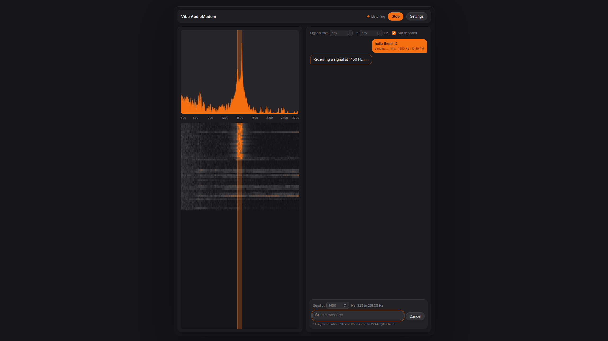

# Vibe AudioModem

**Send short text messages through a radio's audio channel, even when the signal is buried in the noise.**

**Vibe AudioModem** is yet another a one-way, weak-signal digital communication for radio amateurs. But this time, you can have a **real conversation**, in a mordern app that look like a **real chat** !

You type a message, the program turns it into a **8FSK** modulated signal that your beloved radio can transmit on the air, and the receiver decodes them from audio far below what the ear can pick out. There is no return channel and no handshake: you transmit, whoever hears you reads you.

**simple, basic, but really powerful.**

| Preset      | Symbol rate | Useful bit rate | Time on air for 17 characters | Bandwidth | Decodes down to (simulated) |
| :---------- | :---------- | :-------------- | :---------------------------- | :-------- | :-------------------------- |
| `fast`      | 25 baud     | 20 bit/s        | 6.8 s                         | 212 Hz    | -13 dB                      |
| `standard`  | 12.5 baud   | 10 bit/s        | 13.6 s                        | 107 Hz    | -16 dB                      |
| `max-range` | 3.1 baud    | 2.5 bit/s       | 54.4 s                        | 29 Hz     | -22 dB                      |

***note** : Each symbol is one of 8 tones, so it carries 3 bits. Error correction, the preamble and the checksum use most of that.*
*the **useful bit rate** counts only the 17 characters of text that one transmission carries. **A longer message is sent in several transmissions**.*




### What it does

- **Reads signals below the noise.** In simulation the slowest Preset still decodes at **-22 dB** SNR (measured in a 2,500 Hz bandwidth).
- **Fits in a very narrow band.** Between 29 Hz and 212 Hz of bandwidh, depending on the Preset, so the band can be shared with everyone.
- **Never hands you a wrong message.** Every message is corrected using **turbo codes** and a CRC-32.
- **Finds the signal by itself.** no fixed time slots that needs synchronization, **you send whenever you want, it decode whiles it arrives**.

___
### Try it

### Windows: download and run

Get `vibemodem-windows.zip` from the [latest release](https://github.com/BimBim134/vibe-audioModem/releases/latest), unzip it and start the program. Windows may warn about an unknown publisher, because the program is not code-signed; that is expected.

### Any other system: from the source (with love)

You will need [uv](https://docs.astral.sh/uv/), which installs the right Python for you.

```bash
git clone https://github.com/BimBim134/vibe-audioModem.git
cd vibe-audioModem
uv sync --locked --all-extras
uv run python -m vibemodem.app
```

The program starts a small server on your own computer only (`127.0.0.1`) and opens your browser.

### and then ?

The page has:

- **Listen**: Starts receiving from your input device, with a live spectrum and spectrogram.
- **Send**: Type a message and play it on your output device.
- **Settings**: Preset, sound devices, callsign. Not a lore more actually.

And really, that's all. No need for more.

### License

GPL-3.0 (`GPL-3.0-only`). See [`LICENSE`](LICENSE).
