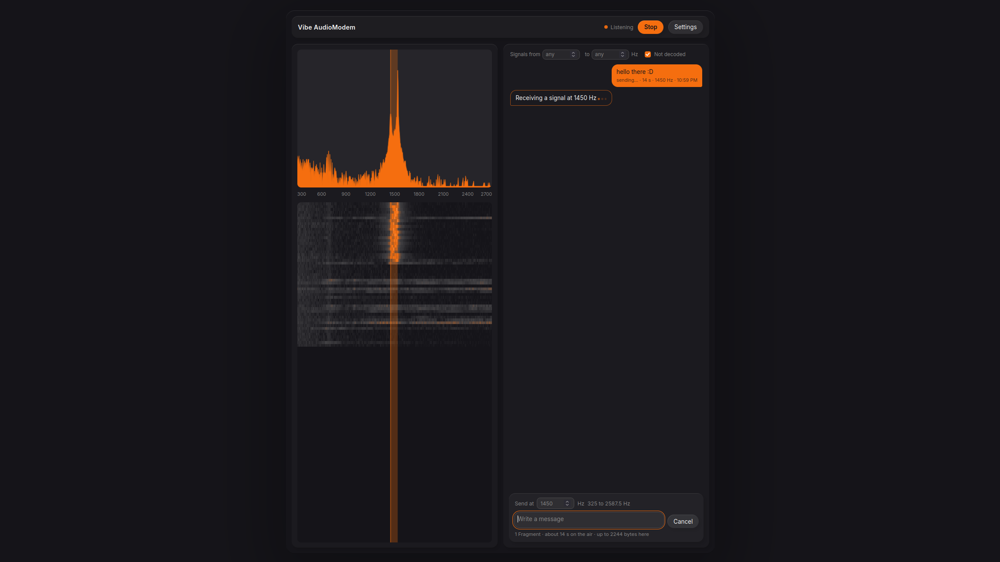

# Vibe AudioModem

**Send short text messages through a radio's audio channel, even when the signal is buried in the noise.**

**Vibe AudioModem** is yet another a one-way, weak-signal digital communication for radio amateurs. But this time, you can have a **real conversation**, in a mordern app that look like a **real chat** !

You type a message, the program turns it into a **FSK** modulated signal that your beloved radio can transmit on the air, and the receiver decodes them from audio far below what the ear can pick out. There is no return channel and no handshake: you transmit, whoever hears you reads you.

**simple, basic, but really powerful.**

| Preset      | Symbol | Transmission time | Bandwidth | Simulated to works down to |
| :---------- | :----- | :---------------- | :-------- | :------------------------- |
| `fast`      | 40 ms  | 6.8 s             | 212 Hz    | -13 dB                     |
| `standard`  | 80 ms  | 13.6 s            | 107 Hz    | -16 dB                     |
| `max-range` | 320 ms | 54.4 s            | 29 Hz     | -22 dB                     |




### What it does

- **Reads signals below the noise.** In simulation the slowest Preset still decodes at **-22 dB** SNR (measured in a 2,500 Hz bandwidth).
- **Fits in a very narrow band.** Between 29 Hz and 212 Hz of bandwidh, depending on the Preset, so the band can be shared with everyone.
- **Never hands you a wrong message.** Every message is corrected using **turbo codes** and a CRC-32.
- **Finds the signal by itself.** no fixed time slots that needs synchronization, **you send whenever you want, it decode whiles it arrives**.

### what it does not yet, but soon will

- **multiple message decoding** for now, it can decode only one message at a time, but soon, you'll be able to decode the whole band at once using Sucessive Interferences Cancelation (like in FT8 or JS8Call)
- **no station identification** so two station can write the same message. it's a known conflict but it will fixed in the next version.
- **light/dark mode and theming** because we deserve the better damnit.
- **remote access** because why would you stay in the shed if you can access it on your phone on the couch ?

### How well does it really work?

- **In simulation** (white noise, random start time and frequency): the table above.
- **Through a real sound chain** (two computers, sound cards and a cable, white noise added at an exact level): all three Presets match the simulator, with **0.0 dB loss** for `max-range`. See [`docs/measurements/`](docs/measurements/README.md).
- **Over the air, with real radios:** not measured yet. Real radio noise is not white and the channel fades, so expect worse. A field study is planned; see [issue #23](https://github.com/BimBim134/vibe-audioModem/issues/23). If you want to take part, that is the best way to help.

___

# Try it

### Windows: download and run

Get `vibemodem-windows.zip` from the [latest release](https://github.com/BimBim134/vibe-audioModem/releases/latest), unzip it and start the program. Windows may warn about an unknown publisher, because the program is not code-signed; that is expected.

### Any other system: from the source with love

You will need [uv](https://docs.astral.sh/uv/), which installs the right Python for you.

```bash
git clone https://github.com/BimBim134/vibe-audioModem.git
cd vibe-audioModem
git clone https://github.com/BimBim134/vibe-audioModem.git
cd vibe-audioModem
uv sync --locked --all-extras
uv run python -m vibemodem.app
```

The program starts a small server on your own computer only (`127.0.0.1`) and opens your browser.

### and then ?

The page has:

- **Listen**: starts receiving from your input device, with a live spectrum and spectrogram;
- **Send**: type a message and play it on your output device;
- **Settings**: Preset, sound devices, listening band, stored receptions.

And really, that's all. No need for more.

___

# For developers

Check your work (CI runs the same commands for Linux and Windows for every push, and on macOS for pull requests):

```bash
uv run ruff check .
uv run ruff format --check .
uv run pytest
```

New here? Start with the [developer's guide](docs/for-humans/developer-guide.md), a long walkthrough of the whole repository. The vocabulary is in [`GLOSSARY.md`](GLOSSARY.md) and the design decisions are in [`docs/adr/`](docs/adr/).

### Layout

| Path                  | Role                                                                                                                        |
| :-------------------- | :-------------------------------------------------------------------------------------------------------------------------- |
| `src/vibemodem/core/` | DSP core: Messages to audio samples and back, and the `Modem` interface candidates implement. No devices, files or network. |
| `src/vibemodem/io/`   | Audio layer: sound cards and WAV files. No DSP.                                                                             |
| `src/vibemodem/app/`  | Local application: loopback web server and interface.                                                                       |
| `bench/`              | Measurement bench: channel simulator, Success threshold command, cable trial, and a toy modem that validates the bench.     |
| `packaging/`          | PyInstaller build and smoke test for the Windows and macOS artifacts.                                                       |
| `tests/`              | Automated tests (about 1,090).                                                                                              |
| `docs/for-humans/`    | The developer's guide.                                                                                                      |
| `docs/measurements/`  | Kept results: thresholds, code comparison, cable trial.                                                                     |
| `docs/adr/`           | Architecture decision records.                                                                                              |
| `docs/packaging/`     | Packaging findings and the clean-machine check procedure.                                                                   |
| `docs/references/`    | Papers and other background reading.                                                                                        |
| `docs/agents/`        | Project memory and map for coding agents.                                                                                   |

### Measure a modem

The bench sends random Messages through the channel simulator at a range of SNRs and reports the **Success threshold**: the lowest SNR (in a 2,500 Hz noise bandwidth) at which at least 95 % of Messages arrive correctly. A candidate is a class with `modulate` and `demodulate` methods (see `src/vibemodem/core/modem.py`), named as `package.module:ClassName`.
New here? Start with the [developer's guide](docs/for-humans/developer-guide.md), a long walkthrough of the whole repository. The vocabulary is in [`GLOSSARY.md`](GLOSSARY.md) and the design decisions are in [`docs/adr/`](docs/adr/).

### Layout

| Path                  | Role                                                                                                                        |
| :-------------------- | :-------------------------------------------------------------------------------------------------------------------------- |
| `src/vibemodem/core/` | DSP core: Messages to audio samples and back, and the `Modem` interface candidates implement. No devices, files or network. |
| `src/vibemodem/io/`   | Audio layer: sound cards and WAV files. No DSP.                                                                             |
| `src/vibemodem/app/`  | Local application: loopback web server and interface.                                                                       |
| `bench/`              | Measurement bench: channel simulator, Success threshold command, cable trial, and a toy modem that validates the bench.     |
| `packaging/`          | PyInstaller build and smoke test for the Windows and macOS artifacts.                                                       |
| `tests/`              | Automated tests (about 1,090).                                                                                              |
| `docs/for-humans/`    | The developer's guide.                                                                                                      |
| `docs/measurements/`  | Kept results: thresholds, code comparison, cable trial.                                                                     |
| `docs/adr/`           | Architecture decision records.                                                                                              |
| `docs/packaging/`     | Packaging findings and the clean-machine check procedure.                                                                   |
| `docs/references/`    | Papers and other background reading.                                                                                        |
| `docs/agents/`        | Project memory and map for coding agents.                                                                                   |

### Measure a modem

The bench sends random Messages through the channel simulator at a range of SNRs and reports the **Success threshold**: the lowest SNR (in a 2,500 Hz noise bandwidth) at which at least 95 % of Messages arrive correctly. A candidate is a class with `modulate` and `demodulate` methods (see `src/vibemodem/core/modem.py`), named as `package.module:ClassName`.

```bash
uv run python -m bench.threshold --modem bench.toy:ToyModem --snr-from -14 --snr-to -4 --trials 300 --seed 1 --out result.json
```

A real candidate does not know when or where its Signal is. Hide it at a random moment and audio frequency with:

```bash
uv run python -m bench.threshold --modem vibemodem.core.baseline:BaselineModem --snr-from -18 --snr-to -12 --snr-step 0.5 \
    --trials 300 --message-bytes 12 --max-lead-in-s 10 --tail-s 1 --freq-offset-from -1100 --freq-offset-to 1100 \
    --out baseline.json --html baseline.html
```

It prints the curve and the threshold and writes everything to `result.json`. The same seed gives the same file. Add `--html report.html` for a readable report (success-rate curve with 95 % confidence bars). To compare several candidates on one chart:
It prints the curve and the threshold and writes everything to `result.json`. The same seed gives the same file. Add `--html report.html` for a readable report (success-rate curve with 95 % confidence bars). To compare several candidates on one chart:

```bash
uv run python -m bench.report toy.json other.json --out compare.html
```

The report is a single offline HTML file, so it can be opened anywhere and kept as a CI artifact. It flags results measured on different terms (message length, channel, Preset) as not directly comparable.
The report is a single offline HTML file, so it can be opened anywhere and kept as a CI artifact. It flags results measured on different terms (message length, channel, Preset) as not directly comparable.

Two companion commands: `python -m bench.speed --modem pkg.mod:Class` times how fast a candidate receives against real time, and `python -m bench.code_curves --code pkg.mod:Class` measures how often an error-correcting code alone loses a frame on white noise. To test a real sound chain with a cable, see `bench/cable_trial.py`.
Two companion commands: `python -m bench.speed --modem pkg.mod:Class` times how fast a candidate receives against real time, and `python -m bench.code_curves --code pkg.mod:Class` measures how often an error-correcting code alone loses a frame on white noise. To test a real sound chain with a cable, see `bench/cable_trial.py`.

How to read the result:

- A trial counts as received only if the candidate returns exactly the Message that was sent. A wrong Message handed over, even next to the right one, makes the trial fail and is counted in `false_receptions`.
- The threshold is the lowest tested SNR that reaches 95 % *and* is not followed by a higher tested SNR that falls short. Its resolution is the `--snr-step` (1 dB by default).
- Near 95 % the measured rate is only known to about 1/sqrt(trials), roughly 2 % with 100 trials. Use 300 trials or more, and a finer step around the threshold, before comparing two candidates.
- The threshold is the lowest tested SNR that reaches 95 % *and* is not followed by a higher tested SNR that falls short. Its resolution is the `--snr-step` (1 dB by default).
- Near 95 % the measured rate is only known to about 1/sqrt(trials), roughly 2 % with 100 trials. Use 300 trials or more, and a finer step around the threshold, before comparing two candidates.
- The toy modem (`bench.toy:ToyModem`, coherent BPSK) validates the bench: its measured success rate must follow the textbook formula within 0.05 (see `tests/test_threshold.py`).

___

### Status and history

The software is a working prototype (release `v1.0`), still evolving. The first prototype (GMSK on GNU Radio) is frozen under the git tag `legacy-v0`, where its documentation can still be read (`git show legacy-v0:docs/doc.md`).

### License

GPL-3.0 (`GPL-3.0-only`). See [`LICENSE`](LICENSE).
GPL-3.0 (`GPL-3.0-only`). See [`LICENSE`](LICENSE).
