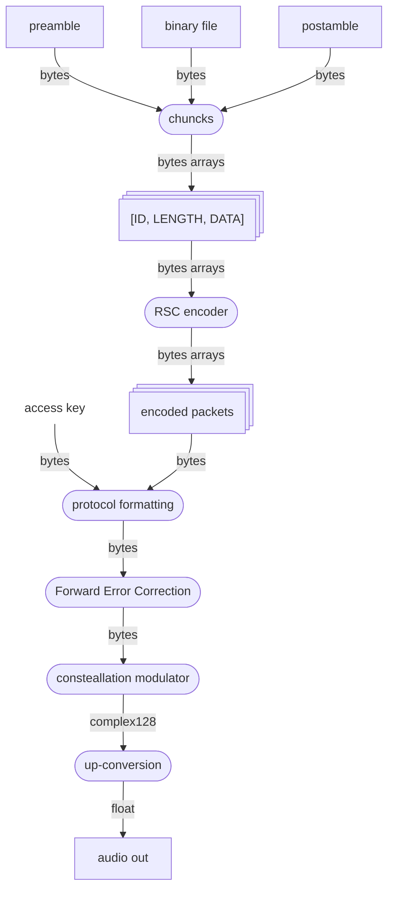

# transmitter

 
# listenning

stream from soundcard

peak detection

when peak detected:
    launch receiver

# receiver

stream from soundcard

converting to complex : hilbert transform

automatic gain control

down converting to baseband signal

lienar equalizatiion

costa loop

constellation decoder

FEC decoder
    convolutionnal code

access code correlation, packet synchronization and protocol parsing

filter out preamble and postamble

reed solomon decoding of each packet

binary file reconstitution