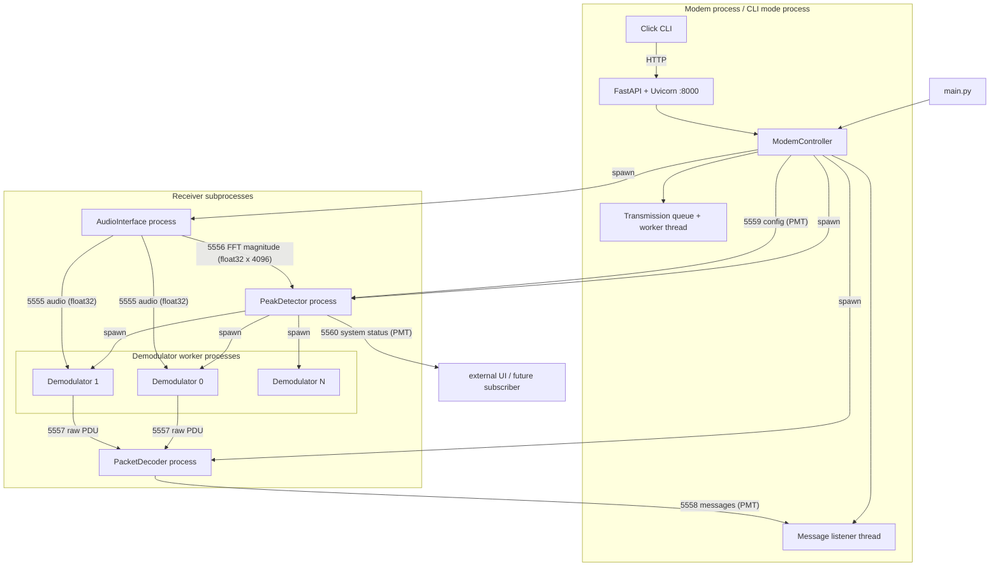
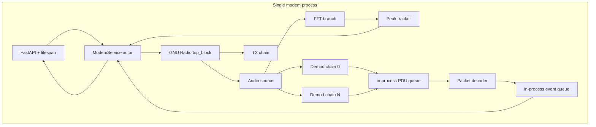

# Vibe AudioModem — Independent Architecture Review

**Review date:** 2026-10-31  
**Branch reviewed:** `gfsk-test`, commit `06153d3` (with `docs/doc.md` modified in the working tree)  
**Scope:** `main.py`, `src/**`, `environment.yml`, `TODO.md`, `docs/doc.md`, `research/architecture_diagram.md`  
**Method:** static code review plus derived timing/throughput calculations. GNU Radio is not installed in the review environment, so DSP statements are based on the source code and documented GNU Radio block semantics rather than live measurement.  
**Revision:** 2026-10-31 — revised after the owner confirmed the product constraints below. The first draft assumed a generic bidirectional, throughput-oriented product; that assumption is wrong and several recommendations have been changed accordingly.

---

## Product constraints (confirmed by the owner)

These constraints are now the decision frame for the whole review:

1. **One-way broadcast for radio amateurs.** There is no return channel. ACK/ARQ, adaptive coding driven by feedback, and retransmission-on-request are not available. Reliability must come from FEC, CRC, interleaving, repetition/diversity, and robust synchronization.
2. **Multi-carrier detection is a core feature, not an experiment.** Each user can tune their radio differently, so the receiver cannot assume a fixed band plan. Carriers may appear at arbitrary frequencies and must be discovered and tracked dynamically.
3. **Remote station control is nice-to-have.** Running a server at the station and accessing it remotely is a future convenience, not a core requirement. Local operation comes first.
4. **Robustness is the product; speed is not.** A message that takes minutes but arrives correctly is a success. Throughput, airtime, and latency are cost budgets, not success metrics. The KPI is correct delivery under noisy conditions.
5. **Users are radio amateurs, not software engineers.** Many are older operators with a normal computer. Simple installation and operation on Windows, macOS, and Linux is a core feature, not polish.
6. **Any technology that improves robustness is acceptable.** There is no requirement to keep GNU Radio, Python, or the current DSP stack if something else is materially more robust. Equally, there is no reward for rewriting a working DSP stack.
7. **Prefer the simplest thing that works.** The owner explicitly wants the system to be as simple as possible. This strengthens the case for fewer processes, fewer transports, conservative defaults, and one obvious way to run the application.
8. **Small-message-first, with a 30-minute transmission ceiling.** Optimize the common case (short text/status), but never let a transmission exceed 30 minutes. At the current default PHY that implies a practical payload maximum around 10–12 KB before repetition/interleaving overhead.
9. **Presets are the default interface; advanced settings are hidden.** The main UI exposes a few named robustness presets. A hidden advanced panel lets interested users experiment, without cluttering the default experience.
10. **Broad hardware/channel compatibility.** The product is not tuned to one radio or audio chain. It must work across HF SSB, VHF FM, handheld speaker/mic, and direct sound-card setups, with automatic level calibration and a configurable search band.

**How this changes the review:**

- The original draft over-weighted throughput and latency. Those are now secondary. A robust 200-baud link that takes 25 minutes for a 10 KB file is acceptable if it decodes reliably.
- **Reject the fixed channel plan suggestion from the first draft.** Multi-carrier detection must remain dynamic. The work is to make the detector a proper *tracker* (CFAR, hysteresis, persistence, bounded workers), not to replace it with fixed channels.
- **Reject "remove the preamble" as a blanket recommendation.** A known preamble is one of the cheapest robustness tools available: it provides detection, AGC settling, timing, and coarse carrier offset. Remove the *redundant postamble and duplicated length fields*, not synchronization itself.
- Protocol v2 is now a **robustness** project: CRC, message identity, fragment indexing, interleaving, blind repetition, and characterized FEC. Airtime reduction is a side effect to accept only when decode probability does not fall.
- The process collapse is now justified primarily by **simplicity and deployability**, not by CPU or latency.
- **Packaging becomes a first-class architectural concern** in Phase 0/1, because "easy to install" is a product requirement and because Python + GNU Radio is a heavy dependency for non-technical users.
- **The message budget and preset-first UI are product requirements**, not later polish: enforce the 30-minute ceiling, show the estimated airtime, and keep advanced controls out of the default flow.
- **The test matrix must span real radio/audio chains**, not just AWGN or one lab setup.
- Remote control stays out of scope until local operation is solid. If it is exposed on a network, auth/TLS and input validation are still mandatory, not optional.

---

## 0. Executive summary

Vibe AudioModem is a competent **research prototype** wrapped in an architecture that is much more distributed than the problem requires. The DSP choices are broadly reasonable: GMSK, differential encoding, convolutional coding, Reed–Solomon, a WAV loopback mode, and a clear split between transmitter, receiver, detector, and decoder modules. The documentation is unusually honest about limitations, which is a strong asset.

The main problem is not Python, GNU Radio, ZeroMQ, or FastAPI individually. The problem is the **shape** of the system:

- A 200-baud audio modem, used as a single carrier by default, is implemented as **6 processes at steady state** (parent, modem, audio, peak detector, packet decoder, demodulator) with **6 ZeroMQ ports**, several daemon threads, and a second HTTP/CLI control plane.
- The architecture uses a **distributed-systems topology** (PUB/SUB buses, process-per-demodulator, broadcast configuration) to solve what is fundamentally an **in-process dataflow problem**.
- The protocol stacks **four framing layers** and produces a **27.7% useful-bit fraction** at the default configuration. Under a robustness-first goal the useful fraction is not the headline problem; the missing CRC, message ID, fragment index, interleaver, and characterized FEC are. The 3-second beeper is a crude detection aid that should become a proper known preamble, not simply be deleted.
- The HTTP server is a good choice in principle but is implemented as a **blocking, unauthenticated, unvalidated control plane** with no graceful shutdown and a drain-based message API.
- There are several **P0 correctness bugs** that are independent of architecture: shared mutable config defaults, a global one-shot stop event, a fragile GNU Radio tag hack, idle workers that drop configuration, and a TX cancel sentinel race.

**Verdict:** this is **not industry-standard architecture** for a production audio modem, but it is a defensible research prototype. With the confirmed constraints the target is a **robust, one-way, easy-to-install appliance for non-technical operators**, not a high-throughput data link. The current DSP is worth keeping; the process topology, control plane, protocol integrity, and packaging are not. The biggest simplification is to stop treating one modem as a microservice fleet.

### The five changes that matter most

1. **Collapse the receiver process tree for simplicity and deployability.** Put the audio source, FFT, peak detector/tracker, N demodulator chains, packet decoder, and message fan-out in one GNU Radio process with in-process queues. Keep a separate process only if you need audio-device isolation or hard CPU isolation. Fewer processes means fewer install/runtime failure modes for non-technical users.
2. **Make lifecycle and configuration first-class.** Replace module-global stop events, mutable default configs, and lossy `PUB` config broadcasts with an instance-owned state machine, immutable validated config snapshots, and a command/response channel (or a retained config store).
3. **Make the protocol robustness-first, not airtime-first.** Keep the physical sync layer and a known preamble; add CRC-32, message ID, fragment index/total, and an interleaver; characterize the existing RS + convolutional code before changing it; use blind repetition/diversity where the channel justifies it. Remove only the redundant postamble and duplicated length fields. Airtime reduction is optional and must never reduce decode probability.
4. **Keep dynamic multi-carrier detection and turn it into a tracker.** The detector must find carriers at arbitrary user-tuned frequencies. Replace the global-mean peak finder with CFAR/local noise estimation, add hysteresis and persistent track state, bound and supervise the worker pool, and expose the tracked carriers. Do **not** replace this with a fixed channel plan.
5. **Treat "easy to install and run" as architecture.** A single process, a local-first GUI/CLI with no web server by default, pinned/bundled dependencies, an installer or one-file packaging path, sensible zero-config defaults, automatic audio-device selection, and CI across Windows/macOS/Linux are part of the product. Remote station control and a web UI are later, optional conveniences.

### What is genuinely good

- The DSP pipeline is understandable and modular: `packetizer.py`, `transmitter.py`, `audio_interface.py`, `peak_detector.py`, `signal_processor.py`, `worker_manager.py`, `demodulator.py`, `packet_decoding.py`.
- The WAV loopback mode (`--test`) is an excellent debugging tool and should become the basis of integration tests.
- The documentation (`docs/doc.md`) is detailed, honest, and useful. It already identifies several real bugs.
- The use of GNU Radio blocks for GMSK, FEC, PDU, and ZMQ is appropriate for a prototype.
- The separation of `SignalProcessor` from `WorkerManager` is a good idea; the former is testable in isolation.
- The code is readable, and the defaults are easy to find.

---

## 1. Ground truth: what the system actually is

### 1.1 Runtime topology



### 1.2 Process and thread count

At startup with `python main.py` and no receiver:

- Parent process: `main.py`.
- One child process: `AudioModem`, running `start_audiomodem`.
- Inside the child: the main control loop, the `HTTPServer` daemon thread, the `MessageListener` daemon thread, and a lazily created `TransmissionWorker` thread after the first `/transmit`.

After `POST /receive` with the default `nb_workers=1`:

- 3 direct children: `AudioInterfaceProcess`, `PeakDetectorProcess`, `PacketDecoderProcess`.
- 1 grandchild: `DemodulatorWorker_0`.
- Total: **6 OS processes** in headless mode.
- In CLI mode (`python main.py --cli`), `start_audiomodem` runs in the main process, so steady state is **5 processes** plus the CLI and HTTP threads.

With `nb_workers=N`, add N-1 more demodulator processes. There is no limit on N at the HTTP boundary (`audioModem.py:321-332`), so a single request can spawn an arbitrary number of processes.

### 1.3 Where the real boundaries are

| Boundary | Current implementation | What it actually buys |
|---|---|---|
| Audio → demodulators | ZeroMQ `PUB` on 5555, one SUB per demodulator | Process isolation and fan-out; also duplicate copies and slow-joiner loss |
| Audio → detector | ZeroMQ `PUB` on 5556, FFT magnitude frames | Decoupling; also 192 KB/s of IPC and a fixed 85 ms frame cadence |
| Demodulators → decoder | ZeroMQ `PUB` on 5557, decoder `SUB` binds | Dynamic workers; also a non-standard bind/connect topology and fire-and-forget loss |
| Decoder → controller | ZeroMQ `PUB` on 5558, controller `SUB` | Decoupling; also a drain-based single-consumer API |
| Controller → detector | ZeroMQ `PUB` on 5559 | Lossy config broadcast with no acknowledgment |
| Detector → external UI | ZeroMQ `PUB` on 5560 | No consumer exists in the repository |
| CLI → modem | HTTP on 8000 | Remote control; also a redundant hop in local CLI mode |

None of these boundaries is wrong in isolation. The issue is that all of them are used **at the same time** for a workload that fits in one process. The result is a system whose complexity is dominated by lifecycle and transport rather than by DSP.

---

## 2. Is this industry standard?

Short answer: **no, not as a production architecture.** It is a prototype with a distributed-systems shape. The individual technology choices are defensible; the composition is not.

### 2.1 Layer-by-layer scorecard

| Layer | Current choice | Industry norm for this workload | Verdict |
|---|---|---|---|
| Language | Python 3.12 for orchestration and DSP graph construction | Python for prototyping/control; a compiled core only if single-binary deployment or real-time guarantees require it | **Technically acceptable; deployment is the risk.** Python is not the DSP problem, but Python + GNU Radio is not installable by a non-engineer without packaging work. |
| DSP framework | GNU Radio | GNU Radio for SDR prototyping; liquid-dsp or a custom C++/Rust DSP core for a small, embeddable modem | **Good for robustness, heavy to deploy.** GNU Radio's blocks are mature and worth keeping if the runtime can be bundled. A compiled single binary is the main alternative if packaging fails. |
| Process model | Process per service and process per demodulator | One DSP process with N flowgraph chains; process isolation only at hardware or failure boundaries | **Wrong shape for this workload and for the target users.** It multiplies memory, startup cost, IPC, lifecycle bugs, and installation failure modes. |
| Transport | ZeroMQ PUB/SUB + PMT for everything | In-process queues/buffers inside the DSP process; Protobuf/gRPC/MQTT/NATS only at real service boundaries | **Over-engineered and semantically wrong for control.** PUB/SUB is not a reliable control bus, and PMT is not a language-agnostic wire format. |
| Control plane | FastAPI/Uvicorn in a daemon thread | Direct in-process service for the local GUI/CLI; FastAPI only as an optional remote adapter with lifespan, validation, auth, and async-safe handlers | **Right framework for remote, wrong as a mandatory local hop.** The current implementation also has blocking handlers, no auth, and no graceful shutdown. |
| CLI | Click + HTTP polling | Click/Typer; direct controller calls when local, HTTP when remote | **Fine, but the local HTTP hop is unnecessary** and the port is hardcoded. |
| Configuration | Mutable dataclasses + module globals + partial broadcast | Validated, immutable config snapshots; one source of truth; explicit apply/restart semantics | **Fragile.** Shared defaults, partial propagation, non-transactional updates. |
| Protocol | PMT → LFSR → 31-byte chunks → RS(48,32) → GR header → rate-1/2 CC → GMSK | Physical sync + known preamble + robust FEC + CRC + message identity + interleaving + optional repetition | **Over-layered but under-protected.** It has strong FEC yet no CRC, interleaving, message identity, or measured BER/SNR curve. Useful fraction is a secondary concern. |
| Detection | 4096-point FFT every 85 ms + global-mean peak finder + 3-second beeper | Dynamic multi-carrier tracking: CFAR/local noise, hysteresis, persistent tracks, bounded workers; arbitrary user-tuned carriers | **Prototype-grade but directionally right.** Dynamic detection is required. It needs tracking, adaptive thresholds, and a proper preamble, not a fixed channel plan. |
| Ops | Conda env, unpinned deps, no tests, no CI, no packaging | Lockfile, pyproject, installer/one-file bundle, CI matrix, tests, metrics, health checks | **Not production-ready, and installability is a core product requirement.** |
| Security | `0.0.0.0` HTTP, no auth/TLS/CORS, all ZMQ buses bind `*` | Bind loopback by default, auth/mTLS, CORS allowlist, rate limits, input validation | **Unsafe if exposed.** Remote control is only nice-to-have, so bind loopback now; auth/TLS is the price of ever enabling remote access. |

### 2.2 Language choice

Python is a reasonable choice for this project:

- GNU Radio does the sample-rate DSP in C++; Python only builds graphs and processes control data.
- The peak detector runs at ~11.7 frames/s over 2048 bins, which is trivial for Python/NumPy.
- The packet decoder and reassembler are low-rate.
- FastAPI and Click are productive.

Python becomes a problem when the architecture uses **multiprocessing and ZMQ to work around the GIL** and to isolate blocking flowgraphs. That is a design choice, not a language limitation. A single-process design with GNU Radio's C++ worker threads would be simpler and likely faster.

A production-grade split would be:

- **DSP core:** GNU Radio C++ or a Rust/C++ DSP library (liquid-dsp, custom GMSK/FEC), exposing a stable API.
- **Control plane:** Python/FastAPI or a small Rust/Go service.
- **Transport:** Protobuf/gRPC or a message bus at the process boundary; in-process queues inside the DSP core.

For this repository, that split is probably overkill. The pragmatic answer is: **keep Python, remove the unnecessary processes and buses.**

The confirmed user constraint changes one part of this: **distribution**. A radio amateur on Windows should not need Conda, a compiler, or a GNU Radio installation guide. Python + GNU Radio is technically sound but operationally heavy. There are two honest paths:

- **Keep Python/GNU Radio and solve packaging properly:** bundle the interpreter and GNU Radio runtime (PyInstaller, conda-pack, Briefcase, or a signed installer), pin every dependency, and test on all three platforms. This preserves the working DSP and is the lowest-risk path.
- **Move the DSP core to a compiled single binary:** C++/Rust with liquid-dsp or a custom GMSK/FEC chain, called by a thin Python/Go control plane or directly by a GUI. This is the best long-term installability story but is a rewrite and must not degrade robustness.

Do not choose a language based on performance here. Choose it based on whether a non-engineer can install the result and whether the DSP can be validated to the same or better robustness.

### 2.3 GNU Radio usage

GNU Radio is used appropriately for the core DSP:

- `digital.gmsk_mod` / `digital.gmsk_demod`
- `fec.cc_encoder` / `fec.cc_decoder`
- `digital.diff_encoder` / `diff_decoder`
- `digital.correlate_access_code_bb_ts`
- `pdu.tagged_stream_to_pdu`
- `zeromq.pub_sink` / `sub_source`

The problems are around GNU Radio, not inside it:

- **Fighting the framework with `TagValueSetter`.** The receiver adds a second `packet_len` tag of 448 bits without removing the tag produced by `correlate_access_code_bb_ts` (`demodulator.py:24-38`, `:161`). Whether the resulting PDU is 48, 52, or 56 bytes depends on GNU Radio tag ordering. The decoder then has a 52-byte special case (`packet_decoding.py:97-99`). This is a version-dependent hack, not a protocol design. Pin GNU Radio and replace the hack with an explicit length contract.
- **PMT as an external wire format.** PMT is GNU Radio's internal polymorphic type system. It is not a language-agnostic data format, despite the claim in `docs/doc.md:100`. Any non-GNU-Radio client must reimplement PMT serialization. Use PMT only inside GNU Radio; use JSON at the local API boundary by default, and a compact binary format only if a measured need appears.
- **Process-per-flowgraph.** GNU Radio flowgraphs are already multi-threaded; multiple demodulator chains can live in one `top_block` or in one process with multiple `top_block`s. A process per demodulator is not required for independence.
- **No use of GNU Radio's message ports for control.** The config path uses a ZMQ PUB socket instead of GNU Radio message ports, which would give in-process, ordered, typed delivery.
- **Generated `.grc` files are stale.** `grc_files/` is not wired into the runtime and contains references to removed symbols (`DEFAULT_DQPSK_CONST`). Keeping generated `.py` files in the tree is a maintenance trap.
- **Deployment weight is the real GNU Radio question.** For a robustness-first prototype, GNU Radio is a strength: its GMSK, FEC, PDU, and filter blocks are mature. For an appliance aimed at non-engineers, the GNU Radio runtime is a large, fragile dependency. Keep it only if you commit to bundling and testing the runtime. If packaging GNU Radio proves unreliable, that is the trigger to consider a compiled DSP core, not a reason to rewrite pre-emptively.

### 2.4 ZeroMQ usage

ZeroMQ is a good tool, but it is used here as a **universal bus** where a mix of in-process queues and one real boundary would be better.

What is wrong:

- **PUB/SUB for configuration.** Configuration is not a stream of events; it is state. A new or restarted subscriber can miss the last broadcast ("slow joiner"). The code already documents this (`docs/doc.md:1338-1340`). Use a request/response command channel or a retained state store; have workers fetch the current config on startup.
- **PUB/SUB for messages with no persistence.** If the controller is slow, disconnected, or restarting, messages are lost. `GET /messages` drains the queue, so a second consumer splits messages. Use a durable log or a broker (NATS/Redis Streams) if messages matter; for a local prototype, use an in-process queue with a ring buffer.
- **PUB/SUB for audio with silent drops.** `drop_on_hwm=True` on the audio and FFT sinks (`audio_interface.py:78-92`) means slow subscribers lose frames. For real-time audio that is acceptable, but the decoder must tolerate gaps. Document and test this.
- **Thread-unsafe socket sharing.** `config_pub_socket` is used from the Uvicorn event-loop thread and closed from the main thread; `_messages_sub_socket` is used by the listener and closed by `shutdown`/`_restart_zmq_sockets`. ZMQ sockets are not thread-safe. This can crash or hang during `/setup`, `/quit`, or shutdown.
- **Bind/connect topology is inconsistent.** Most publishers bind; the packet decoder's SUB binds and demodulators' PUBs connect (`packet_decoding.py:162-167`, `demodulator.py:176-178`). This is valid ZMQ but unusual, and it makes startup order and reconnection semantics harder to reason about. A broker or a stable endpoint would be simpler.
- **All buses bind `tcp://*`.** Audio, FFT, raw packets, messages, config, and system status are exposed on every network interface with no authentication. For internal buses, bind `127.0.0.1`.
- **`localhost` vs `127.0.0.1`.** The controller SUB uses `tcp://localhost` (`audioModem.py:68`, `:91`), while other components use `127.0.0.1`. On systems where `localhost` resolves to IPv6, this can fail or behave differently. Pick one and be consistent.
- **One context per `/fft` request.** `GET /fft` creates a new ZMQ context and SUB socket per request (`http_server.py:43-57`), then blocks in `recv()` for up to 1 second. This is expensive and makes the first request likely to time out. Use a long-lived subscriber or a cached latest-FFT snapshot.

A simpler design:

- Inside the DSP process: GNU Radio stream connections and message ports.
- Between DSP and control plane: one command queue and one event queue (in-process if same process; `multiprocessing.Queue` or a Unix socket if separate).
- Between the modem and remote clients: HTTP/WebSocket or gRPC with a real schema.

### 2.5 HTTP server

FastAPI is a good choice for an optional remote control plane. The implementation is not production-grade:

- **Blocking calls in `async` handlers.** `/receive`, `/setup`, and `/stop` call controller methods that join/terminate processes and sleep 0.5 s (`audioModem.py:95-164`, `:321-428`, `:515-533`). Because Uvicorn runs a single event loop, these calls block **all** other requests, including the CLI's once-per-second `/messages` poll. `/fft` blocks for up to 1 s, and `/logs` reads the entire log file synchronously.
- **No graceful shutdown.** `run_http_server` accepts `stop_event` but never uses it (`http_server.py:104`). Uvicorn is started in a daemon thread and is killed when the process exits. There is no `uvicorn.Server` instance, no `should_exit`, and no join. Meanwhile, the main thread can close ZMQ sockets and terminate processes while the event loop is still serving requests.
- **No authentication, TLS, CORS, rate limiting, or request-size limits.** The server binds `0.0.0.0:8000` by default (`http_server.py:104-109`). `/logs` exposes the log; `/setup` can change ports; `/receive` can spawn unbounded processes. This is a remote DoS surface.
- **No request/response models.** Routes parse raw JSON (`await request.json()`) and pass dicts to the controller. Invalid types raise `ValueError` inside the handler and become HTTP 500, sometimes after partially mutating config (`audioModem.py:344-415`).
- **Drain-based message API.** `GET /messages` drains the controller queue (`audioModem.py:197-205`). Multiple consumers split messages. There is no cursor, no history, no replay, and no push. For a web UI, use SSE or WebSocket and keep a ring buffer with sequence numbers.
- **No job model for asynchronous operations.** `/transmit` returns `{"status": "queued"}` with no job ID. Cancellation is global (`/stop` with `tx=true`), not per job. The queue has no size limit and no backpressure (`audioModem.py:54`).
- **No health/readiness/metrics endpoints.** Add `/healthz`, `/readyz`, and `/metrics`.

A correct FastAPI design would use:

- `lifespan` to construct and shut down the controller.
- Pydantic request/response models and validation.
- `def` handlers or `await asyncio.to_thread(...)` for blocking controller calls.
- A single-threaded actor/command queue for state changes.
- SSE/WebSocket for messages and FFT.
- Auth, CORS, TLS, rate limits, and `127.0.0.1` by default.

**The simpler architecture given the product constraints is local-first.** Remote access is only nice-to-have, so the default application should not require a web server at all: the GUI/CLI calls `ModemService` directly in-process. Keep FastAPI as an optional adapter, enabled only when the user asks to serve remote clients. That removes Uvicorn and the entire remote attack surface from the default installation path.

### 2.6 CLI

Click is fine. The main issues:

- The CLI talks to the modem over HTTP even when it is launched in the same process (`audioModem.py:574-575`). This is an unnecessary hop and a hardcoded `http://localhost:8000`.
- `main.py` headless mode does not forward `http_port` to the child (`main.py:21-25`), and argparse does not expose a port flag (`main.py:35-38`).
- The CLI polls `/messages` every second (`cli.py:24-34`), which is a drain endpoint. A push channel would be better.
- `config show` prints `constellation_name`, which the controller never returns (`cli.py:160`; `audioModem.py:463-487`).
- Message polling and any other consumer split the queue.

For a local CLI, call the controller directly through a `ModemClient` interface; for a remote CLI, keep HTTP. Define the interface once and provide two implementations.

### 2.7 Configuration

Configuration is the weakest part of the control plane.

- `PacketConfig` and `PortsConfig` are taken by reference when no explicit config is passed (`audioModem.py:44-46`). `start_audiomodem` constructs `ModemController(test_mode=test_mode)` (`audioModem.py:562`), so `self.pkt_conf` and `self.ports_conf` are the **module-global default objects**. `handle_setup` mutates them in place (`audioModem.py:369-415`), so a setup request permanently changes process-wide defaults. `SignalConfig` is deep-copied, so it is protected; the inconsistency is accidental.
- `DEFAULT_*` dataclasses are mutable and used as function-signature defaults across modules (for example `audio_interface.py:110-111`, `peak_detector.py:19-22`, `packet_decoding.py:155-156`, `demodulator.py:200-203`, `transmitter.py:139-140`).
- `search_for_incomming_transmission` uses `stop_event=multiprocessing.Event()` as a default argument (`peak_detector.py:22`), which is evaluated once at import and shared by every default-constructed call.
- Configuration propagation is partial. Only `baudrate`, `beeper_duration`, and `carrier_freq` are broadcast (`audioModem.py:207-232`). `samp_rate`, `fft_size`, packet fields, and ports require a restart. That is a reasonable rule, but it is implicit.
- Broadcasts are lossy and unacknowledged. A peak detector that starts after a broadcast never learns the update. A running worker that receives `update_preset` is retuned to the controller's **global** `carrier_freq`, not its detected peak (`demodulator.py:284-304`). An **idle** worker ignores `update_preset` entirely because the idle loop only handles `start` and `stop` (`demodulator.py:243-311`). This is a direct explanation for the asymmetric `TODO.md` result: "start at 500 then set 200 passes; start at 200 then set 500 fails" (`TODO.md:21-28`).
- No validation. `total_packets_len=272` makes the length flag collide with the postamble marker; `total_packets_len=17` yields a zero-length chunk; values below 17 yield a negative chunk length; `baudrate=0` divides by zero; odd `fft_size` breaks the half-spectrum assumption; `nb_workers` can be negative or huge. There is no central validation in the dataclasses or in `handle_setup`.
- Port changes are applied before the receiver is restarted (`audioModem.py:417-424`). If the restart fails, the controller is on the new ports and the old children are on the old ports.
- `handle_setup` is not transactional. A type error midway leaves a partially updated controller.

The fix is straightforward:

- One validated, immutable `AppConfig` snapshot with a monotonically increasing `version`.
- `dataclasses.replace` or Pydantic `model_copy` for updates; never mutate shared defaults.
- A single `ConfigService.apply(new_config)` that validates, stops/restarts what is necessary, and returns a result.
- Workers receive `(version, config)` and ignore stale versions; on startup they request the current config.
- Ports, sample rate, FFT size, and packet/FEC parameters are startup-only; do not allow live changes that silently require a restart.
- Presets are named, validated `AppConfig` snapshots. The main UI exposes only the preset selector and essentials; advanced overrides live behind a hidden panel, are validated against the same invariants, and can be reset to the preset.

### 2.8 Wire protocol

This is the second-weakest part after the process topology. The protocol is a stack of four nested framing layers:

```text
Application dict
  → PMT serialization
  → LFSR scrambler
  → 31-byte chunks with 1-byte length + random filler
  → Reed–Solomon(48, 32) with 16 parity bytes
  → GNU Radio header: 4-byte access code + 2-byte length + 2-byte repeated length
  → rate-1/2 convolutional code (K=7, polys 79/109)
  → differential encoding
  → GMSK, BT=0.35
```

At the default configuration:

| Quantity | Value |
|---|---:|
| Audio sample rate | 48,000 Hz |
| Baud rate | 200 symbol/s |
| Samples per symbol (TX) | 240 |
| GMSK bits per symbol | 1 |
| RS codeword | 48 bytes |
| RS message | 32 bytes (1 length + 31 data) |
| GNU Radio header | 8 bytes |
| Physical frame | 56 bytes = 448 bits |
| Coded bits per frame (rate 1/2) | 896 |
| Samples per frame | 215,040 |
| Airtime per frame | **4.48 s** |
| Useful data per frame | 31 bytes = 248 bits |
| Useful fraction | **248 / 896 = 27.68%** |
| Maximum useful throughput | 31 B / 4.48 s = **6.92 B/s** |

With the default 3 s beeper and one preamble + one postamble frame, a short message costs:

```text
T = 3.0 s + (C + 2) * 4.48 s
```

where `C = ceil(serialized_PMT_size / 31)`. Because the PMT dictionary includes `sender_name`, `type`, and `data` keys, even a 5-byte message can serialize to dozens of bytes and need 2–3 chunks. A 2-chunk message costs `3 + 4 * 4.48 = 20.9 s`. A 1 KB message costs about `3 + 35 * 4.48 = 159.8 s`, or 2.7 minutes, for 6.4 B/s.

The product ceiling is a 30-minute transmission. At the current default PHY that is roughly **12 KB** of useful payload before interleaving and repetition overhead, so a practical maximum is around **10–12 KB**. Repetition multiplies airtime and reduces this proportionally. The UI should estimate airtime before sending, enforce the ceiling, and treat short text/status messages as the primary use case.

The protocol has these integrity/robustness problems, assessed now against a one-way, robustness-first goal:

- **No CRC.** Reed–Solomon can miscorrect on rare error patterns. There is no outer integrity check to catch a miscorrection, so a corrupted message can be accepted as valid. This is the single most important protocol defect for a one-way link: add CRC-32 over the logical frame.
- **No message ID or fragment index/total.** Reassembly assumes "preamble, then data, then postamble." If a fragment is lost, the message is silently truncated or fails. There is no way to detect duplicates, reordering, or interleaved messages. Add `msg_id`, `frag_index`, and `frag_total`.
- **No interleaving.** Burst noise, fading, and audio dropouts destroy consecutive symbols. RS + convolutional coding cannot recover a long burst even though the average SNR is adequate. A block interleaver across each frame or message is one of the highest-value robustness additions. It costs buffer memory and latency, both acceptable for this product.
- **No soft-decision decoding or diversity.** GNU Radio's byte-oriented convolutional decoder consumes hard bits. A soft-decision Viterbi (or an LDPC code) can buy several dB on a noisy channel. If the operator can transmit the same message on two frequencies or at two times, blind diversity plus `msg_id` de-duplication is more valuable than any header optimization.
- **No blind repetition.** A one-way link has no ACK/ARQ. The only "retransmission" is the sender repeating the whole message N times, or repeating the critical header. Make this an explicit, configurable robustness mode, and let the receiver select or combine copies using CRC and `msg_id`.
- **No rateless/fountain coding.** For large one-way transfers, a RaptorQ-style fountain code would let the receiver reconstruct the message from any sufficiently large subset of fragments, with no feedback. It is more complex than interleaving, so treat it as a later option once CRC/interleaving are measured.
- **The FEC has never been characterized.** RS(48,32) + rate-1/2 CC is a strong, fixed concatenation, but there is no BER/SNR curve, no measured burst-length tolerance, and no evidence that it is matched to the audio/radio channel. Keep it until measurements show a better option; do not replace it merely because it is "inefficient".
- **The preamble and postamble are not synchronization sequences.** The 3 s beeper is a crude tone. The application preamble/postamble are two full RS-coded dummy frames used as reassembly conventions, costing 8.96 s. Keep a **known constant-amplitude preamble** for detection, AGC settling, timing, and coarse carrier offset; remove the postamble and replace its function with `frag_total` plus a short end marker.
- **The length is encoded twice in the GR header.** 2 bytes of length plus 2 bytes repeated. That is 4 bytes per 56-byte frame (7.1% overhead). Keep one authoritative length; remove the repeat if both ends are controlled.
- **The length is encoded again per chunk.** 1 byte per 32-byte RS message. Replace it with the fragment header fields.
- **Random filler is used in the final chunk.** It costs nothing on air because it fills the fixed 31-byte payload, but it makes debugging harder. Use deterministic zero padding, or a shortened code.
- **No compression.** Text and files should still be compressed before framing, but this is secondary to robustness. Compression must be lossless and must fall back to the original payload if it expands or fails.
- **No encryption/authentication.** The LFSR is whitening, not cryptography. If messages are sensitive, add AES-GCM at the application layer. This is orthogonal to link robustness.
- **PMT is not a compact wire format.** It carries dictionary keys and type tags. Replace it with a compact application header and raw payload.

A robustness-first frame:

```text
Physical: [known preamble][GR access code + one length][FEC][interleaver] + GMSK

Logical:  [magic:1][version:1][flags:1][msg_id:2][frag_index:2][frag_total:2]
          [payload_len:2][payload:N][crc32:4]
```

Then:

- Keep the GNU Radio header/access code and add a known preamble; both are synchronization aids and should stay.
- Use **dynamic detection** for arbitrary carriers. Do not introduce a fixed channel plan.
- Remove the application postamble and the duplicated length. Keep one length field and a fragment total.
- Add CRC-32, `msg_id`, `frag_index`, and `frag_total` so corrupted or missing fragments are detected and partial messages are explainable.
- Add a block interleaver sized to the expected burst length; measure its effect before and after.
- Keep RS + CC until BER/SNR measurements justify a change. Then test, in order: interleaving, soft-decision/LDPC, stronger/low-rate codes, and blind repetition.
- Make blind repetition a first-class mode: N copies of a message (or of the header), receiver-side de-duplication by `msg_id`, optional selection/combining by CRC.
- Compress text/file payloads only if the compressed form is smaller and the extra CPU cannot jeopardize real-time audio handling.
- Use PMT only inside GNU Radio. At the local API boundary, JSON is the simplest format that works; add MessagePack/CBOR only if a measured need appears.

The first draft's "cut short-message airtime by 40–60%" is no longer a design goal. Such savings are accepted only if decode probability is unchanged or better. For a robustness-first product, a longer preamble or a lower-rate code that actually decodes in noise is worth more than a shorter frame that fails.

### 2.9 Detection and worker scheduling

The detector is a 4096-point FFT every `4096 / 48000 = 85.33 ms` (11.72 frames/s), with a Blackman–Harris window, magnitude only, positive half. It averages up to 10 frames, optionally smooths, optionally normalizes by a fixed median-filtered noise floor, runs `scipy.signal.find_peaks`, then applies a 3-hit persistence filter.

Numbers at the defaults:

| Quantity | Value |
|---|---:|
| FFT bin width | 48,000 / 4,096 = **11.72 Hz** |
| Frame period | **85.33 ms** |
| Frames per second | **11.72** |
| Averaging depth | 10 frames = **853 ms** |
| Persistence | 3 hits = **~256 ms** after first candidate |
| Worst-case detection latency | **~0.85–1.1 s** |
| Peak minimum distance | 8 bins = **93.75 Hz** |
| Persistence tolerance | 4 bins = **46.875 Hz** |
| Noise-floor median kernel | 35 bins = **410 Hz** |
| Worker eviction | >50 missed frames = **~4.35 s** |
| No-data timeout | 50 polls × 100 ms = **~5 s** |
| Low-frequency cutoff | **1,000 Hz** |

Problems:

- **The 3 s beeper is doing three jobs:** it attracts the detector, gives the AGC time to settle, and provides a carrier reference. It is not a proper synchronization preamble, it is inflexible, and it dominates short-message airtime. Replace it with a known preamble that serves the same purposes more reliably; do not simply delete the synchronization aid.
- **Detection latency is ~1 s.** A proper preamble with a matched filter or a chirp detector can be faster and more reliable. Latency is secondary for this product, but robust detection and AGC settling are not.
- **The global-mean threshold is brittle.** `find_peaks(..., prominence=min_prominence * mean(spectrum), height=...)` adapts to the whole band, not to local noise. A strong adjacent signal can mask a weak one. A CFAR detector or per-bin noise estimate is better.
- **The noise floor, when enabled, is calibrated once and fixed.** It does not adapt to changing ambient noise. The code exposes `recalibrate()` but no HTTP path calls it.
- **The 1 kHz cutoff is arbitrary.** It prevents legitimate carriers below 1 kHz, which is unacceptable when users tune their radios arbitrarily. Make the band configurable and default it low enough not to exclude valid signals.
- **The default `nb_workers=1` defeats multi-carrier reception.** The detector can dispatch multiple peaks, but the default only has one worker. Multi-carrier reception is a core feature, so default to a small usable pool (for example 4) or size it from the CPU count, and bound it.
- **Worker eviction is slow.** 50 frames (~4.35 s) is a long hangover. Use a shorter hysteresis (e.g., 500 ms–1 s) plus a state machine that distinguishes "acquiring", "tracking", and "lost".
- **No liveness check.** `WorkerManager.update_state` drains status messages but does not check `process.is_alive()`. A dead worker can remain `running` or `ready` forever. `start_tuning` marks `running` before the worker confirms (`worker_manager.py:35-39`, `:60-70`).
- **No track identity.** Spawning a demodulator for every spectral peak is not enough for a core feature. A carrier that drifts, fades, or momentarily disappears looks like a new peak, and a strong adjacent signal can steal its worker. The detector needs persistent **tracks** keyed by frequency and bandwidth, with hysteresis, merge/split rules, a maximum track count, and per-track demodulator state. This is the real fix; a fixed channel plan is not an option because users tune arbitrarily.

### 2.10 Reproducibility, testing, and operations

- `environment.yml` pins only Python 3.12. GNU Radio, NumPy, SciPy, `reedsolo`, `pyzmq`, FastAPI, Uvicorn, and Click are unpinned. There is no lockfile. GNU Radio version changes can alter tag ordering and break the fragile `TagValueSetter`/52-byte assumptions. Pin GNU Radio explicitly.
- `requests` is imported by the CLI (`cli.py:5`) but not declared. `readline` is imported with a fallback; it is not stdlib on Windows. `websockets` is declared but unused. `matplotlib` is used only by `research/`. `sip` is installed via pip for research GUI scripts whose GUI frameworks are not in the environment.
- There is **no `tests/` directory**, no pytest/tox config, no CI, no lint config, no type-check config, and no packaging metadata. `TODO.md:40` lists a test suite as future work. This is the single largest process risk.
- There is **no install path for a non-engineer.** Running the project currently means Conda, an editable install, a manual GNU Radio environment, and a terminal. That directly contradicts constraint 5. A signed Windows installer and a macOS/Linux package (or at minimum a one-file bundle) must be treated as deliverables, not documentation afterthoughts. Test installation on a clean machine, not the developer's machine.
- The repository tracks ~26.8 MB of WAV/PNG/profiling binaries, including `research/ultimate_test.wav` (15.4 MB), `research/test.wav` (5.6 MB), and `profiling` (1.2 MB). `.gitignore` ignores `*.wav` but the files are already tracked. There is no README or LICENSE.
- `research/` and `grc_files/` are development history. They are useful, but they should not be part of the runtime package, and stale generated `.py` files should not be tracked.

---

## 3. Performance baseline and where the time goes

### 3.1 Airtime budget

For `samp_rate=48000`, `baudrate=200`, `total_packets_len=48`, `error_correction_len=16`, `preamble=1`, `postamble=1`:

| Component | Cost | Notes |
|---|---:|---|
| Beeper | 3.00 s | Pure 2500 Hz tone, amplitude 0.77 |
| Each physical frame | 4.48 s | 448 bits × 2 (CC) / 200 baud |
| Preamble | 4.48 s | One full RS frame with length flag 0 |
| Postamble | 4.48 s | One full RS frame with length flag 255 |
| Data chunk | 4.48 s | 31 bytes max |
| Test-mode silence | 10.00 s | Only in `--test` |

Examples:

| Message | Serialized size (approx.) | Chunks | Frames | Airtime | Effective throughput |
|---|---:|---:|---:|---:|---:|
| `"hello"` | 40–70 B (PMT overhead) | 2 | 4 | 20.9 s | ~0.3–0.6 B/s |
| 1 KB | 1,024 B | 34 | 36 | 164.3 s | 6.2 B/s |
| 10 KB | 10,240 B | 331 | 333 | 1,494.8 s (~25 min) | 6.85 B/s |

The 3 s beeper + 8.96 s preamble/postamble is **11.96 s of fixed overhead per message**. For short messages, that is the dominant cost.

**Under the confirmed product goal these are cost figures, not failure figures.** A 10 KB file taking ~25 minutes is acceptable if it arrives correctly. The KPI is `P(message decoded correctly)` under noise, fading, mistuning, and imperfect audio levels — not bytes per second, not airtime, and not latency. The 27.7% useful fraction matters only where it increases exposure to noise; do not trade decode robustness for throughput.

### 3.2 Why only 200 baud works

`TODO.md:20-30` reports:

- 400 baud: fail
- 500 baud: fail
- 100 baud: fail
- 200 baud: pass
- 220 baud: pass
- Start at 500, then set 200: pass
- Start at 200, then set 500: fail

There is no single cause, but the code points to several strong suspects:

1. **Idle worker drops `update_preset`.** The outer loop handles only `start`/`stop` (`demodulator.py:243-311`). An idle worker that receives `update_preset` discards it, then starts later with stale `signal_config`. This exactly matches "start at 200, then set 500 fails" and "start at 500, then set 200 passes" if the worker was running in the second case.
2. **Running workers are retuned to the global carrier.** `update_preset` sets `signal_config.carrier_freq = new_carrier_freq` (`demodulator.py:284-293`), where `new_carrier_freq` is the controller's global default (2500 Hz), not the detected peak. A baud-rate update can move a worker off its carrier.
3. **AGC is slow.** `analog.agc_cc(1e-4, ...)` has a time constant on the order of `1 / rate = 10,000` samples. At the decimated rates:
   - 100 baud: 1,000 Hz → ~10 s
   - 200 baud: 2,000 Hz → ~5 s
   - 220 baud: 2,200 Hz → ~4.5 s
   - 400 baud: 4,000 Hz → ~2.5 s
   - 500 baud: 5,000 Hz → ~2 s
   The 3 s beeper is not enough for 100 baud, and the AGC is still moving when data starts at 200 baud.
4. **The beeper amplitude is 0.77, while the GMSK data amplitude is different.** The AGC sees a strong tone, reduces gain, then has to recover for the data. A constant-amplitude preamble or a feed-forward gain estimate would be better.
5. **The channel filter scales with baud.** `firdes.low_pass(1.0, samp_rate, baudrate * 1.5, baudrate / 3, ...)` (`demodulator.py:112-119`). At 100 baud, the transition is 33.3 Hz; at 200 baud, 66.7 Hz; at 500 baud, 166.7 Hz. The filter length and decimation interact with the symbol timing loop.
6. **`omega_relative_limit=0.005` is not the main suspect.** 0.005 is 5,000 ppm, which is **loose** compared with GNU Radio defaults (often 200 ppm). The claim in `docs/doc.md:807-809` that this is "very tight" is misleading. The baud sensitivity is more likely AGC/filter/timing-loop scaling and the stale-config bugs.
7. **The demodulator uses `actual_sps`, not a hardcoded 10.** `demodulator.py:128-129` passes `self.actual_sps`, which is `samp_rate / (decimation * baudrate)`. At 220 baud, `sps = int(48000/220) = 218`, `decimation = 21`, `actual_sps = 10.39`; at 500 baud, `sps = 96`, `decimation = 9`, `actual_sps = 10.67`. The DSP subagent claim that this is hardcoded to 10.0 is incorrect. The computed value is used, but the loop parameters and filter are still tuned for the 200-baud design point.

A diagnostic plan:

1. Run `--test` loopback at 100, 200, 220, 400, 500 baud with **fixed** config (no live update). Log AGC gain, symbol timing error, access-code hits, PDU length, and RS errors.
2. Run the same with **live** `update_preset` from idle and from running. This isolates the idle-worker bug.
3. Sweep AGC rate (1e-2, 1e-3, 1e-4), filter cutoff/transition, decimation, and `omega_relative_limit`.
4. Measure BER vs SNR with `research/addNoise.py` at each baud.
5. Replace the beeper with a constant-amplitude preamble of known length and re-measure AGC settling.
6. Use a rational resampler to get an exact 10 samples/symbol at every baud, instead of integer decimation.
7. Record real-chain samples (HF SSB, VHF FM, handheld speaker/mic, direct sound card) and replay them through the receiver. Tune against this matrix, not only against loopback or AWGN.

**Do not raise the baud rate merely because the receiver can be fixed.** With robustness as the goal, 200 baud may be the correct operating point if it decodes under worse SNR than 400 or 500 baud. Characterize BER/SNR and message success probability first; only then decide whether more speed is free or whether it trades away the product's main promise.

### 3.3 CPU, memory, and IPC

- Audio stream: 48,000 samples/s × 4 bytes = **192 KB/s**.
- FFT stream: 4,096 bins × 4 bytes × 11.72 frames/s = **192 KB/s**.
- Each demodulator subscribes to the audio stream, so N workers add N × 192 KB/s of loopback TCP traffic and N copies.
- The FFT itself is small (4,096 points at 11.7 Hz), but the per-demodulator FIR at 48 kHz with a 300 Hz cutoff and decimation 24 is the main DSP cost.
- Each Python process carries the Python runtime, NumPy, GNU Radio, and its flowgraph. Six processes can easily use **300–600 MB** of RSS. A single process is more likely **100–150 MB**.
- Process startup is expensive: each `/receive` creates three children plus N grandchildren. Every restart pays Python import and GNU Radio flowgraph construction again.

A single process with N demod chains would:

- Share one audio source and one ZMQ subscription.
- Avoid N loopback copies.
- Avoid process startup per receive.
- Make worker lifecycle a thread/flowgraph operation instead of a process operation.
- Reduce shutdown/orphan risk.

The GIL is not a reason to avoid this: GNU Radio's DSP runs in C++ worker threads, and the Python control/peak-detection work is low-rate.

---

## 4. Defect register

Severity: **P0** = correctness/liveness/security; **P1** = data loss/resource leak; **P2** = robustness/maintainability; **P3** = cleanup.

### P0 — fix before anything else

| ID | Defect | Evidence | Impact | Fix |
|---|---|---|---|---|
| P0-1 | Shared mutable config defaults | `audioModem.py:44-46`; defaults at `config.py:119-139`; `handle_setup` mutates at `audioModem.py:369-415` | A `/setup` request permanently changes process-wide `DEFAULT_PACKET_CONFIG`/`DEFAULT_PORTS_CONFIG`; new controllers and default-argument calls see corrupted values | Deep-copy all configs; make defaults frozen; use `dataclasses.replace` |
| P0-2 | Global one-shot stop events | `audioModem.py:29-30`; `INTERNAL_STOP_EVENT` never cleared; `STOP_EVENT` left set at shutdown | A second controller/start in the same process exits immediately; multiple instances impossible; tests interfere | Instance-owned lifecycle and stop events; clear on start |
| P0-3 | HTTP server never stops gracefully | `http_server.py:104-132`; `stop_event` unused; daemon thread | Shutdown races with live requests; sockets/context closed while handlers use them; no clean flush | Use `uvicorn.Server` with `should_exit` and a `lifespan`; join the server thread |
| P0-4 | Blocking calls in async handlers | `http_server.py:39-96`; `audioModem.py:95-164`, `:321-428`, `:515-533` | `/receive`, `/setup`, `/stop` block the event loop for seconds; all other requests stall | Use `def` handlers or `await asyncio.to_thread(...)`; move state changes to an actor |
| P0-5 | Fragile GNU Radio tag hack / PDU length ambiguity | `demodulator.py:24-38`, `:161`; `packet_decoding.py:97-99` | Whether PDUs are 48, 52, or 56 bytes depends on tag ordering; 52-byte branch is dead; version upgrade can break RX | Remove `TagValueSetter`; use the correct tag; assert PDU length; pin GNU Radio; golden test |
| P0-6 | Idle workers drop `update_preset` | `demodulator.py:243-311`; `worker_manager.py:72-80` | Baud/carrier changes are ignored for idle workers; stale config on next start; matches TODO baud failures | Handle `update_preset` in the idle loop; acknowledge; version configs |
| P0-7 | Running workers retuned to global carrier | `demodulator.py:284-304`; `audioModem.py:207-232` | A config update moves a worker off its detected peak to the controller's default 2500 Hz | Preserve the worker's active frequency; only update baud/beeper; send a full config snapshot |
| P0-8 | TX cancel sentinel race | `audioModem.py:234-305`, `:499-513` | A `None` sentinel can strand a new item; cancel clears a shared event; `/status` can report idle while audio still plays | Per-job cancellation token; job IDs; no shared event; explicit state machine |
| P0-9 | Unauthenticated, unvalidated remote API | `http_server.py:104-109`; `audioModem.py:321-332`, `:334-428` | `/setup`, `/receive`, `/stop` are remotely exploitable DoS; no auth/TLS/CORS/limits; all ZMQ buses bind `*` | Bind `127.0.0.1` by default; add auth, CORS, rate limits, request size limits, validation |

### P1 — data loss and resource leaks

| ID | Defect | Evidence | Impact | Fix |
|---|---|---|---|---|
| P1-1 | `reassemblers` global never pruned | `packet_decoding.py:69`, `:103-106` | One entry per demodulator ID, forever; a new ID is created per flowgraph start (`demodulator.py:67`) | Evict on timeout; use a bounded LRU; reset per worker session |
| P1-2 | Unbounded reassembly buffer | `packet_decoding.py:60-62` | A malicious/corrupt stream can grow memory; no max message size | Max size, timeout, total-length validation |
| P1-3 | PUB/SUB message loss | `audio_interface.py:78-92`; `packet_decoding.py:171-172`; `audioModem.py:64-69` | Slow joiner, restart, or slow consumer loses audio/FFT/config/messages | Retained config; durable message log; in-process queues; document lossy streams |
| P1-4 | Drain-based `/messages` | `audioModem.py:197-205`; `cli.py:24-34` | Multiple consumers split messages; a failed client loses them | Ring buffer with sequence numbers; SSE/WebSocket; cursor-based GET |
| P1-5 | No worker liveness check | `worker_manager.py:60-70`; `:82-86` | Dead worker can remain `running`/`ready`; frequency stays occupied; no restart | `is_alive()`, heartbeat, restart policy, error state |
| P1-6 | Grandchildren orphaned on hard terminate | `audioModem.py:104-110`; `main.py:29-31` | `terminate()` on Windows is hard; demodulators survive if peak detector is force-killed | Process groups/job objects; supervisor; terminate children explicitly |
| P1-7 | No liveness/exit-code check in parent | `main.py:21-31` | A child that fails during startup exits silently; parent returns success | Check `exitcode`; log; restart or fail |
| P1-8 | ZMQ sockets used across threads | `audioModem.py:64-93`, `:175-195`, `:541-552`; `http_server.py:43-57` | Concurrent close/use can crash or hang; `context.term()` can block | Confine each socket to one thread; use an actor; stop threads before closing |
| P1-9 | `/fft` per-request context | `http_server.py:43-57` | Expensive; first request often times out; blocks event loop 1 s | Long-lived subscriber; cached latest frame; async/thread offload |
| P1-10 | Type/metadata loss on RX | `packet_decoding.py:234-236` | Original `raw_string`/`raw_bytes`/`file` type is overwritten with `data`; files/bytes become base64 | Preserve original type in a separate field; add a download endpoint |
| P1-11 | No message size limit on TX | `audioModem.py:307-319` | A huge message builds a huge flowgraph and blocks the TX worker | Enforce the 10–12 KB / 30-minute budget; reject with 413 and an airtime estimate; fragment |
| P1-12 | No limit on `nb_workers` | `audioModem.py:321-332` | Process exhaustion via one request | Validate range; cap at CPU count/track budget |

### P2 — robustness and maintainability

| ID | Defect | Evidence | Impact | Fix |
|---|---|---|---|---|
| P2-1 | No config validation | `audioModem.py:334-428`; `config.py:48-116` | Invalid values cause divide-by-zero, overflow, infinite loops, or silent corruption | Pydantic models with bounds and cross-field validators |
| P2-2 | Slow AGC / beeper mismatch | `demodulator.py:125`; `transmitter.py:85` | Baud-rate sensitivity; AGC not settled at 100 baud; transient at data start | Faster/feed-forward AGC; constant-amplitude preamble; gain estimate |
| P2-3 | Detection latency and fragility | `signal_processor.py:54-116`; `peak_detector.py:70-129` | ~1 s detection; global-mean threshold; fixed noise floor; 1 kHz cutoff | Preamble/chirp detection; CFAR; adaptive noise floor; configurable cutoff |
| P2-4 | No CRC / message ID / interleaving | protocol design | Corrupt messages can be accepted; lost fragments silently truncate; burst errors defeat FEC | Add CRC-32, message ID, fragment index/total, and a block interleaver |
| P2-5 | No compression | protocol design | Longer airtime for text/files | Optional zlib/lz4 before framing, with fallback if it expands |
| P2-6 | PMT as external format | `packetizer.py:143,163,182`; `audioModem.py:182,216,229`; `packet_decoding.py:47,209` | Not language-agnostic; not compact; couples external clients to GNU Radio | JSON for the local API; compact binary only if measured |
| P2-7 | `TagValueSetter` / 48/52/56 ambiguity | see P0-5 | See P0-5 | See P0-5 |
| P2-8 | `Path` TX overload broken | `packetizer.py:138`, `:142` | `NameError` on file transmission | Use `input_data`; add a test |
| P2-9 | `_export_to_bin` writes ndarray | `packetizer.py:194-197` | Broken if used | `data.tobytes()` |
| P2-10 | `visualize_bytes` prints arrays | `packetizer.py:200-219` | Debug output is unreadable | Format hex |
| P2-11 | `cancel_queue` state mismatch | `audioModem.py:499-509` | `/status` says idle while audio still plays | Track TX state in the worker; only clear after `tb.wait()` |
| P2-12 | Non-transactional setup | `audioModem.py:334-428` | Partial mutation on error | Validate first; apply atomically; return errors |
| P2-13 | Port restart ordering | `audioModem.py:417-424` | Controller on new ports, children on old if restart fails | Stop children first; apply; restart; rollback on failure |
| P2-14 | Log file shared by processes/threads | `config.py:28-36`; `http_server.py:119-125` | Interleaved/corrupt lines; no rotation | `QueueHandler`/`QueueListener`; JSON logs; rotation |
| P2-15 | `datetime.now().isoformat()` as ID | `demodulator.py:67` | Potential collisions; not a UUID | `uuid.uuid4()` |
| P2-16 | `AudioProbe` claims 2 s but uses current block | `audio_interface.py:29-45` | Misleading diagnostics | Accumulate a real window |
| P2-17 | Audio/WAV metadata not validated | `audio_interface.py:69-74`, `:121-134` | Wrong sample rate/channels silently break timing | Check rate/channels; reject mismatches |
| P2-18 | `AudioInterface` stop race | `audio_interface.py:147-166` | Stop before `flowgraph_started` leaves flowgraph running | Start first, then monitor; or use a state machine |
| P2-19 | `catch_exceptions=True` hides TX errors | `transmitter.py:35`, `:159-181` | Failed TX can be logged as success | Check `tb.run()`/exception; propagate |
| P2-20 | `get_nb_of_audio_samples` integer division | `transmitter.py:121-134` | Truncates last frame if input is not a multiple of 48 | Validate length; use ceil; assert |

### P3 — cleanup / dead code

- `handle_set_preset` is unrouted and `presets_path` is never set (`audioModem.py:430-451`, `:562`). Presets are now a product requirement, so this is a missing feature to wire, not dead code to delete.
- `handle_set_carrier_freq` is unrouted (`audioModem.py:453-461`).
- `handle_cancel_queue` is unrouted (`audioModem.py:511-513`).
- `Demodulator.set_carrier_freq` is unused (`demodulator.py:42-46`).
- `run_http_server(stop_event=...)` is unused (`http_server.py:104`).
- `constellation_name` is accepted by the CLI but ignored (`cli.py:126`, `:160`).
- `freq_deviation` and `hdr_format` are set but unused in `demodulator.py` (`:81`, `:86`).
- `List` and `time` are imported but unused in `http_server.py` (`:2-3`).
- `audio` is imported but unused in `demodulator.py:9`.
- `docs/doc.md` says `tests/` is empty; the directory does not exist.
- `research/architecture_diagram.md` says FFT is a complex vector and messages are JSON; actual FFT is magnitude `float32`, messages are PMT.
- `grc_files/` contains stale generated code and missing symbols.
- `research/conjecture.txt` is unrelated to the modem.

---

## 5. Simplification plan

### 5.1 Collapse the process tree

**Current:** parent → modem → audio + peak + packet + N demod; HTTP thread; message listener; TX worker; TX wait thread; CLI poller.

**Target (recommended):** one modem/DSP process, with:

- One GNU Radio `top_block` containing the audio source, FFT branch, N demod chains, and TX chain.
- A peak-detection/tracking thread or Python GNU Radio block reading the FFT stream and maintaining dynamic carrier tracks.
- A packet-decoder block/thread reading PDUs from the demod chains.
- FastAPI in the same process with `lifespan`.
- In-process queues for control/events.
- A separate process only if the audio device needs isolation or the DSP needs hard CPU isolation.



Benefits:

- 6 processes → 1 (or 2 with audio isolation).
- 6 ZMQ sockets → 0 internal sockets.
- No slow-joiner, no PMT-over-TCP, no cross-process socket threading.
- Simpler lifecycle: one start/stop, one config, one log.
- Faster restarts and lower memory.
- Easier testing: construct the modem in-process, feed a WAV, assert messages.

Tradeoffs:

- A crash in the DSP takes down the control plane. Mitigate with a supervisor that restarts the process.
- Audio device access is shared. If TX and RX need different devices or full-duplex, use a small audio-service process.
- CPU isolation is weaker. If you run many carriers and need hard isolation, use a process pool per band, not per carrier.

If you must keep processes, keep **one DSP process** and **one control process**, not five. Use a single command/event channel (`multiprocessing.Queue`, Unix socket, or gRPC) instead of six PUB/SUB ports.

### 5.2 Replace the control bus with an actor/command channel

**Current:** HTTP handlers call controller methods directly; config is broadcast on a PUB socket; workers poll/ignore; state is guarded by ad-hoc locks and globals.

**Target:** a single-threaded `ModemService` actor:

- Owns all state: config, receiver state, worker state, TX queue, message ring buffer.
- Receives commands from HTTP/CLI via a thread-safe queue.
- Emits events (state changes, messages, errors) to subscribers.
- Serializes all state changes, eliminating most locks and races.
- Uses request IDs and futures for command responses.

```text
HTTP/CLI → CommandQueue → ModemService (single thread) → DSP/Worker commands
                                     ↓
                              EventBus → SSE/WebSocket/CLI
```

This is the same pattern as an actor or a game loop. It is simpler than shared mutable state plus locks and ZMQ broadcasts.

### 5.3 Make configuration immutable and validated

**Current:** mutable dataclasses, module globals, partial broadcast, no validation.

**Target:**

```python
from pydantic import BaseModel, Field, model_validator

class SignalConfig(BaseModel):
    samp_rate: int = Field(48_000, gt=0, le=192_000)
    carrier_freq: float = Field(2_500, gt=0)
    baudrate: int = Field(200, gt=0)
    beeper_duration: float = Field(3.0, ge=0)

    @model_validator(mode="after")
    def check(self):
        if self.samp_rate // self.baudrate < 2:
            raise ValueError("samples per symbol must be >= 2")
        if self.carrier_freq >= self.samp_rate / 2:
            raise ValueError("carrier must be below Nyquist")
        return self

class AppConfig(BaseModel):
    version: int
    signal: SignalConfig
    packet: PacketConfig
    ports: PortsConfig
```

Rules:

- `AppConfig` is immutable (`frozen=True`) and versioned.
- `ConfigService.apply(new)` validates, computes a diff, stops/restarts only what is needed, and returns a result.
- Workers receive `(version, config)` and ignore stale versions.
- On startup, workers fetch the current config; do not rely on a broadcast.
- Ports and protocol parameters are startup-only. Changing them is an explicit restart, not a live update.
- Never use mutable dataclasses as default arguments. Use `None` and construct inside.
- **Presets are named, validated config bundles** (for example `Robust`, `Balanced`, `Fast`). The main UI exposes the preset selector plus a few essentials; the advanced panel is hidden behind an explicit toggle.
- **Advanced settings are still validated.** They cannot bypass cross-field invariants, and they must show an estimated airtime and enforce the 30-minute ceiling rather than silently accepting a configuration that cannot finish.
- Enforce a hard maximum payload (around 10–12 KB at the current default PHY). Reject larger messages with a clear message-size error and suggest a faster preset or a shorter message.

**Suggested preset semantics (placeholder values, to be tuned from measurements):**

| Preset | PHY / FEC | Interleaving | Repetition | Intended use |
|---|---|---|---|---|
| `Robust` | 200 baud, RS + CC as baseline | Deep | 2–3 copies for critical messages | Weak/noisy channel, maximum range, default for uncertain conditions |
| `Balanced` | 200 baud, RS + CC | Moderate | 1 | Everyday use; the default preset |
| `Fast` | 200 baud first; 400/500 only after the receiver is fixed and measured | Light or none | 1 | Clean channel, short messages, experimentation |

Do not expose the raw numbers in the main UI. The preset names are the interface; the advanced panel shows the underlying values and lets the user copy, modify, and reset them. Every preset must still respect the 30-minute / 10–12 KB budget.

### 5.4 Make the protocol robustness-first (and remove accidental layers)

**Current:** PMT → LFSR → 31-byte chunks → RS(48,32) → 8-byte GR header → rate-1/2 CC → GMSK, with preamble/postamble.

**Target:**

```text
Physical:  [known preamble][GR access code + one length][FEC][block interleaver] + GMSK
Logical:   [magic][version][flags][msg_id][frag_index][frag_total][payload_len][payload][crc32]
```

Recommendations, in robustness order:

- **Keep a known preamble and the GR access code.** Remove the postamble, which serves only as an end convention, and replace it with `frag_total` plus a short end marker. A proper preamble (chirp, Zadoff–Chu, or a known constant-amplitude symbol pattern) is worth its airtime because it gives detection, AGC settling, timing, and coarse carrier offset.
- **Keep dynamic detection.** Do not introduce a fixed channel plan; users tune arbitrarily.
- **Add CRC-32** over the logical frame so miscorrections are rejected rather than delivered as data.
- **Add `msg_id`, `frag_index`, and `frag_total`** so lost fragments are detectable, duplicates are identifiable, and messages can interleave.
- **Add a block interleaver** matched to the measured burst length. This is likely the largest single robustness gain per line of code, at the cost of latency and buffer memory.
- **Characterize the existing FEC before replacing it.** Keep RS(48,32) + rate-1/2 CC as the baseline, measure BER/SNR and burst tolerance, then test soft-decision Viterbi, LDPC, and stronger/low-rate codes. Do not adopt a weaker code to save airtime.
- **Add an optional blind-repetition mode.** One-way has no ARQ, so repeating a message N times and de-duplicating by `msg_id` is the only retransmission mechanism available. It should be explicit and configurable, not a hack.
- **Consider a fountain/rateless code later** (for example RaptorQ) for large files. It provides graceful reconstruction from any sufficient subset of fragments without feedback, but it adds real complexity. Do not start there; start with CRC, fragment identity, and interleaving.
- Remove the per-chunk length byte; use the fragment header instead.
- Remove the duplicated length in the GR header if you control both ends; otherwise document it and keep one authoritative copy.
- Remove random filler; use deterministic zero padding or a shortened code.
- Use PMT only inside GNU Radio. For the local HTTP API, JSON is the simplest choice; use MessagePack/CBOR only if profiling shows a need.
- Compress text/file payloads only when the compressed form is smaller and the extra CPU cannot disturb real-time audio. This is optional.

Airtime effects (these are opportunities, not goals):

| Change | Airtime effect | Adopt? |
|---|---|---|
| Remove postamble (keep preamble) | −4.48 s per message | Yes, no robustness loss |
| Replace 3 s beeper with a ~0.5–1 s known preamble | −2 to −2.5 s per message | Yes, if measured sync/AGC is equal or better |
| Remove duplicated length (4 B/frame) | ~7% of frame airtime | Yes, if both ends are controlled |
| Fragment header instead of per-chunk length | ~3% of RS payload | Yes |
| Compression of text | 2–5× for typical text | Optional, guardrailed |
| Block interleaver | Adds latency/memory, no airtime change | **Yes**, highest robustness value |
| Blind repetition (N copies) | +N× airtime for critical messages | Optional mode |
| Stronger / lower-rate FEC | Increases airtime | Only if measurements show it is needed |

Do not schedule this work by airtime saved. Schedule it by measured decode probability under noise, fading, mistuning, and level variation.

### 5.5 Simplify HTTP and CLI

**Local-first target:**

- The default desktop app/CLI calls `ModemService` directly in-process. No HTTP server, no Uvicorn, no network port, no auth surface, and one less dependency to package.
- FastAPI is an optional remote adapter enabled explicitly (`--serve` or a settings toggle), only when the user wants station access from another machine.

**HTTP target (only when the optional remote adapter is enabled):**

- `lifespan` owns the controller; `uvicorn.Server` owns shutdown.
- Pydantic request/response models; 4xx for invalid input, 5xx only for unexpected errors.
- Non-blocking handlers: `def` or `await asyncio.to_thread(...)`.
- `POST /transmit` returns a `job_id`; `GET /transmit/{id}` returns status; `DELETE /transmit/{id}` cancels.
- `GET /messages?since=<seq>` returns history from a ring buffer; `GET /events` is SSE/WebSocket.
- `GET /receiver`, `POST /receiver`, `DELETE /receiver` instead of verb-heavy `/receive`/`/stop` (or keep the old routes as aliases).
- `GET /healthz`, `GET /readyz`, `GET /metrics`.
- Auth (API key/bearer/JWT), CORS allowlist, rate limits, body size limits, TLS via reverse proxy or Uvicorn.
- Bind `127.0.0.1` by default; `--host 0.0.0.0` only with auth.

**CLI target:**

- Define a `ModemClient` protocol with `LocalClient` (direct controller calls) and `HttpClient` (remote).
- Use the local client in `--cli` mode; use HTTP only when `--host` is remote.
- Add `--host`/`--port` flags; forward the port in headless mode.
- Use SSE/WebSocket when available; fall back to cursor-based polling.
- Add `--preset {robust,balanced,fast}` and keep advanced flags under a clearly named `advanced` command group or hidden panel, not in the main flow.
- Show estimated airtime and remaining 30-minute budget when composing a message.
- Remove the `constellation_name` ghost and other dead keys.

### 5.6 Delete or wire dead code

Delete:

- `handle_set_carrier_freq`, `handle_cancel_queue` (or wire them with tests).
- `Demodulator.set_carrier_freq` if workers always rebuild.
- `run_http_server.stop_event` if unused.
- `constellation_name` from the CLI.
- `_export_to_bin`/`visualize_bytes` if not used, or fix them.
- `grc_files/*.py` generated artifacts from the repository; generate in CI if needed.
- Committed WAVs/profiling from Git; use a small fixture or external storage.
- `research/` from the runtime package; move to `experiments/` with a README.

Wire:

- `presets` are now a real product requirement: implement `presets_path`, wire `handle_set_preset`, add `GET/PUT /presets` for the optional remote adapter and direct service methods for the local UI, validate every preset, and test round-trips.
- `noise floor` options: expose them via `/config` if they are useful; otherwise remove the dead parameters.
- `peak_detector_system_port`: either add a consumer (web UI) or remove the publisher.
- `FFT` endpoint: cache the latest frame; do not create a context per request.

### 5.7 Before/after complexity

| Metric | Current | Target (Option B) |
|---|---:|---:|
| Steady-state processes (1 worker) | 6 | 1 (or 2 with audio isolation) |
| Internal ZMQ ports | 6 | 0 |
| Default network listeners | HTTP `:8000` + 6 ZMQ buses | None; optional authenticated HTTP adapter |
| HTTP endpoints | 10 | 8–12, with job/event models (remote adapter only) |
| Python threads (approx.) | 8+ | 3–4 (DSP callbacks, service actor, HTTP) |
| Config sources of truth | 3 mutable dataclasses + globals | 1 immutable versioned `AppConfig` |
| User-facing config | Raw fields and partial updates | Preset selector + hidden, validated advanced panel |
| Framing layers | 4 | 2 (physical + logical) + interleaver |
| Fixed per-message overhead | 11.96 s (beeper + preamble + postamble) | ~0.5–1.5 s (robust preamble, no postamble) |
| Useful bit fraction | 27.7% | Not a KPI; may fall if FEC/interleaving improve decode probability |
| Tests | 0 | unit + integration + property + DSP characterization |
| Installability | Conda + manual GNU Radio env | signed installer or one-file bundle, clean-machine tested |

---

## 6. Optimization plan

### 6.1 Robustness first, airtime second

The product is small-message-first, with a hard 30-minute transmission ceiling (roughly a 10–12 KB payload at the current default PHY before repetition/interleaving overhead). Presets and the UI should make that budget visible.

Priority order:

1. **Fix correctness and lifecycle bugs first** (Section 4). A robust modem that drops config or crashes on shutdown is not robust.
2. **Measure before changing the PHY.** Build BER/SNR curves and message-success curves across SNR, audio level, carrier offset, baud rate, and burst-noise patterns. Without this baseline, "optimization" is guesswork.
3. **Add CRC, `msg_id`, `frag_index`, `frag_total`.** These make loss and corruption observable, which is a prerequisite for improving robustness.
4. **Add an interleaver.** Match its depth to measured burst lengths; this is usually the best robustness-per-line-of-code change for a fading/noisy channel.
5. **Replace the beeper with a known preamble** that provides detection, AGC settling, timing, and coarse AFC. Keep enough preamble for the AGC to settle at the slowest supported baud.
6. **Remove the postamble and duplicated length fields**, provided decode probability is unchanged.
7. **Add optional blind repetition** for critical messages, with receiver-side de-duplication by `msg_id`.
8. **Consider rateless/fountain coding for large files later.** It gives graceful reconstruction from any sufficient subset of fragments without feedback, but it is more complex than interleaving and should follow the simpler integrity work.
9. **Characterize FEC and only then tune it.** Keep RS + CC if it meets the measured requirement; test interleaving, soft-decision/LDPC, and stronger codes against the same baseline.
10. **Compression is optional.** Use it for text/files when it is clearly smaller and cannot disturb audio timing.
11. **Frame size is a robustness tradeoff, not just an overhead tradeoff.** Smaller frames limit the damage of a burst but add per-frame overhead; larger frames amortize headers but lose more data per failure. Interleaving changes this calculation. Test both.
12. **Consider a higher baud rate only after the receiver is fixed and measured.** The channel is only ~270 Hz wide at 200 baud, so there is room, but 200 baud may deliberately buy SNR margin. Treat any baud increase as a product tradeoff, not an automatic win.

### 6.2 DSP and baud robustness

**Channel-agnostic by default.** The product must fit as many user setups as possible: HF SSB, VHF FM, handheld speaker/mic, and direct sound-card connections. Do not tune to one chain or assume a fixed audio level or frequency response. Use automatic input-level calibration, a configurable search band, and recordings from multiple real chains as test fixtures.

- **AGC:** replace the slow `agc_cc(1e-4)` with a faster loop (`1e-2`–`1e-3`) or a feed-forward gain estimate from the preamble. Tie the time constant to the symbol rate, not a fixed sample count.
- **Preamble:** use a constant-amplitude known sequence at the same amplitude as the data. This gives the AGC a known reference and the receiver a timing/carrier reference.
- **Resampling:** use `rational_resampler` or a polyphase filter to get exactly 10 samples/symbol at every baud. The current integer decimation gives 10.0 at 200/400/100, 10.39 at 220, and 10.67 at 500.
- **Timing loop:** use `digital.symbol_sync_cc` with a Gardner or Mueller–Muller TED and a loop bandwidth scaled to the symbol rate. `gmsk_demod`'s internal loop is okay, but document and tune it. `omega_relative_limit=0.005` is loose; do not blame it for the baud failures without measurement.
- **Filter:** consider a two-stage decimator (e.g., 8× then 3×) or a polyphase channelizer to reduce CPU. At 48 kHz with a 300 Hz cutoff, a single-stage FIR is expensive.
- **Equalization:** acoustic channels have reverberation. A decision-feedback equalizer or a short training sequence may improve robustness. Measure before adding complexity.
- **FEC:** `fec.extended_encoder`/`decoder` with `puncpat='11'` is a no-op puncture. Remove the wrapper or use a real puncture pattern. Consider `CC_TERMINATED`/tail-biting instead of `CC_STREAMING` if frame alignment is unreliable. Add a CRC to catch miscorrections. Do not reduce FEC strength for speed.
- **Interleaving:** add a block interleaver across the frame or message. This is the main defense against burst noise and short fades; measure the depth against real recordings, not only synthetic AWGN.
- **Soft decision and stronger codes:** evaluate a soft-decision Viterbi or an LDPC code against the hard-decision RS + CC baseline. Adopt only if the measured message-success rate improves at the target SNR.
- **Carrier offset (AFC):** estimate coarse offset from the known preamble and track residual offset during the frame. This directly addresses arbitrary user tuning and radio drift, and it is more valuable than a higher baud rate.
- **Diversity:** if the operator can repeat a message on two frequencies or at two times, support it explicitly and de-duplicate by `msg_id`. One-way links have no ARQ; diversity is the substitute.
- **Baud rate:** keep 200 baud as the robust default until measurements show a faster rate retains the same success probability. Do not treat the 200-baud limit as a bug to be fixed for its own sake.
- **Modulation alternatives:** if measured GMSK performance is inadequate, evaluate a more robust mode (MFSK, narrowband OFDM with interleaving, or an existing HF/VHF data mode) rather than only tuning GMSK. This is a larger change and should follow the measurement work, not precede it.
- **Access code:** 32 bits with threshold 3 has a false-positive probability of roughly `sum_{k=0}^3 C(32,k) / 2^32 ≈ 1.28e-6` per bit position, or about one false sync every ~65 minutes at 200 baud. A longer sync word (64 bits) or a stricter threshold would reduce this. Measure before changing.
- **PDU length:** remove `TagValueSetter`; assert the PDU is exactly the expected length; add a golden test.

### 6.3 Detection and scheduling

- **Replace the beeper with a robust preamble/chirp.** Use a matched filter, a Goertzel bank, or a correlator. The goal is reliable detection at low SNR, not minimum latency.
- **Keep dynamic detection; build a tracker.** Do not use a fixed channel plan. Maintain persistent carrier tracks keyed by frequency and bandwidth, with hysteresis, merge/split rules, a maximum track count, and per-track demodulator state. A track should survive short fades and should not be stolen by a strong adjacent signal.
- **Cover the user's tuning range.** The detector must not assume carriers near 2.5 kHz or above 1 kHz. Make the search band configurable, default it wide, and reject DC/very-low-frequency artifacts explicitly rather than with a hard 1 kHz cutoff.
- **CFAR / local noise floor.** Estimate noise per bin with a median filter or a percentile, and adapt over time. Do not calibrate once and freeze. Match the threshold to the local noise around each candidate, not the band mean.
- **Shorter persistence and hangover.** 3 hits × 85 ms is okay for detection, but 50 missed frames (~4.35 s) is too long for eviction. Use 0.5–1 s of hysteresis and a state machine (`acquiring` → `tracking` → `lost`).
- **Bound workers.** Multi-carrier is core, so default to a small pool (for example 4) or size it from the CPU count, and validate `nb_workers`. Reject absurd values. When the track count exceeds the pool, prioritize by SNR/confidence and age, not by arrival order.
- **Liveness.** Check `process.is_alive()`/heartbeat; restart dead workers; expose track and worker state via `/status` and metrics.

### 6.4 CPU, memory, and IPC

- **Single process:** share the audio source and FFT; avoid N subscriptions and N copies.
- **In-process queues:** use `queue.Queue` or `gr` message ports; reserve ZMQ for true external boundaries.
- **Bounded queues:** prevent memory growth under load; apply backpressure.
- **Avoid per-request ZMQ contexts:** cache the latest FFT and reuse a subscriber.
- **Measure:** add `cProfile` or `py-spy` around startup, /receive, /transmit, and peak detection. The repository already has `profile_memory.py`, `view_profile.py`, and a `profiling` artifact; use them deliberately and do not commit the results.

### 6.5 Latency

Current latency for a short message:

- Detection: ~0.85–1.1 s.
- AGC settling: ~2–10 s (baud-dependent).
- Beeper: 3 s.
- Preamble/postamble: 8.96 s.
- Data: 4.48 s per chunk.

Opportunistic improvements (not requirements):

- Detection: faster with a matched preamble, but robustness matters more than the exact latency.
- AGC: settle within the preamble at the slowest supported baud; a feed-forward gain estimate can help.
- Preamble: as long as needed for reliable sync/AGC, typically 0.5–1.5 s.
- Keep the preamble; remove the postamble.
- Data: unchanged until FEC/interleaving and baud are characterized.

Latency is a user-experience nicety here, not the product goal. Do not shorten the preamble or weaken FEC merely to make a short message arrive sooner if doing so reduces the probability that it arrives at all.

### 6.6 HTTP/control-plane performance

- Move blocking work off the event loop.
- Use a single actor for state changes; avoid locks.
- Use SSE/WebSocket instead of 1 s polling.
- Cache the latest FFT; do not create a context per request.
- Stream logs from a ring buffer; do not read the whole file.
- Add metrics and health checks so you can see the effect of changes.

---

## 7. Target architecture options

### Option A — Minimal refactor (keep the process tree)

**Scope:** fix P0/P1 bugs, add validation, tests, CI, and HTTP hardening. Keep the five processes and six ZMQ ports.

**Effort:** 1–2 weeks.

**Pros:** low risk; preserves the current design; quickest path to a stable prototype.

**Cons:** the complexity remains; slow restarts; IPC copies; slow-joiner and lifecycle issues persist; memory footprint stays high; multiple processes make installation and support harder for non-technical users.

**Use when:** the goal is a demo or a paper, and the current behavior is acceptable. This does not fit the confirmed "simple to install and operate" constraint.

### Option B — Single-process DSP + control plane (recommended)

**Scope:** one modem process with a GNU Radio `top_block`, in-process peak detection/tracking and packet decoding, a local-first `ModemService`/CLI (optional FastAPI remote adapter), actor-based state, immutable config, tests/CI, and a packaging spike.

**Effort:** 3–5 weeks plus packaging.

**Pros:** large simplification; fewer install/runtime failure modes; lower memory; faster restarts; no internal ZMQ; easier testing; dynamic multi-carrier detection preserved; still Python/GNU Radio.

**Cons:** requires rewriting the process/lifecycle layer and the HTTP/data API; a DSP crash affects the control plane (mitigate with a supervisor); GNU Radio packaging remains the main distribution risk.

**Use when:** the goal is a maintainable, robust application that a non-engineer can install. This is the best fit for the current codebase and constraints.

### Option C — Product-grade split

**Scope:** C++/Rust DSP core (GNU Radio or liquid-dsp) + Python/Go control plane + gRPC/Protobuf + proper packaging/CI/observability. Dynamic multi-carrier tracking, robustness-first FEC/interleaving, optional authenticated remote control.

**Effort:** 2–3 months.

**Pros:** performance, robustness, single-binary deployability, clear contracts, testability.

**Cons:** much more work; loses the "small research project" simplicity; requires C++/Rust expertise; risks regressing the current DSP before it is characterized.

**Use when:** GNU Radio cannot be packaged acceptably, or the product needs a compiled single binary, or measured robustness requirements exceed what the Python/GNU Radio stack can deliver.

### Comparison

| Criterion | A: Minimal | B: Single process | C: Product split |
|---|---|---|---|
| Effort | Low | Medium | High |
| Risk | Low | Medium | High |
| Complexity reduction | Low | High | High |
| Memory/CPU | Unchanged | Better | Best |
| Robustness work | Separate | Fits well | Fits well |
| Installability | Poor | Good if GNU Radio is bundled | Best (single binary) |
| Dynamic multi-carrier | Kept | Kept and improved | Kept and improved |
| Remote security | Medium (add auth) | High (add auth) | High |
| Constraint fit (robust + simple) | Low | High | Medium |
| Recommended for | Demo | This repo | If packaging/robustness demands it |

**Recommendation:** do Option A immediately (fix the P0 bugs and add tests), then execute Option B as the main refactor **with a packaging spike in parallel**. Keep Option C as a fallback if GNU Radio cannot be bundled reliably or if measured robustness requirements exceed the Python stack. Do not choose Option C merely for speed.

---

## 8. Phased roadmap

### Phase 0 — Stabilize (1–2 weeks)

- Fix P0-1 through P0-9.
- Add Pydantic validation for config and HTTP bodies.
- Add `pytest`, `ruff`, `mypy`/`pyright`, `pre-commit`.
- Add unit tests for packetizer, scrambler, RS, reassembler, and config.
- Add a WAV loopback integration test at 200 baud.
- Add a golden test for the wire format and PDU lengths.
- Add `pyproject.toml`, a lockfile, and a README.
- Remove committed binaries and stale generated files.
- Run a **packaging spike**: PyInstaller, conda-pack, or Briefcase on Windows first, then macOS/Linux; document what breaks.
- Test installation on a clean machine or VM, not the developer machine.

**Acceptance:** `pytest` green; `ruff`/`mypy` green; `python main.py --test` passes; `/receive`, `/transmit`, `/stop`, `/quit` work; graceful shutdown; no global config mutation; a non-developer can start the app from a bundle or installer.

### Phase 1 — Collapse and harden (2–4 weeks)

- Single-process DSP + control plane (Option B).
- Actor-based `ModemService`; in-process command/event queues.
- Local-first CLI/GUI calling `ModemService` directly; FastAPI only as an optional remote adapter with `lifespan`, `uvicorn.Server` shutdown, and SSE/WebSocket.
- Immutable versioned config; startup-only ports/protocol.
- Job IDs for TX; per-job cancellation.
- Ring buffer for messages; cursor-based GET.
- Auth/CORS/TLS/rate limits; bind loopback by default.
- Health/metrics endpoints; structured logging.
- Installer/one-file bundle and dependency pinning; clean-machine smoke test.
- Dynamic multi-carrier tracker replaces per-peak worker spawning.
- Preset bundles (`Robust`, `Balanced`, `Fast`) plus a hidden advanced panel; airtime estimator and 10–12 KB / 30-minute budget enforcement.

**Acceptance:** 1 process (or 2 with audio isolation); no internal ZMQ; no HTTP listener in default local mode; when the remote adapter is enabled, multiple SSE clients receive all messages and `/receive` does not block other requests; clean shutdown; metrics visible; a non-engineer can install and run it; dynamic carriers are tracked rather than spawned per peak; presets work and advanced settings are hidden by default; oversized messages are rejected with a clear airtime estimate.

### Phase 2 — Protocol v2: robustness (2–3 weeks)

- Logical frame with `msg_id`, `frag_index`, `frag_total`, payload length, CRC-32.
- Keep a known preamble and the GR access code; remove the postamble and duplicated length.
- Add a block interleaver and measure its effect on burst errors.
- Add optional blind repetition for critical messages.
- Characterize RS + CC; test soft-decision/LDPC/stronger codes against the same baseline.
- Golden tests and fuzz/property tests for framing, including boundary payload sizes around the 10–12 KB maximum.
- Measure message-success probability at 200 baud under noise, level variation, and mistuning.
- Enforce the maximum payload and the 30-minute airtime budget, including repetition/interleaving overhead.

**Acceptance:** corrupt/lost fragments are detected, not delivered; multiple messages can interleave; decode probability under noise is equal or better than before; golden tests pass; oversized messages are rejected with an accurate airtime estimate. Airtime reduction is a bonus, not an acceptance criterion.

### Phase 3 — DSP characterization and improvement (2–4 weeks)

- Fix AGC, resampling, timing loop, filter scaling, and the idle/retune bugs.
- Replace the beeper with a chirp/preamble; add matched-filter detection and coarse AFC.
- Dynamic multi-carrier tracking with hysteresis, bounded worker pool, and liveness checks.
- Configurable search band; no fixed channel plan and no hard 1 kHz cutoff.
- BER/SNR and message-success sweeps at 100/200/220/400/500 baud.
- Channel-matrix validation using real recordings from HF SSB, VHF FM, handheld, and direct sound-card chains; automatic input-level calibration.
- Decide whether to keep RS + CC or adopt interleaving/soft-decision/stronger FEC, based on measurements.
- Keep 200 baud as the robust default unless a faster rate matches its success probability.

**Acceptance:** documented BER/SNR and message-success curves; decode probability at the target SNR is measured and improved across the channel matrix; no dead workers; arbitrary carriers are tracked. A higher baud rate is optional, not a goal.

### Phase 4 — Productization (ongoing)

- Signed installers and release artifacts for Windows/macOS/Linux; CI matrix.
- Remote station mode is optional; if enabled, mTLS/VPN and audit logging are mandatory.
- Web/desktop UI with preset-first workflow and a hidden advanced panel; message persistence (SQLite); file download with airtime estimates.
- Metrics/alerts; log rotation; backup/restore.
- License/README/contributing.

---

## 9. Testing, CI, observability, security checklist

### Testing

- **Unit:** `Scrambler`/`Unscrambler` symmetry; `split_payload_into_packet` boundaries; `PacketReassembler` state machine; config validation; PDU size.
- **Property:** Hypothesis for framing/reassembly round-trips; random payload sizes, including 0, 1, 30, 31, 32, 255, and large.
- **Golden:** serialized frame bytes for a known message; PDU length; access-code position.
- **Integration:** WAV loopback at multiple baud rates; inject noise; assert message or expected failure.
- **Channel matrix:** replay recordings from HF SSB, VHF FM, handheld speaker/mic, and direct sound-card chains. Vary input level, device, frequency response, and carrier offset. The product must degrade gracefully on all of them, not just one lab chain.
- **DSP:** synthetic GMSK at known SNR; measure BER and message-success probability; inject burst noise, carrier offset, and level variation; compare TX/RX constellations; check AGC settling and automatic input calibration.
- **Robustness:** interleaver round-trips and burst coverage; CRC rejection of corrupted frames; `msg_id` de-duplication; blind-repetition selection/combining; lost-fragment behavior.
- **HTTP:** pytest + httpx/ASGI transport; validation errors; auth; job lifecycle; SSE.
- **Lifecycle:** start/stop/restart 100 times; no leaked processes/sockets/threads.

CI:

- Linux container with GNU Radio (or a micromamba env); Windows/macOS for the non-GNU-Radio unit tests.
- `ruff`, `mypy`/`pyright`, `pytest`, coverage.
- Cache conda/pip; pin GNU Radio.
- Build and smoke-test the Docker image.
- Build the installer/one-file bundle and smoke-test it on a clean Windows VM (and macOS/Linux runners if available). Installation is a product requirement, so it belongs in CI.

### Observability

- Structured JSON logs with `process`, `thread`, `message_id`, `demod_id`, `carrier_freq`.
- Metrics: frames received, RS errors, CRC errors, sync hits, peak/track detections, worker state, queue depth, TX duration, airtime, CPU/RSS.
- Product KPI metrics: messages delivered correctly, message success ratio by SNR/baud, fragments missing, duplicate copies received, time-to-complete for a message, track churn, and AGC/timing convergence time.
- Health: `/healthz` (process alive), `/readyz` (audio device open, receiver state).
- Tracing: propagate `message_id` from TX to RX; log timestamps at each stage.
- Log rotation and retention.

### Security

- Bind `127.0.0.1` by default. Remote station access is optional; do not expose the API just because the feature exists in `TODO.md`.
- If remote access is enabled, auth (API key/bearer/JWT), TLS/mTLS, and a CORS allowlist are mandatory.
- Validate and bound all config values; reject unknown fields.
- Rate-limit `/transmit`, `/receive`, `/setup`, `/fft`, `/logs`.
- Limit request body size and message size.
- Do not expose raw logs without auth; redact paths/secrets.
- Run as a non-root user; use a container; restrict filesystem access.
- Treat the LFSR as whitening, not encryption. Use AES-GCM at the application layer if confidentiality is required.
- Pin GNU Radio and dependencies; audit supply chain.

---

## 10. Appendix

### A. Port and socket map

| Port | Owner | Bind/Connect | Direction | Payload | Notes |
|---:|---|---|---|---|---|
| 5555 | AudioInterface | bind `tcp://*` | PUB → demod SUBs | `float32` audio | Real audio, one channel |
| 5556 | AudioInterface | bind `tcp://*` | PUB → peak detector, `/fft` | `float32[4096]` magnitude | FFT shifted; positive half at `[2048:]` |
| 5557 | PacketDecoder | **bind** `tcp://*` | SUB ← demod PUBs | PMT PDU `[meta, u8vector]` | Unusual SUB-bind topology |
| 5558 | PacketDecoder | bind `tcp://*` | PUB → controller SUB | PMT dict | Messages and system events |
| 5559 | ModemController | bind `tcp://*` | PUB → peak detector SUB | PMT dict | Config/preset updates; lossy |
| 5560 | PeakDetector | bind `tcp://*` | PUB → external UI | PMT dict | No in-repo consumer |
| 8000 | Uvicorn | bind `0.0.0.0` | HTTP | JSON | No auth/TLS/CORS |

### B. Config and derived values (defaults)

| Parameter | Default | Derived/effect |
|---|---:|---|
| `samp_rate` | 48,000 | Nyquist 24,000; FFT bin 11.72 Hz |
| `carrier_freq` | 2,500 | GMSK center; beeper frequency |
| `baudrate` | 200 | `sps = 240`; frame 4.48 s |
| `beeper_duration` | 3.0 | 144,000 samples |
| `total_packets_len` | 48 | RS codeword size |
| `error_correction_len` | 16 | Corrects 8 byte errors; 32→48 |
| `data_chunck_len` | 31 | 48 − 16 − 1 |
| `preamble_packets` | 1 | One dummy frame |
| `postamble_packets` | 1 | One dummy frame |
| `fft_size` | 4,096 | 11.72 Hz/bin; 85.33 ms/frame |
| `buffer_size` | 10 | 853 ms averaging |
| `persistence_hits` | 3 | ~256 ms confirmation |
| `nb_workers` | 1 (controller) | 2 in the function default; too low for core multi-carrier reception |
| `max_payload` | 10–12 KB (proposed) | ~30 min at 6.92 B/s before repetition/interleaving overhead |
| `airtime_budget` | 1,800 s | Hard ceiling; reject or warn before sending |
| `presets` | `Robust`, `Balanced`, `Fast` (proposed) | Validated config bundles; advanced panel hidden by default |
| `filter_low_cutoff` | 1,000 Hz | Peaks ≤1 kHz ignored |
| `persistence` (eviction) | 50 frames | ~4.35 s hangover |
| `max_no_data` | 50 polls | ~5 s idle timeout |

### C. File:line index of the most important findings

| Finding | Location |
|---|---|
| Global stop events | `src/audioModem/audioModem.py:29-30` |
| Shared config defaults | `src/audioModem/audioModem.py:44-46`; `src/misc/config.py:119-139` |
| Config mutation | `src/audioModem/audioModem.py:369-415` |
| Process spawn/stop | `src/audioModem/audioModem.py:95-164` |
| Message drain | `src/audioModem/audioModem.py:197-205` |
| TX queue/cancel | `src/audioModem/audioModem.py:234-305`, `:499-513` |
| HTTP blocking handlers | `src/audioModem/http_server.py:39-96` |
| Uvicorn daemon/no shutdown | `src/audioModem/http_server.py:104-132`; `src/audioModem/audioModem.py:565-571` |
| Per-request ZMQ context | `src/audioModem/http_server.py:43-57` |
| Tag hack | `src/rx/demodulator.py:24-38`, `:161` |
| 52-byte special case | `src/rx/packet_decoding.py:97-99` |
| Idle worker preset drop | `src/rx/demodulator.py:243-311` |
| Global carrier retune | `src/rx/demodulator.py:284-304` |
| Reassembler leak | `src/rx/packet_decoding.py:69`, `:103-106` |
| Type overwrite | `src/rx/packet_decoding.py:234-236` |
| AGC | `src/rx/demodulator.py:125` |
| Timing loop | `src/rx/demodulator.py:128-136` |
| Detection parameters | `src/rx/signal_processor.py:54-116`; `src/rx/peak_detector.py:70-129` |
| Worker eviction/dispatch | `src/rx/worker_manager.py:102-146` |
| Path bug | `src/tx/packetizer.py:138`, `:142` |
| `_export_to_bin` bug | `src/tx/packetizer.py:194-197` |
| TX sample count | `src/tx/transmitter.py:121-134` |
| TX cancel handling | `src/tx/transmitter.py:162-179` |
| Headless port not forwarded | `main.py:21-25`; `main.py:35-38` |
| Unpinned deps | `environment.yml:4-18` |
| No tests/CI/packaging | repository root |
| Committed binaries | `research/*.wav`, `profiling` |

### D. Product decisions and consequences

The owner answered the questions from the first draft on 2026-10-31. These answers replace the assumptions in the original analysis.

| # | Question | Decision | Consequence for the architecture |
|---|---|---|---|
| 1 | One-way broadcast or bidirectional link? | **One-way broadcast** for radio amateurs. | FEC, CRC, interleaving, repetition, and diversity are the only reliability tools. No ACK/ARQ, no feedback-driven adaptation, no NAK. Success is eventual correct delivery. |
| 2 | Is multi-carrier detection core? | **Core.** Users tune radios arbitrarily, so a fixed band plan is unusable. | Keep dynamic detection; build a tracker (CFAR, hysteresis, persistent tracks, bounded workers). Delete the fixed-channel-plan recommendation from the first draft. |
| 3 | Is remote station control required? | **Nice-to-have.** | Local-first. Bind loopback by default. Remote access is deferred; if implemented, auth/TLS is mandatory. Do not let it drive the architecture now. |
| 4 | Target throughput/latency? | **Robustness is the goal, not speed.** A slow message that arrives is a success. | Measure message-success probability, not B/s. Accept long airtime. Do not weaken FEC or shorten the preamble for throughput. |
| 5 | Which platforms / users? | **Windows, macOS, Linux; non-engineer radio amateurs, often older.** | Installation and operation are core features. Single process, bundled runtime, installer/one-file package, zero-config defaults, clean-machine testing. |
| 6 | Is GNU Radio a hard requirement? | **No dogma: use whatever best serves robustness.** | Keep GNU Radio while it is the most robust practical option and can be packaged. Reconsider a compiled DSP core only if packaging or measured robustness demands it. |
| 7 | Is PMT interoperability required? | **Not sure; wants the simplest possible setup.** | Do not require external clients to speak PMT. Keep PMT internal to GNU Radio and use the simplest external format (JSON for the local API; MessagePack/CBOR only if profiling shows a need). |
| 8 | Largest message/file to support? | **Optimize for small messages; a 30-minute transmission is the hard ceiling.** | At the current default PHY (~6.92 B/s useful), 30 minutes is roughly **12 KB** before interleaving/repetition overhead. Set a hard maximum payload (around 10–12 KB), show the estimated airtime in the UI, and refuse or warn above 30 minutes. Repetition and interleaving reduce the usable payload; larger files require a faster preset or a higher baud rate. Small text/status messages are the primary UX. |
| 9 | Presets or manual tuning? | **Presets by default, plus an "advanced settings" panel hidden by default.** | Define named, validated preset bundles (for example `Robust`, `Balanced`, `Fast`). The main UI exposes only the preset selector and the essentials; advanced baud/FEC/interleaver/repetition/search-band controls live behind a toggle. Advanced overrides are validated and resettable; they must not bypass the same invariants or break the 30-minute budget silently. |
| 10 | Which radio/audio chain? | **Not one chain. The product must fit as many user setups as possible.** | Tune and test for channel-agnostic robustness: automatic input-level calibration, configurable search band, no assumptions about frequency response or absolute levels, and a test matrix covering HF SSB, VHF FM, handheld speaker/mic, and direct sound-card connections. Real recordings from multiple chains matter more than AWGN-only tests. |

All first-draft questions are now answered; there are no remaining blocking product questions.

### E. Bottom line

The DSP concept is not the problem, and **robustness should remain the north star**. The current implementation is over-distributed, under-protected at the frame level, and hard to install. For a one-way broadcast used by non-technical radio amateurs, the fastest path to a significantly better system is:

1. Fix the P0 bugs and add tests; treat lifecycle and config correctness as part of robustness.
2. Collapse the receiver into one process with in-process queues, primarily for simplicity and installability.
3. Make the protocol robustness-first: CRC-32, message ID, fragment index/total, interleaving, a known preamble, and optional blind repetition. Remove only accidental redundancy (postamble, duplicated length). Characterize the FEC before changing it.
4. Keep dynamic multi-carrier detection and turn it into a tracker. Do not adopt a fixed channel plan.
5. Make "easy to install and run" a deliverable: bundle/pin dependencies, build an installer or one-file package, test on clean machines, and use a preset-first UI with advanced settings hidden by default.
6. Harden the HTTP API for safety and bind loopback by default. Remote station control stays optional until local operation is solid.
7. Measure `P(message decoded correctly)` under realistic noise, mistuning, level variation, burst errors, and a matrix of real radio/audio chains. Optimize that number, not throughput, and enforce the 30-minute / ~10–12 KB message budget.

That path preserves the working GNU Radio DSP, matches the confirmed product constraints, removes most accidental complexity, and gives the project a foundation it can grow on.

---

*This review is intentionally opinionated. It is based on the code at the reviewed commit and on standard SDR/audio-modem practice. It is not a substitute for profiling on the target hardware or for a formal protocol review.*
