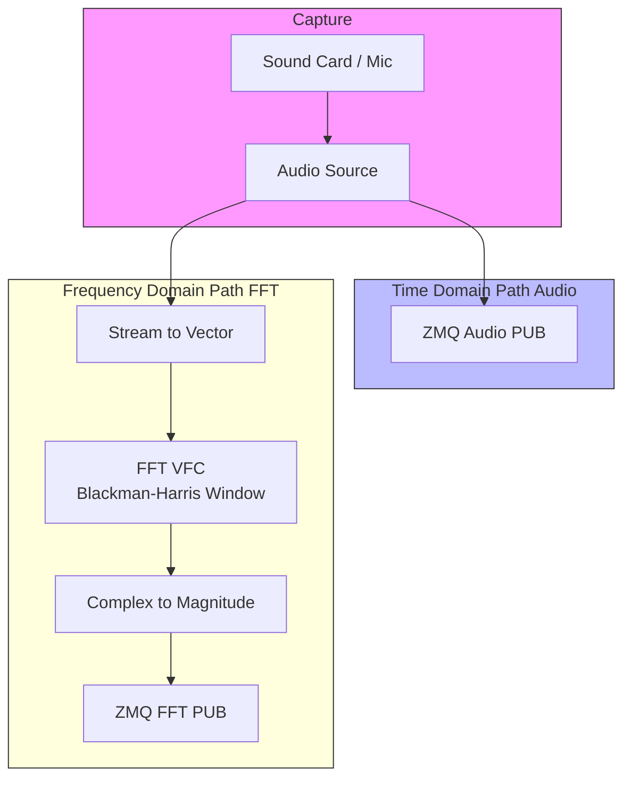

# Audio Interface Documentation

The `Audio Interface` module in `src/rx/audio_interface.py` is the hardware abstraction layer for the receiver. It captures live audio from the sound card and provides two separate streams for the rest of the system: raw time-domain samples and frequency-domain FFT magnitudes.

## Flowgraph Architecture

The module is implemented as a GNU Radio `top_block` with two parallel processing paths.

## Functional Breakdown

### 1. Audio Capture
- **Audio Source**: Interfaces with the system's default audio input device (ALSA/PulseAudio/Jack). It samples at the rate defined in the `SignalConfig`.

### 2. Time Domain Stream
- The raw floating-point samples from the microphone are immediately broadcasted via a ZeroMQ PUB sink.
- This stream is typically consumed by the `Demodulator` for symbol recovery and decoding.

### 3. Frequency Domain Stream
- **Vectorization**: Continuous samples are grouped into vectors of size `fft_size` (e.g., 2048).
- **Windowing**: A **Blackman-Harris window** is applied to reduce spectral leakage before the Fourier transform.
- **FFT**: Computes the Forward FFT (Complex output).
- **Magnitude**: Converts the complex FFT bins into scalar magnitudes (power spectral density).
- This stream is consumed by the `Peak Detector` to identify where signals are present in the spectrum.

## Interfaces and Ports

The `AudioInterface` serves as a ZMQ server, publishing data on the following ports:

| Port | Protocol | Data Type | Description |
| :--- | :--- | :--- | :--- |
| `audio_port` | ZMQ PUB | Float32 | Continuous stream of time-domain audio samples. |
| `fft_port` | ZMQ PUB | Float32 Vector | Magnitude spectrum vectors (size: `fft_size`). |

## Implementation Details

### Signal Handling
The module includes a robust signal handler for `SIGINT` and `SIGTERM`, ensuring that the GNU Radio flowgraph is stopped and the audio device is released cleanly when the process is terminated.

### Threading
- Uses a `threading.Event` (`flowgraph_started`) to signal when the capture hardware is ready.
- Supports an optional `stop_event` (multiprocessing/threading) to allow external control over the module's lifecycle.

---
*Documentation generated for vibe-audioModem project.*
