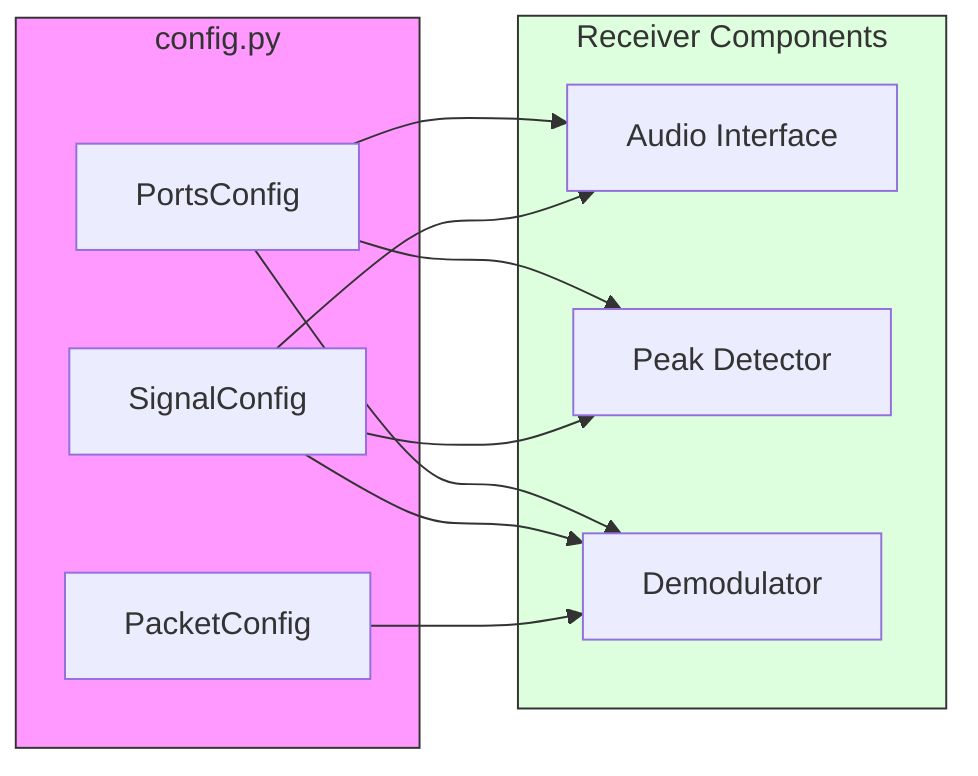

# Configuration Documentation

The `Configuration` module in `src/config.py` centralizes all parameters used across the `vibe-audioModem` project. It uses Python dataclasses to provide a structured and type-safe way to manage settings for packets, signals, and networking ports.

## Overview of Configuration Classes

The following diagram shows how the configuration data flows into the main system components.

## Configuration Dataclasses

### 1. PacketConfig
Defines the structure of the data packets transmitted over the audio link.
- **`total_packets_len`**: Total size of a packet in bytes (default: 255 for RS compatibility).
- **`preamble_packets`**: Number of header packets sent before the payload.
- **`postamble_packets`**: Number of trailing packets (EOF signal).
- **`error_correction_len`**: Number of Reed-Solomon parity bytes per packet.
- **`data_chunck_len` (Property)**: Calculated as `total - parity - 1` (1 byte reserved for length metadata).

### 2. SignalConfig
Contains physical layer parameters for the audio signal.
- **`samp_rate`**: Audio sampling rate in Hz (default: 48000).
- **`carrier_freq`**: Default center frequency in Hz.
- **`baudrate`**: Symbols per second (default: 500).
- **`sps` (Property)**: Samples per symbol, calculated as `samp_rate / baudrate`.
- **`beeper_duration`**: Duration of the activation tone.

### 3. PortsConfig
Defines the ZeroMQ networking topology for inter-process communication.
- **`audio_port`**: Raw audio stream (default: 5555).
- **`fft_port`**: Spectral data stream (default: 5556).
- **`fft_size`**: Number of bins in the FFT (default: 4096).
- **`raw_packets_port`**: Decoded PDUs (default: 5557).
- **`constellation_port`**: IQ points for visualization (default: 5559).

## Default Settings

The module exports several pre-configured instances used as system defaults:

| Name | Type | Key Values |
| :--- | :--- | :--- |
| `DEFAULT_PACKET_CONFIG` | `PacketConfig` | 255 bytes, 12 parity bytes |
| `DEFAULT_SIGNAL_CONFIG` | `SignalConfig` | 48kHz, 2.5kHz Carrier, 500 Baud |
| `DEFAULT_PORTS_CONFIG` | `PortsConfig` | Ports 5555-5559, FFT 4096 |
| `DEFAULT_DQPSK_CONST` | `gr.digital` | DQPSK constellation object |

## Utility Functions

### `setup_logging(level)`
Configures the global logging format for all modules in the project. It is automatically invoked with `DEBUG` level when `src.config` is imported.

---
*Documentation generated for vibe-audioModem project.*
