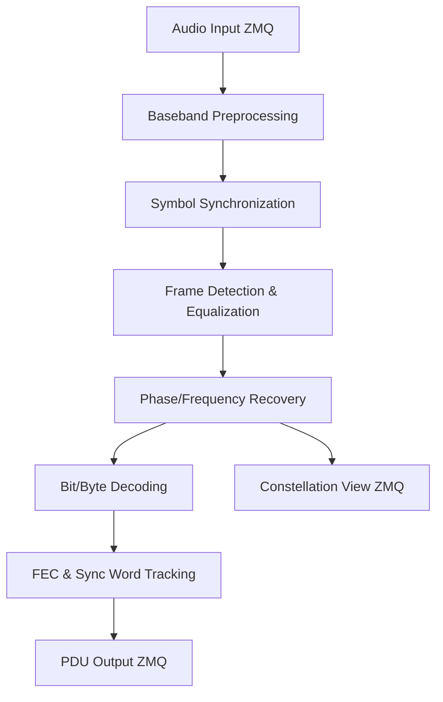
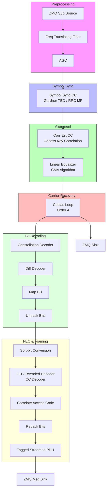

# Demodulator Documentation

The `Demodulator` class in `src/rx/demodulator.py` is a GNU Radio based receiver designed for DQPSK modulated audio signals. It handles frequency translation, timing recovery, equalization, carrier recovery, and FEC decoding.

## High-Level Architecture

The following diagram illustrates the major stages of the demodulation process:

## Detailed Signal Processing Chain

The receiver flowgraph is composed of multiple GNU Radio blocks connected to perform specific signal processing tasks.

## Key Components

### 1. Baseband Preprocessing
- **Freq Translating FIR Filter**: Shifts the signal from the carrier frequency to baseband and performs initial decimation and low-pass filtering.
- **AGC (Automatic Gain Control)**: Normalizes the signal amplitude to a constant level, ensuring consistent performance for subsequent blocks.

### 2. Digital Synchronization
- **Symbol Sync**: Employs the **Gardner TED** (Timing Error Detector) and a **Root Raised Cosine** matched filter. It outputs 1 sample per symbol.
- **Correlation Estimator**: Uses a manually generated DQPSK reference of the `access_key` to detect frame boundaries.

### 3. Equalization & Phase Recovery
- **Linear Equalizer**: Uses the **CMA (Constant Modulus Algorithm)** to compensate for channel-induced inter-symbol interference (ISI).
- **Costas Loop**: A 4th-order loop that tracks and corrects residual carrier frequency and phase offsets.

### 4. Decoding & Error Correction
- **Differential Decoder**: Reverses the differential encoding used at the transmitter to resolve phase ambiguity.
- **FEC Extended Decoder**: Implements Convolutional Encoding (CC) decoding to correct bit errors introduced by the channel.
- **Correlate Access Code TS**: Searches for the fixed access code to identify the start of the payload bits in the stream.

## Ports and Interfaces

| Port Name | Protocol | Type | Description |
| :--- | :--- | :--- | :--- |
| `audio_port` | ZMQ SUB | Float | Input audio samples |
| `raw_packets_port` | ZMQ PUB | PDU | Decoded data packets |
| `constellation_port` | ZMQ PUB | Complex | IQ points after phase recovery |

---
*Documentation generated for vibe-audioModem project.*
