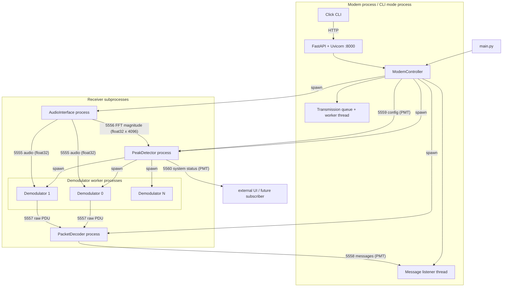

# Vibe AudioModem — complete code walkthrough

> This document explains the repository from the ground up: what it does, how the
> processes talk to each other, how a message is turned into sound, how sound is
> turned back into a message, what every module does, and where the sharp edges
> are. It is based on the code currently checked out (branch `gfsk-test`) and is
> intentionally more detailed than a README.

---

## 1. What this project is

Vibe AudioModem is an experimental **software-defined radio over an audio link**.
It sends digital packets through a normal sound card (or a WAV file) using
GNU Radio. The physical layer is **GMSK** at 200 baud, the link layer adds a
GNU Radio access code + length header, convolutional coding, Reed–Solomon
coding, scrambling, and a simple preamble/postamble packet protocol.

The app is split into three functional layers:

1. **Digital signal processing** — GNU Radio flowgraphs for the transmitter,
   audio capture/FFT, and demodulator.
2. **Process/network plumbing** — ZeroMQ PUB/SUB sockets carry audio, FFT,
   packets, messages, and configuration between processes.
3. **Control plane** — a FastAPI HTTP server on port 8000, an interactive Click
   CLI, and a `ModemController` that owns lifecycle and configuration.

The current implementation is a research prototype. There is **no automated test
suite** (`tests/` is empty), only a single baud rate is known to work reliably
(200 baud), and several old notes/endpoints are stale. Those points are listed
explicitly in section 14.

---

## 2. Repository map

| Path                            | Role                                                                                                                                        |
| :------------------------------ | :------------------------------------------------------------------------------------------------------------------------------------------ |
| `main.py`                       | Entry point. Parses `--cli` / `--test`, starts the modem either in-process (CLI mode) or in a child process (headless mode).                |
| `src/misc/config.py`            | Dataclasses for signal/packet/port configuration, defaults, logging setup, ZMQ monitor helper.                                              |
| `src/misc/scrambling.py`        | 7-bit additive LFSR scrambler/unscrambler.                                                                                                  |
| `src/tx/packetizer.py`          | Converts `str`/`bytes`/`Path` into PMT bytes, scrambles, chunks, Reed–Solomon encodes, adds preamble/postamble.                             |
| `src/tx/transmitter.py`         | GNU Radio transmitter flowgraph: protocol header, convolutional coding, differential encoding, GMSK, carrier shift, beeper, audio/WAV sink. |
| `src/rx/audio_interface.py`     | GNU Radio audio source + FFT computation. Publishes raw audio on 5555 and magnitude FFT on 5556.                                            |
| `src/rx/peak_detector.py`       | Subscribes to FFT, detects carriers, manages demodulator workers.                                                                           |
| `src/rx/signal_processor.py`    | FFT averaging, optional smoothing/noise floor, peak finding, persistence filtering.                                                         |
| `src/rx/worker_manager.py`      | Pool of persistent demodulator worker processes and their state machine.                                                                    |
| `src/rx/demodulator.py`         | GNU Radio receiver flowgraph: downconversion, AGC, GMSK demod, differential/convolutional decoding, frame sync, PDU output.                 |
| `src/rx/packet_decoding.py`     | Reed–Solomon decode, multi-packet reassembly, unscrambling, PMT deserialization, publishing finished messages.                              |
| `src/audioModem/audioModem.py`  | `ModemController`: owns config, queues, threads, receiver subprocesses, ZMQ sockets; business logic behind HTTP.                            |
| `src/audioModem/http_server.py` | FastAPI app and Uvicorn thread.                                                                                                             |
| `src/ui/cli.py`                 | Click-based interactive command loop that talks to the HTTP API.                                                                            |
| `grc_files/`, `research/`       | GNU Radio Companion flowgraphs, experiments, analysis scripts. Not used by the application at runtime.                                      |
| `environment.yml`               | Conda environment.                                                                                                                          |
| `TODO.md`                       | Known limitations and planned work.                                                                                                         |
| `docs/gardner1986.pdf`          | Background paper on symbol timing recovery (Gardner algorithm).                                                                             |

---

## 3. Requirements and how to run it

### 3.1 Environment

`environment.yml` creates a Conda env named `vibe-audiomodem` with Python 3.12,
GNU Radio, NumPy, SciPy, Matplotlib, `reedsolo`, `pyzmq`, FastAPI, Uvicorn,
WebSockets, Click, and `sip` via pip.

Important practical notes:

- The application imports `pmt`, `gnuradio`, `zmq`, `pmt`, `numpy`, `scipy`,
  `reedsolo`, `fastapi`, `uvicorn`, and `click`. All of those are in the
  environment except `requests`, which the CLI uses and which is normally pulled
  in transitively by other packages. If the CLI fails with `ModuleNotFoundError:
  requests`, install it explicitly.
- `grc_files/` and some research scripts also need PyQt5, PySide6, `sounddevice`,
  etc. Those are **not** required by the modem itself.
- GNU Radio must be importable from the same Python interpreter that runs
  `main.py`. The project assumes a Conda/GNU Radio installation, not a plain
  `pip` environment.

### 3.2 Launch commands

Run from the repository root (imports are absolute: `from src...`, and log/WAV
paths are relative to the current directory).

```bash
conda env create -f environment.yml
conda activate vibe-audiomodem

python main.py              # headless: HTTP server only, no terminal CLI
python main.py --cli        # HTTP server + interactive terminal CLI
python main.py --test       # TX writes test.wav, RX reads test.wav
python main.py --cli --test # handy local loopback (also used by .vscode/launch.json)
```

`--test` is a **file loopback** mode:

- Every transmission is written to `test.wav` instead of the speakers.
- 10 seconds of silence are appended so the receiver has time to finish.
- The receiver reads from `test.wav` instead of the microphone.
- You must send at least once before starting the receiver, otherwise
  `POST /receive` returns an error because `test.wav` does not exist.

### 3.3 Main process model

`main.py`:

- Calls `setup_logging(level=logging.INFO)` before importing the modem.
- In CLI mode, calls `start_audiomodem(...)` directly in the main process.
- In headless mode, spawns a `multiprocessing.Process` named `AudioModem` and
  joins it. `Ctrl+C` terminates that process.

`start_audiomodem()` is in `src/audioModem/audioModem.py:557`. It:

1. Imports the CLI lazily.
2. Creates a `ModemController`.
3. Gives it to the FastAPI module via `set_controller`.
4. Starts the Uvicorn server in a daemon thread.
5. Optionally starts the interactive CLI.
6. Sleeps in a loop until `INTERNAL_STOP_EVENT` is set (by `/quit`, the CLI exit
   path, or `Ctrl+C`).
7. Calls `controller.shutdown()` in a `finally` block.

---

## 4. High-level architecture

### 4.1 Processes, threads, and sockets



Key point: **audio, FFT, raw packets, and messages never pass through Python
queues between processes** — they go through ZeroMQ. Python `queue.Queue` is
used only *inside* the controller for transmission and received-message queues.

### 4.2 Transmit path

```mermaid
flowchart LR
    M["message str / bytes / file"] --> P["prepare_data()<br>PMT serialize"]
    P --> S["scramble (LFSR)"]
    S --> C["split into 31-byte chunks<br>+ length byte"]
    C --> RS["Reed–Solomon(16)<br>32 → 48 bytes"]
    RS --> F["prepend preamble<br>append postamble"]
    F --> H["GNU Radio protocol header<br>access key + length + length repeat"]
    H --> CC["convolutional encoder<br>rate 1/2, K=7"]
    CC --> D["differential encoder"]
    D --> G["GMSK, BT=0.35, 240 sps"]
    G --> R["complex rotator → carrier"]
    R --> A["real audio<br>3 s beeper + data (+ silence)"]
```



### 4.3 Receive path


### 4.4 Why so many processes?

- GNU Radio flowgraphs are blocking and CPU-heavy; each demodulator must be
  independent so several carriers can be decoded at once.
- The audio interface and packet decoder are long-lived services.
- ZeroMQ gives a clean, language-agnostic boundary between them and lets the
  peak detector spawn/kill demodulators dynamically.
- The controller and HTTP server stay responsive while transmission and
  reception run elsewhere.

The trade-off is complexity: configuration must be copied into child processes
and propagated via ZMQ, and lifecycle bugs are easy to introduce.

---

## 5. Configuration in depth

All configuration lives in `src/misc/config.py` as frozen-by-convention
dataclasses. They are mutable at runtime; the controller modifies them and
recreates processes when necessary.

### 5.1 `PacketConfig`

| Field | Default | Unit | Meaning |
| :--- | :---: | :---: | :--- |
| `total_packets_len` | 48 | byte | Size of one Reed–Solomon codeword on the wire. |
| `preamble_packets` | 1 | packet | Number of dummy packets with length flag `0`. |
| `postamble_packets` | 1 | packet | Number of dummy packets with length flag `255`. |
| `error_correction_len` | 16 | byte | Number of Reed–Solomon parity bytes per 48-byte codeword. |

Derived properties:

- `data_chunck_len` (note the typo in the code) = `48 - 16 - 1 = 31`.
  One byte is reserved for the chunk length, leaving 31 payload bytes.
- `rsc_codec` returns a **new** `reedsolo.RSCodec(16)` every time it is accessed.
  A 16-byte parity codeword can correct **8 byte errors**, not 16. It can also
  handle up to 16 erasures if positions are known, but the application does not
  use erasures.

The full RS codeword is:

```text
[ length flag: 1 byte ][ data + random filler: 31 bytes ][ RS parity: 16 bytes ]
                         └──────── 32-byte RS message ────────┘
```

### 5.2 `SignalConfig`

| Field | Default | Unit | Meaning |
| :--- | :---: | :---: | :--- |
| `samp_rate` | 48000 | sample/s | Audio sample rate. |
| `carrier_freq` | 2500 | Hz | Center frequency of the GMSK signal and beeper. |
| `beeper_duration` | 3.0 | s | Duration of the pure carrier tone before data. |
| `baudrate` | 200 | symbol/s | GMSK symbol rate. |

Derived properties and useful numbers:

- `sps = int(samp_rate / baudrate) = 240` samples/symbol.
- `beeper_nb_sample = int(samp_rate * beeper_duration) = 144000`.
- `nyquist_freq = 24000`.
- FFT resolution = `48000 / 4096 = 11.71875 Hz/bin`.
- GMSK is 1 bit/symbol. With rate-1/2 convolutional coding, one 48-byte packet
  plus the 8-byte GNU Radio header is `(48 + 8) * 8 * 2 = 896` coded symbols,
  i.e. `896 * 240 = 215040` audio samples = **4.48 s per packet**.
- Total airtime ≈ `beeper_duration + number_of_packets * 4.48 s` (plus optional
  silence padding in test mode).

### 5.3 `PortsConfig`

| Field | Default | Bound by | Consumed by |
| :--- | :---: | :--- | :--- |
| `audio_port` | 5555 | `AudioInterface` PUB | demodulators SUB |
| `fft_port` | 5556 | `AudioInterface` PUB | peak detector SUB, HTTP `/fft` SUB |
| `fft_size` | 4096 | `AudioInterface` | FFT block and peak detector |
| `raw_packets_port` | 5557 | `PacketDecoder` SUB bind | demodulators PUB connect |
| `messages_port` | 5558 | `PacketDecoder` PUB bind | controller SUB connect |
| `config_port` | 5559 | `ModemController` PUB bind | peak detector SUB connect |
| `peak_detector_system_port` | 5560 | peak detector PUB bind | external UI (currently no in-repo subscriber) |

All ZMQ sockets use TCP on localhost except the controller's config PUB which
binds `tcp://*:<port>`, and the peak-detector system PUB which also binds `*`.

### 5.4 Defaults in one place

```python
DEFAULT_PACKET_CONFIG = PacketConfig(
    total_packets_len=48,
    preamble_packets=1,
    postamble_packets=1,
    error_correction_len=16,
)
DEFAULT_SIGNAL_CONFIG = SignalConfig(
    samp_rate=48000, beeper_duration=3.0,
    carrier_freq=2500, baudrate=200,
)
DEFAULT_PORTS_CONFIG = PortsConfig(
    audio_port=5555, fft_port=5556, fft_size=4096,
    raw_packets_port=5557, messages_port=5558,
    config_port=5559, peak_detector_system_port=5560,
)
```

### 5.5 Logging

`setup_logging()` in `src/misc/config.py:14`:

- Writes to `audiomodem.log` (append mode) by default.
- Console output is **off** unless `console=True`. `main.py` therefore logs only
  to the file. The CLI does not show live log lines; use `logs` command or
  `GET /logs`.
- Format: `time: processName: level: message`.
- Matplotlib/PIL/urllib3 noise is reduced; Uvicorn access logs are suppressed.
- Uvicorn is given its own file handler in `http_server.py`, also writing to
  `audiomodem.log`.

---

## 6. The wire protocol

This is the most important part to understand. There are **four nested framing
layers**.

### 6.1 Layer 1 — application payload

`prepare_data()` in `src/tx/packetizer.py` uses `functools.singledispatch` on the
input type:

| Input type | PMT dict produced |
| :--- | :--- |
| `str` | `{"sender_name": ..., "type": "raw_string", "data": uint8 vector of UTF-8}` |
| `bytes` | `{"sender_name": ..., "type": "raw_bytes", "data": uint8 vector}` |
| `Path` | `{"sender_name": ..., "type": "file", "path": str(path), "data": uint8 vector}` |

That dict is converted with `pmt.to_pmt(...)` and then serialized to a binary
string with `pmt.serialize_str(...)`. From this point on it is just a byte
sequence.

⚠️ The `Path` overload is currently broken: it references an undefined variable
`filepath` instead of `input_data`. It would also need to serialize the NumPy
array correctly. Only `str` and `bytes` are safe today.

### 6.2 Layer 2 — scrambling and chunking

**Scrambling** (`src/misc/scrambling.py`):

- Additive XOR scrambler built from a 7-bit LFSR.
- Default `mask=0x48`, `seed=0x7F`, `reg_length=7`.
- `process()` resets the register to the seed, then emits one pseudo-random bit
  per input bit, MSB-first within each byte.
- The same class is used for scrambling and unscrambling because XOR is
  symmetric.
- Only the PMT payload is scrambled. The preamble/postamble dummy packets are
  not scrambled.

**Chunking** (`split_payload_into_packet`):

For each chunk:

```text
input:  up to 31 bytes of scrambled PMT data
output: [actual_chunk_len: 1 byte][chunk data][random filler to 31 bytes]
```

- All non-final chunks use the full 31 bytes and length flag `31`.
- The final chunk stores its true length (`0..31`) and pads with
  `secrets.token_bytes(...)`.
- `0` is reserved for preamble and `255` for postamble.
- The receiver ignores filler by only copying `decoded_payload[1:len+1]`.

### 6.3 Layer 3 — Reed–Solomon

Each 32-byte chunk message is encoded with `RSCodec(16)`, producing a 48-byte
codeword:

```text
packet (48 bytes)
┌────────────┬──────────────────────────────┬─────────────────────┐
│ length = 0 │ random payload               │ RS parity           │  preamble
│ 1 byte     │ 31 bytes                     │ 16 bytes            │
├────────────┼──────────────────────────────┼─────────────────────┤
│ length=1..31│ scrambled PMT chunk + filler│ RS parity           │  data
│ 1 byte     │ 31 bytes                     │ 16 bytes            │
├────────────┼──────────────────────────────┼─────────────────────┤
│ length=255 │ random payload               │ RS parity           │  postamble
│ 1 byte     │ 31 bytes                     │ 16 bytes            │
└────────────┴──────────────────────────────┴─────────────────────┘
```

- Preamble: length flag `0`, random 31-byte body, RS-encoded.
- Data: length flag = real data length, scrambled PMT data + random filler,
  RS-encoded.
- Postamble: length flag `255`, random body, RS-encoded.

The preamble/postamble are **framing markers**, not the RF sync word. The actual
bit-level sync word is the 32-bit access code in the GNU Radio header.

### 6.4 Layer 4 — GNU Radio header, convolutional coding, GMSK

Transmitter (`src/tx/transmitter.py`):

- Access key: `"11100001010110101110100010010011"` = `0xE15AE893`.
- `digital.header_format_default(access_key, 0)` builds a header containing:
  - 4-byte access code,
  - 2-byte payload length,
  - 2-byte repeated payload length.
- `protocol_formatter_bb` prepends that 8-byte header to each 48-byte RS packet.
- `blocks.stream_to_tagged_stream(..., 48, "packet_len")` groups the input into
  48-byte chunks before the formatter.
- `fec.cc_encoder_make(frame_size=(48+8)*8=448, k=7, rate=2,
  polys=[79,109], mode=CC_STREAMING)` encodes each frame with a rate-1/2
  convolutional code.
- `fec.extended_encoder(..., puncpat='11')`: the puncture pattern is all ones,
  so no bits are actually punctured; the code remains rate 1/2.
- `digital.diff_encoder_bb(2)` differentially encodes bits to resolve phase
  ambiguity.
- `digital.gmsk_mod(samples_per_symbol=240, bt=0.35)` modulates.
- `blocks.rotator_cc(2π * carrier_freq / samp_rate)` shifts the complex baseband
  signal to the audio carrier (2500 Hz).
- `blocks.complex_to_real()` keeps the real passband signal for the sound card.
- A 3-second, amplitude-0.77 sine wave at the carrier frequency is prepended.
- Optional zero-valued silence of `silence_padding * samp_rate` samples is
  appended.
- A `blocks.head()` stops the flowgraph after exactly
  `beeper + data + silence` samples.

The GNU Radio header means the true physical frame is **56 bytes**
(8 header + 48 RS), not 48. The 48-byte number in `PacketConfig` is the
RS codeword size; remember this when reasoning about timing or debugging.

### 6.5 Example timing

For a message whose serialized PMT + metadata is `n` bytes:

- Chunk count = `max(1, ceil(n / 31))`.
- Non-final chunks carry 31 bytes; final carries `n mod 31` (or 31 if divisible).
- Total packets = `chunk_count + preamble_packets + postamble_packets`.
- Air time ≈ `3.0 s + total_packets * 4.48 s`.

Example: a short message that produces 4 data chunks → 6 packets → about
`3 + 6 * 4.48 = 29.9 s` of audio.

---

## 7. Transmitter in detail

File: `src/tx/transmitter.py`.

### 7.1 `Transmitter(gr.top_block)`

Constructor steps:

1. Copies `PacketConfig` and `SignalConfig`.
2. Calls `prepare_data(input_data, pkt, sender_name)`, producing the encoded
   byte stream (preamble + data + postamble, RS-coded).
3. Computes the GNU Radio header format and frame size:
   - `access_key` is 32 bits.
   - `header_len = 32 // 8 + 4 = 8` bytes.
   - `cc_frame_size = (48 + 8) * 8 = 448` bits.
4. Builds the flowgraph:
   - `vector_source_b(input_file, repeat=False)`
   - `stream_to_tagged_stream(..., 48, "packet_len")`
   - `protocol_formatter_bb`
   - `tagged_stream_mux` (header + payload)
   - `unpack_k_bits_bb(8)` (bytes → bits)
   - `extended_encoder`
   - `diff_encoder_bb(2)`
   - `gmsk_mod`
   - `rotator_cc`
   - `complex_to_real`
   - `multiply_const_ff(1.0)`
   - `head(...)`
   - `analog.sig_source_f(...)` for the beeper
   - `stream_mux` for beeper/data/silence
   - `audio.sink(...)` or `blocks.wavfile_sink(...)`
5. Starts all blocks.

`get_nb_of_audio_samples()` computes:

```text
packet_count = len(encoded_bytes) / 48
bits = packet_count * (48 + 8) * 8 * 2
symbols = bits                 # GMSK = 1 bit/symbol
samples = symbols * sps
```

It is used to size the `head` block so the flowgraph terminates cleanly.

### 7.2 `send_data()`

- Builds a `Transmitter`.
- Optionally installs SIGINT/SIGTERM handlers (disabled when called from the
  controller, which owns lifecycle).
- Starts the flowgraph and sets `flowgraph_started`.
- If `cancel_event` is provided, it runs `tb.wait()` in a helper thread and polls
  the cancel flag every 100 ms. On cancellation it calls `tb.stop()` and returns.
- Otherwise it simply blocks in `tb.wait()` until the `head` block exhausts the
  stream.

The controller always calls `send_data(..., handle_signals=False,
cancel_event=...)` so that cancellation is cooperative and the HTTP server keeps
running.

### 7.3 Output choices

- Default: `audio.sink(samp_rate, '', True)` → system default output device.
- Test mode: `blocks.wavfile_sink("test.wav", 1, samp_rate,
  FORMAT_WAV, FORMAT_PCM_16, False)` → mono 16-bit WAV.

### 7.4 Transmitter notes

- The beeper is not a synchronization preamble processed by the receiver. It is
  a simple strong carrier that makes the peak detector fire and gives the AGC /
  demodulator time to settle.
- The transmitter does not include a timestamps or sequence number. Reassembly
  relies only on preamble/postamble and “first packet starts after preamble”.
- There is no application-level acknowledgment or retransmission.
- `multiply_const_ff(1.0)` is a no-op hook for gain adjustment.

---

## 8. Receiver in detail

### 8.1 `AudioInterface` — audio capture and FFT

File: `src/rx/audio_interface.py`.

Two modes:

- Live: `audio.source(samp_rate, "", True)`.
- File: `blocks.wavfile_source(input_file, False)` followed by
  `blocks.throttle(sizeof_float, samp_rate, True)` so the file plays at real
  time. The `AudioProbe` additionally logs RMS/peak every 2 seconds.

Audio distribution:

- `zeromq.pub_sink(sizeof_float, 1, "tcp://*:5555")` → raw audio for demodulators.

FFT branch:

1. `stream_to_vector(sizeof_float, fft_size=4096)` — non-overlapping frames.
2. `fft.fft_vfc(4096, forward=True, window=blackmanharris(4096), shift=True, 1)`.
3. `blocks.complex_to_mag(4096)` — magnitude only, phase discarded.
4. `zeromq.pub_sink(sizeof_float, 4096, "tcp://*:5556")`.

Because the FFT is shifted, the second half of the vector (`data[2048:]`) is the
positive-frequency half from DC to Nyquist. The peak detector uses exactly that
slice and maps bin index `k` to frequency `k * samp_rate / fft_size`.

Frame rate: one FFT every `4096 / 48000 ≈ 85.3 ms` (~11.7 frames/s). There is no
overlap.

`start_audio_interface()` logs WAV metadata, starts the flowgraph, and installs a
monitor thread that stops the flowgraph when `stop_event` is set. A file source
ends naturally when the file is exhausted; the peak detector notices after 5 s of
no FFT data and exits.

### 8.2 Peak detector orchestration

File: `src/rx/peak_detector.py`.

`search_for_incomming_transmission(...)` (spelling as in code) does:

1. Creates a ZMQ context and two SUB sockets:
   - FFT on `ports.fft_port` (5556).
   - Config updates on `ports.config_port` (5559).
2. Creates a PUB socket bound to `peak_detector_system_port` (5560) for future UI
   status messages.
3. Instantiates:
   - `WorkerManager(nb_workers, signal_conf, ports_conf, pkt_conf, system_pub)`
   - `SignalProcessor(fft_size, freq_resolution, baudrate, ...)`
4. Polls both sockets every 100 ms.

On a config message (PMT dict with `type` `preset_update` or `config_update`):

- Updates `signal_conf.baudrate`, `carrier_freq`, `beeper_duration`.
- Updates `signal_processor.baudrate`.
- Optionally updates processor options:
  `enable_smoothing`, `enable_noise_floor`, `persistence_hits`,
  `min_prominence`, `recalibrate_noise_floor`.
- Calls `worker_manager.update_all_presets(signal_conf)`.

On an FFT message:

- Converts from `float32`.
- Ignores frames whose length is not exactly `fft_size`.
- Takes `real_spectrum = data[fft_size // 2:]`.
- `signal_processor.process_frame(real_spectrum)` returns confirmed peak
  frequencies.
- `worker_manager.update_worker_states(peak_freqs, baudrate, persistence=50)`
  stops workers that lost their carrier.
- `worker_manager.dispatch_peaks(peak_freqs, baudrate)` assigns idle workers to
  new carriers.

If no FFT data arrives for 50 polls (about 5 s), the detector assumes the audio
source is gone and exits.

### 8.3 `SignalProcessor` — FFT → frequencies

File: `src/rx/signal_processor.py`.

Parameters from the peak detector call:

| Parameter | Default used by controller | Meaning |
| :--- | :---: | :--- |
| `buffer_size` | 10 | FFT frames averaged together. |
| `min_prominence` | 2.0 | Ratio/absolute prominence threshold. |
| `enable_smoothing` | False | 5-bin moving average. |
| `enable_noise_floor` | False | Median-filtered floor normalization. |
| `persistence_hits` | 3 | Required hits before a peak is dispatched. |
| `persistence_window` | 5 | Maximum hit counter. |

`process_frame(real_spectrum)`:

1. Appends the frame to a deque and computes the mean of the last ≤10 frames.
2. Optional smoothing: convolution with a 5-tap box filter.
3. Noise-floor optional path:
   - Before calibration: collect 10 raw frames, detect on the normal spectrum.
   - At calibration: compute a median-filtered floor with kernel size
     `int(baudrate * 2 / freq_resolution)` (≈35 bins ≈410 Hz at defaults),
     clamped to at least `1e-6`.
   - After calibration: divide the processed spectrum by this **fixed** floor.
     It does not adapt unless `recalibrate()` is called.
4. Peak detection with SciPy `find_peaks`:
   - Minimum distance = `max(1, int(baudrate / (2 * freq_resolution)))` = 8 bins
     ≈ 93.75 Hz at defaults.
   - Without noise-floor normalization: prominence and minimum height are both
     `min_prominence * mean(avg_spectrum)`.
   - With normalization: prominence = `min_prominence` (ratio) and minimum
     height = `1.0`.
5. Persistence filtering (enabled at defaults because `persistence_hits=3`):
   - Each current peak is matched to an existing candidate within
     `max(1, int(baudrate / (4 * freq_resolution)))` = 4 bins ≈46.9 Hz.
   - Match → increment hit count, capped at 5.
   - No match → decrement; drop at 0.
   - New unmatched peak → hit count 1.
   - Return only current peaks whose matched candidate has at least 3 hits.

`set_options()` allows dynamic updates; `recalibrate()` clears the noise floor.

Important: because the controller does not pass `persistence_hits`, the default
value `3` from `search_for_incomming_transmission` is used, so **persistence is
active even though smoothing and noise floor are disabled**.

### 8.4 `WorkerManager` and demodulator lifecycle

Files: `src/rx/worker_manager.py`, `src/rx/demodulator.py`.

The peak detector pre-spawns `nb_workers` persistent processes. The controller
passes `nb_workers=1` by default; `POST /receive` can request more.

`DemodulatorWorker`:

- Has a `multiprocessing.Queue` for commands and one for status.
- Runs `launch_demodulator(..., command_queue=..., status_queue=...)`.
- State machine: `initializing` → `ready` → `running` → `ready`.
- `start_tuning(freq)` sets `active_freq`, state `running`, sends
  `{"action":"start","freq":freq}`, and publishes a `dispatching` system message.
- `stop_tuning()` sends `{"action":"stop"}`.
- `update_state()` drains status messages.
- `update_preset(sig_conf)` sends baudrate/beeper/carrier to the worker.
- `terminate()` sends `None`, joins 1 s, then kills if necessary.

`WorkerManager`:

- `update_worker_states()`:
  - For each running worker, check whether any detected peak is within
    `baudrate / 2` of `active_freq`.
  - If yes, reset `missed_frames`.
  - If no, increment; after more than 50 misses, stop tuning.
- `dispatch_peaks()`:
  - Ignores peaks at or below 1000 Hz (DC/low-frequency noise).
  - Skips peaks already covered by a running worker within `baudrate / 2`.
  - Assigns the first `ready` worker.
- `update_all_presets()` sends the new signal config to every worker.
- `terminate_all()` shuts all workers down.

Worker process behavior (`launch_demodulator`):

- Legacy mode (`command_queue is None`): create one `Demodulator` and run until
  it ends.
- Worker mode:
  - Outer loop waits for commands.
  - `start`: update carrier frequency, create a **fresh** `Demodulator` (clean
    algorithm state), start it, report `running`.
  - While running:
    - `None` → stop and exit the process.
    - `stop` → stop/wait/delete the flowgraph, report `ready`, return to outer
      loop.
    - `update_preset` → update local `signal_config`, stop and rebuild the
      flowgraph, restart with the new settings, report `running`.
  - Idle `stop` → report `ready`.

### 8.5 `Demodulator` flowgraph

File: `src/rx/demodulator.py`.

Input:

- `zeromq.sub_source(sizeof_float, 1, "tcp://127.0.0.1:5555")` — raw audio.

Downconversion and decimation:

- `freq_xlating_fir_filter_fcc(decimation, taps, center_freq=carrier_freq,
  samp_rate)`.
- `decimation = max(1, int(sps / 10))` → target about 10 samples/symbol.
  At defaults: `240 // 10 = 24`, so the DSP rate becomes `48000 / 24 = 2000 Hz`
  and `actual_sps = 48000 / (24 * 200) = 10.0`.
- Low-pass taps: cutoff `baudrate * 1.5 = 300 Hz`, transition
  `baudrate / 3 ≈ 66.7 Hz`, Kaiser window beta 6.76, computed at the input
  sampling rate.
- `analog.agc_cc(1e-4, 1.0, 1.0, 1000)`.

Demodulation:

- `digital.gmsk_demod(samples_per_symbol=actual_sps, gain_mu=0.175, mu=0.5,
  omega_relative_limit=0.005, freq_error=0.0)`.
  `omega_relative_limit=0.005` is a very tight clock-tracking limit; this is one
  reason the modem is sensitive to baud-rate changes.
- `digital.diff_decoder_bb(2, DIFF_DIFFERENTIAL)`.
- `uchar_to_float` → `multiply_const_ff(2)` → `add_const_ff(-1)` maps bits
  `{0,1}` to soft values `{-1,+1}` for Viterbi decoding.
- `fec.extended_decoder(cc_dec, puncpat='11', integration_period=10000)`.
- `digital.correlate_access_code_bb_ts(access_key, 3, "packet_len")` finds the
  32-bit access code with a Hamming-distance threshold of 3 and emits a
  `packet_len` tag.
- `TagValueSetter("packet_len", cc_frame_size=448)` overwrites the tag value to
  448 bits. This is a pragmatic frame-sync fixer: the correlate block’s tag value
  is not the full frame length.
- `blocks.repack_bits_bb(1, 8, "packet_len", True, GR_MSB_FIRST)` packs bits
  into bytes.
- `pdu.tagged_stream_to_pdu(byte_t, "packet_len")` creates PDUs.
- `pdu_set` adds `demodulator_id` (an ISO timestamp unique per flowgraph) and
  `carrier_freq`.
- `zeromq.pub_msg_sink("tcp://127.0.0.1:5557")` publishes PDUs.

#### Frame-length subtlety

The receiver expects the PDU to be **52 bytes**:
`[2-byte length][2-byte repeated length][48-byte RS codeword]`, not 56. The
`packet_decoding` module strips 4 bytes when the PDU length is
`total_packets_len + 4 = 52`. This corresponds to the GNU Radio access-code tag
landing after the 32-bit access word. If a PDU ever arrives with the full 8-byte
header (56 bytes), the current decoder will not strip it and Reed–Solomon
decoding will likely fail. This is a brittle point to keep in mind when changing
GNU Radio versions or blocks.

### 8.6 Packet decoding and reassembly

File: `src/rx/packet_decoding.py`.

`listen_for_packets()`:

- ZMQ SUB **bind** on `raw_packets_port` (5557); demodulators connect to it.
- ZMQ PUB bind on `messages_port` (5558); the controller subscribes.
- A ZMQ monitor socket logs connect/disconnect events.
- Polls with a 500 ms timeout and stops when `stop_event` is set.

`decode_packet(payload, pkt)`:

1. Unpacks `payload = [metadata, np.ndarray]`.
2. Reads `demodulator_id` and `carrier_freq`.
3. Converts raw bytes.
4. If length is 52, strips the first 4 bytes (header tail).
5. Gets/creates a `PacketReassembler` keyed by `demodulator_id`.
6. Reed–Solomon decodes 48 → 32 bytes.
7. On `ReedSolomonError`, resets the reassembler and emits a system error
   message.
8. Passes the decoded 32 bytes to `PacketReassembler.process_packet()`.

`PacketReassembler`:

- State `IDLE` / `COLLECTING`.
- First byte is the length flag:
  - `0`: preamble → reset buffer, state `COLLECTING`, remember carrier frequency.
  - `1..254`: if collecting, append `payload[1:length+1]`; otherwise discard.
  - `255`: postamble → if collecting, unscramble the accumulated buffer,
    `pmt.deserialize_str`, `pmt.to_python`, attach `carrier_freq`, reset, and
    return the dict. If not collecting, just report postamble.
- Any bad state or RS failure resets the reassembler; there is no retry.

When a full message is returned:

- `type == "raw_string"`: data is converted to a UTF-8 string.
- Otherwise (`raw_bytes`, `file`): data is base64-encoded for JSON compatibility.
- The original type is **overwritten** with `"data"` before publishing, so the
  CLI cannot distinguish a file from raw bytes after reception.
- The final dict is PMT-serialized and published on 5558.

Status/system messages published include:

- `{"type":"system","status":"preamble","carrier_freq":...}`
- `{"type":"system","status":"collecting","bytes_received":...}`
- `{"type":"system","status":"deserialization_error","carrier_freq":...}`
- `{"type":"system","status":"error","error":"Reed-Solomon error ...","carrier_freq":...}`

---

## 9. `ModemController` — the control plane

File: `src/audioModem/audioModem.py`.

### 9.1 State owned by the controller

| Attribute | Purpose |
| :--- | :--- |
| `signal_conf`, `pkt_conf`, `ports_conf` | Mutable runtime configuration. |
| `test_mode` | File loopback flag. |
| `receiver_active`, `receiver_nb_workers`, `receiver_processes` | Receiver subprocess lifecycle. |
| `rx_input_file` | WAV input path in test mode. |
| `_transmission_queue` | `queue.Queue` of pending transmissions. |
| `_transmission_thread`, `_transmission_lock`, `_is_transmitting`, `_cancel_event` | Single-worker TX queue and cancellation. |
| `_received_messages`, `_messages_lock` | Queue filled by the message listener thread. |
| `config_pub_socket` | PUB on 5559. |
| `_messages_sub_socket` | SUB to 5558. |
| `_message_listener_thread` | Daemon thread converting PMT messages into `_received_messages`. |

### 9.2 Background threads

- **Message listener**: loops on `recv(NOBLOCK)`, deserializes PMT, pushes dicts
  into `_received_messages`. Sleeps 100 ms when no message.
- **Transmission worker**: started lazily on first `_queue_transmission`.
  Processes one message at a time via `send_data`. Sets `_is_transmitting` while
  busy. Handles a `None` sentinel as “exit”.
- **HTTP server thread**: Uvicorn, daemon.
- **CLI thread/loop**: only in `--cli` mode; runs on the main thread.

### 9.3 Receiver lifecycle

`_start_receiver_processes(nb_workers, input_file)`:

- If receiver is already active, stops it first.
- Spawns, in order:
  1. `AudioInterfaceProcess` → `start_audio_interface`
  2. `PeakDetectorProcess` → `search_for_incomming_transmission`
  3. `PacketDecoderProcess` → `listen_for_packets`
- Passes the same `STOP_EVENT` (`multiprocessing.Event`) to all three.
- Sets `receiver_active = True`.

`_stop_receiver_processes()`:

- Returns immediately if not active.
- Sets `STOP_EVENT`.
- Joins each process with a 2 s timeout, then terminates alive processes.
- Clears the event again unless `INTERNAL_STOP_EVENT` is set (so a later
  receiver restart works during normal operation).
- Sleeps 0.5 s to let ALSA/PortAudio release the audio device.
- Sets `receiver_active = False`.

Note: the `STOP_EVENT` is a **global module-level** multiprocessing event, not
per-controller. This is fine for a single modem instance but would be a problem
for multiple controllers in one process.

### 9.4 Configuration propagation

`handle_setup(data)` accepts:

```json
{
  "signal": {
    "samp_rate": 48000,
    "carrier_freq": 2500,
    "baudrate": 200,
    "beeper_duration": 3.0
  },
  "packet": {
    "total_packets_len": 48,
    "preamble_packets": 1,
    "postamble_packets": 1,
    "error_correction_len": 16
  },
  "port": {
    "audio_port": 5555,
    "fft_port": 5556,
    "fft_size": 4096,
    "raw_packets_port": 5557,
    "messages_port": 5558,
    "config_port": 5559,
    "peak_detector_system_port": 5560
  }
}
```

Behavior:

- `samp_rate`, `fft_size`, and all packet parameters mark `restart_needed`.
- `carrier_freq`, `baudrate`, `beeper_duration` mark `broadcast_needed`.
- Any port change restarts the controller’s ZMQ sockets and marks
  `restart_needed`.
- If the receiver is active:
  - `restart_needed` → restart all receiver processes with new configs.
  - otherwise `broadcast_needed` → publish a `config_update` on 5559.
- Returns the full current config.

`handle_get_config()` returns the same three-section dictionary.

`handle_set_preset(data)`:

- Loads presets from `self.presets_path` (JSON file).
- `presets_path` is never set by `start_audiomodem`, so in the current
  application this always returns “Unknown preset”.
- When it does work, it only changes `baudrate` and `beeper_duration`, then
  broadcasts a `preset_update` that also includes `carrier_freq`.

`handle_set_carrier_freq(data)`:

- Sets `signal_conf.carrier_freq` only.
- It does **not** broadcast or restart the receiver, and it is not exposed as an
  HTTP route. Currently unused.

`cancel_queue()`:

- Sets `_cancel_event` (cooperative cancellation of a running transmission).
- Drains the queue.
- Puts `None` to stop the worker thread.
- Marks `_is_transmitting = False`.

`handle_cancel_queue()` is implemented but has **no HTTP route**.

### 9.5 Shutdown

`shutdown()`:

1. Stops receiver processes.
2. Cancels the transmission queue.
3. Joins the transmission thread (2 s).
4. Joins the message listener thread (2 s).
5. Closes both ZMQ sockets and terminates the context.

`handle_quit()` only sets `INTERNAL_STOP_EVENT`; the main loop then runs the
shutdown sequence. The Uvicorn thread is a daemon and is not explicitly stopped;
it dies when the process exits.

---

## 10. HTTP API (actual, port 8000)

File: `src/audioModem/http_server.py`.

The server binds `0.0.0.0:8000` by default and has no authentication, CORS, or
TLS. It is intended for local/lab use.

| Method | Path | Body / query | Handler | Description |
| :--- | :--- | :--- | :--- | :--- |
| GET | `/status` | — | `handle_get_status` | `{status, is_transmitting, queue_size}` |
| GET | `/configuration` | — | `handle_get_config` | Full signal/packet/port config. |
| GET | `/messages` | — | `get_received_messages` | Drain and return received messages. |
| GET | `/fft` | — | inline | Take one FFT snapshot from 5556 (1 s timeout). |
| GET | `/logs` | `?lines=100` | inline | Last N lines of `audiomodem.log`. |
| POST | `/receive` | `{"nb_workers": 1}` | `handle_receive` | Start receiver subprocesses. |
| POST | `/setup` | Config object | `handle_setup` | Update config; may restart receiver. |
| POST | `/transmit` | `{"message": "...", "sender_name": "..."}` | `handle_transmit` | Queue a message. |
| POST | `/stop` | `{"rx": true, "tx": true}` | `handle_stop` | Stop receiver and/or cancel TX queue. |
| POST | `/quit` | — | `handle_quit` | Request graceful shutdown. |

### 10.1 Request/response details

`POST /transmit`:

```json
{"message": "hello", "sender_name": "alice"}
```

- `message` is required; else `{"status":"error","error":"Message is required"}`.
- `sender_name` defaults to `"HTTP"`.
- In test mode, the controller forces `output_file="test.wav"` and
  `silence_padding=10.0`.
- Returns `{"status":"queued","message":"hello","sender":"alice"}`.
- The message is sent asynchronously; poll `/status` or `/messages`.

`POST /receive`:

```json
{"nb_workers": 2}
```

- `nb_workers` is cast to `int`; invalid → error.
- In test mode, input is `test.wav`; if it does not exist → error.
- Stops any active receiver and starts a fresh one.
- Returns `{"status":"ok","receiver_active":true,"nb_workers":2}`.

`POST /stop`:

```json
{"rx": true, "tx": false}
```

- `rx` stops receiver processes.
- `tx` cancels the queue and the current transmission.
- Strings `"true"`, `"1"`, `"yes"` are accepted as true.
- Returns `{"status":"ok","stopped":["receiver"]}` or an error if neither is set.

`GET /fft`:

- Creates a fresh ZMQ context and SUB socket per request, connects to 5556,
  receives one message, converts `float32` array to a Python list.
- Because of PUB/SUB slow-joiner behavior, the first request may time out and
  return `{"status":"error","error":"No FFT data available within timeout"}`.
- Returns `{"status":"ok","fft":[...4096 floats...]}`.

`GET /logs`:

- Reads `audiomodem.log`.
- Returns `{"status":"ok","logs":[lines]}` or an error.

### 10.2 Endpoint drift from the old notes

The previous version of this document listed `/config`, `/preset`, `/carrier`,
and `/cancel`. Those routes **do not exist** in the current `http_server.py`.
The controller has internal methods for presets/carrier/cancel, but they are not
wired to FastAPI. Use `/configuration`, `/setup`, and `/stop` instead.

---

## 11. CLI (`src/ui/cli.py`)

The CLI is not a separate binary; it starts only from `start_audiomodem(...,
cli=True)` (i.e. `python main.py --cli`). It talks to the HTTP server through
`requests`, not directly to the controller.

### 11.1 Command reference

| Command | Description |
| :--- | :--- |
| `send <message>` | `POST /transmit` with the message. |
| `receive [-n N]` | `POST /receive` with `nb_workers=N` (default 1). |
| `status` | Show `is_transmitting` and queue size. |
| `config show` | Display signal, packet, and port configuration. |
| `config setup <json-or-file>` | Read JSON inline or from a file, post to `/setup`. |
| `config set <param> <value>` | Convert value and post a one-key `/setup`. |
| `stop -rx` | Stop receiver. |
| `stop -tx` | Cancel transmitter queue. |
| `fft` | Fetch and summarize one FFT snapshot. |
| `logs [N]` | Show last N log lines (default 20). |
| `exit` | `POST /quit` and leave the CLI. |
| `clear` | Clear the terminal. |
| `help [command]` | Show Click help. |

`PARAM_MAP` supports:

- Signal: `samp_rate`, `carrier_freq`, `beeper_duration`, `baudrate`,
  `constellation_name` (accepted by the CLI but ignored by the controller).
- Packet: `total_packets_len`, `preamble_packets`, `postamble_packets`,
  `error_correction_len`.
- Ports: `audio_port`, `fft_port`, `fft_size`, `raw_packets_port`,
  `messages_port`, `config_port`, `peak_detector_system_port`.

### 11.2 Message polling

`ModemState.start_message_polling()` starts a daemon thread that calls
`GET /messages` every second and prints each returned message:

- `type == "data"`: `[Received from <sender>]: <data>`.
- Other types: `[System message]: {...}` (preamble/collecting/error statuses).

Because `/messages` **drains** the controller queue, only one consumer should
poll it. Running the CLI and a separate script/UI against `/messages` at the same
time will split messages between consumers.

---

## 12. ZeroMQ message schemas

### 12.1 Audio (5555)

- Publisher: `AudioInterface` (bind).
- Subscribers: demodulator worker processes (connect).
- Payload: raw `float32` audio samples, one channel, no metadata.

### 12.2 FFT (5556)

- Publisher: `AudioInterface` (bind).
- Subscribers: peak detector (connect), HTTP `/fft` (connect).
- Payload: `float32[4096]` magnitude spectrum, shifted so positive half starts at
  index 2048.

### 12.3 Raw packets (5557)

- Subscribers: `PacketDecoder` (bind).
- Publishers: each `Demodulator` (connect).
- Payload: PMT-serialized PDU `[metadata, uint8 vector]`.
- Metadata keys: `demodulator_id` (ISO timestamp string), `carrier_freq`
  (double).

### 12.4 Messages (5558)

- Publisher: `PacketDecoder` (bind).
- Subscriber: controller message listener (connect).
- Payload: PMT-serialized dict.

Final data message:

```json
{
  "sender_name": "alice",
  "type": "data",
  "data": "hello" or "<base64>",
  "carrier_freq": 2500.0
}
```

System message examples:

```json
{"type":"system","status":"preamble","carrier_freq":2500.0}
{"type":"system","status":"collecting","bytes_received":62}
{"type":"system","status":"error","error":"Reed-Solomon error ...","carrier_freq":2500.0}
```

### 12.5 Config (5559)

- Publisher: controller (bind `tcp://*:5559`).
- Subscriber: peak detector.
- Payload: PMT-serialized dict.

```json
{
  "type": "config_update",
  "baudrate": 200,
  "beeper_duration": 3.0,
  "carrier_freq": 2500.0
}
```

`preset_update` adds a `"preset"` field. Optional processor keys
(`enable_smoothing`, `enable_noise_floor`, `persistence_hits`, `min_prominence`,
`recalibrate_noise_floor`) are also forwarded if present.

### 12.6 Peak detector system status (5560)

- Publisher: peak detector (bind).
- No in-repo consumer currently.
- Example:

```json
{"type":"system","status":"dispatching","frequency":2500.0,"worker_id":0}
```

---

## 13. End-to-end walkthrough

### 13.1 Sending `"hello"`

1. CLI `send hello` → `POST /transmit`.
2. `handle_transmit` clears the cancel event and queues
   `{message:"hello", sender_name:"HTTP", ...}`.
3. The transmission worker thread calls `send_data`.
4. `prepare_data("hello", pkt, "HTTP")`:
   - UTF-8 bytes.
   - PMT dict with sender/type/data.
   - Serialized to a binary string.
5. `Scrambler.process` XORs the serialized payload with the LFSR sequence.
6. `split_payload_into_packet` divides it into 31-byte chunks with a length byte
   and random filler.
7. Each chunk is RS-encoded to 48 bytes.
8. One preamble and one postamble packet are RS-encoded and added.
9. GNU Radio adds the 8-byte access-code/length header to each 48-byte packet,
   convolutional-encodes each frame, differentially encodes, GMSKs, and shifts
   to 2500 Hz.
10. Three seconds of 2500 Hz tone are emitted, then the data, then (test mode)
    10 s of silence.
11. The WAV file or speaker carries the signal.

### 13.2 Receiving it

1. `AudioInterface` publishes audio on 5555 and FFT magnitude on 5556.
2. The peak detector averages FFT frames and sees the 2500 Hz beeper. Persistence
   requires 3 hits, so it waits a few frames.
3. It dispatches 2500 Hz to an idle demodulator worker.
4. The worker creates a fresh demodulator, which:
   - downconverts 2500 Hz to baseband,
   - decimates by 24 to 2000 Hz (10 samples/symbol),
   - AGC-normalizes,
   - GMSK-demodulates, differentially decodes,
   - Viterbi-decodes the rate-1/2 convolutional code,
   - correlates the 32-bit access key,
   - packs bytes into PDUs and publishes them on 5557.
5. `PacketDecoder` receives each PDU, strips the 4-byte header tail, RS-decodes
   48 → 32 bytes, and strips the length byte.
6. The preamble packet resets the reassembler; data packets append; the
   postamble triggers unscrambling and PMT deserialization.
7. The final dict is published on 5558.
8. The controller receives it, stores it in `_received_messages`.
9. The CLI’s poll thread fetches it via `GET /messages` and prints it.

### 13.3 When the signal disappears

Each worker compares detected peaks to its tuned frequency. If no peak is within
`baudrate / 2` for 50 FFT frames (~4.3 s), `stop_tuning()` is called and the
worker returns to `ready`. The beeper at the start and the packet duration are
sized so this is not too aggressive, but a long gap in the middle of a
transmission can cause the worker to tune out.

---

## 14. Sharp edges, bugs, and important limitations

These are behaviors of the current code, not suggestions.

### 14.1 Known functional limitations

- **Only 200 baud works reliably.** `TODO.md` documents failures at 100, 400,
  and 500 baud, and success at 200 and 220. The GMSK clock loop has
  `omega_relative_limit=0.005`, and the decimation target/sample rate make the
  modem sensitive to rate changes.
- **No tests.** `tests/` is empty. `TODO.md` explicitly lists a full test suite
  as future work.
- **No encryption/authentication.** The scrambler is whitening, not security.
- **No integrity check beyond Reed–Solomon.** A corrupted packet resets the
  whole message; there is no retransmission.
- **No message persistence.** Received messages exist only in the controller
  queue until fetched; the CLI/UI drains them.
- **Single message at a time on TX.** The queue serializes transmissions.
- **No file writing on RX.** Files/bytes are delivered base64 in the message
  dict; the app does not reconstruct them to disk.

### 14.2 Bugs / dead code

- `src/tx/packetizer.py` `Path` overload references undefined `filepath`. Sending
  a file path will raise `NameError`.
- `_export_to_bin()` writes a NumPy array directly with `f.write(data)` instead
  of `data.tobytes()`; likely broken if used.
- `visualize_bytes()` prints raw NumPy arrays rather than formatted hex.
- `handle_set_preset` is unreachable through HTTP, and `presets_path` is never
  set, so presets always report unknown.
- `handle_set_carrier_freq` and `handle_cancel_queue` are implemented but not
  routed.
- `Demodulator.set_carrier_freq()` is defined but never used by the worker path;
  workers rebuild a new flowgraph instead.
- `constellation_name` is accepted by `config set` but ignored by
  `handle_setup`.
- `config show` prints `sig.get('constellation_name')`, which is never present in
  the config response.
- Idle workers ignore `update_preset` commands (the outer `launch_demodulator`
  loop handles only `start`/`stop`). A worker that was idle during a config
  change may start later with its old local `signal_config`.
- `PacketReassembler` only strips a 4-byte header when the PDU is exactly 52
  bytes; a 56-byte PDU is not handled.
- The old flow diagrams in this file were inaccurate: FFT is 5556, not 5557;
  the modulation is GMSK, not BPSK.
- `grc_files/` generated flowgraphs are stale relative to `src/` (for example
  they import `DEFAULT_DQPSK_CONST`, which no longer exists in
  `src/misc/config.py`).

### 14.3 Race/ordering issues to be aware of

- ZMQ PUB/SUB has a “slow joiner” problem. The first config broadcast or FFT
  frame can be lost immediately after sockets connect.
- `/fft` creates a new SUB socket per request; the first request often times out.
- The controller’s receiver `STOP_EVENT` is global, not per-instance.
- `_process_transmission_queue` checks `_cancel_event` at the top of the loop but
  does not immediately `continue`/`break` there; the useful check is after the
  queue `get`.
- `handle_setup` updates config objects while processes may be reading them; the
  restart path avoids most (but not all) races.
- The message listener and CLI polling both assume a single consumer of
  `/messages`.

### 14.4 Old notes vs current reality

| Old note / doc claim | Current code |
| :--- | :--- |
| `GET /config` | Actual route is `GET /configuration`. |
| `POST /preset`, `/carrier`, `/cancel` | Not implemented as routes. |
| Modulation: BPSK | GMSK, BT=0.35, differential encoding. |
| FFT published on 5557 | FFT is 5556; 5557 is raw packets. |
| 16-byte error correction “length” | 16 parity bytes → corrects 8 byte errors. |
| 48-byte packet is the whole frame | 48-byte RS codeword; physical GNU Radio frame is 56 bytes. |
| Default carrier 2000 Hz (from TODO examples) | Default is 2500 Hz. |
| 3-second beeper only for timing | Also used by the peak detector and AGC to acquire the signal. |

---

## 15. `research/` and `grc_files/`

These directories are development history, not runtime dependencies. They are
useful for understanding how the design evolved.

### 15.1 `research/`

| File | Purpose |
| :--- | :--- |
| `completeChain.py` | Early GUI flowgraph combining TX and RX, using DQPSK and a previous config API. |
| `transmitter_to_file.py` | Earlier transmitter variant writing to a file. |
| `audio_from_file.py` | Earlier audio-interface/file variant. |
| `chunck.py` | Standalone packet chunk/RS encode/decode experiments. |
| `serialization.py` | PMT file ↔ bytes experiments. |
| `audio-fft.py` | Interactive FFT/decimation/smoothing viewer for WAV files. |
| `analyze_test_wav.py`, `analyze_modulation.py`, `analyze_gap.py`, `scan_gaps.py` | WAV/spectrum diagnostics. |
| `addNoise.py` | Adds Gaussian noise at a target SNR to a WAV file; prepends 1 s of noise. |
| `test_zmq.py` | Standalone FFT subscriber/waterfall experiment. |
| `test_constellation_sink.py` | ZMQ constellation-point receiver experiment. |
| `test_webview.py` | PySide6/Qt WebEngine chat prototype. |
| `audio_device.py` | Lists sound devices via `sounddevice`. |
| `default_python_block.py` | Examples of GNU Radio block types. |
| `access_key_to_bytes.py` | Shows `0xE15AE893` conversion. |
| `frequ_shift_debug.py`, `audio_analysis.py` | GNU Radio GUI debugging flowgraphs. |
| `*.wav` | Captured test signals at various stages. |
| `conjecture.txt` | A French text about the Poincaré conjecture, used as a large file payload in experiments (unrelated to the modem). |

### 15.2 `grc_files/`

GNU Radio Companion `.grc` files and their generated Python counterparts:

- `completeChain.grc/.py`, `completeChain_006.py`
- `transmitter_Master.py`, `transmitter_master.grc`
- `receiver_master.py/.grc`
- `gfsk_test_transmitter.py/.grc`
- `gfsk_modulation_analaysis.py/.grc`
- `gfsk_gmsk_comparison.py/.grc`
- `beeper.py/.grc`
- `peakDetect.grc`
- `audio-analysis.grc`, `audio_monitoring.grc`, `analog_signal_analysis.grc`
- `training_data.py/.grc`
- `test_corr_est.grc`
- `visual_signal_debugger.py/.grc`
- `RX/RX_AUDIO_INTERFACE.grc`, `RX/RX_AUDIO_INTERFACE_from_file.grc/.py`

They document the experiments that led to the current flowgraphs (BPSK/DQPSK →
GFSK/GMSK, correlation/timing tests, etc.). They are not wired into `main.py`.

### 15.3 Utility scripts at the repository root

- `profile_memory.py` / `view_profile.py` / `profiling`: profiling artifacts and
  helpers.
- `TODO.md`: roadmap and the baud-rate experiment log.

---

## 16. Glossary

| Term | Meaning |
| :--- | :--- |
| **PMT** | GNU Radio’s Polymorphic Type system; used here to serialize dictionaries over ZMQ. |
| **PDU** | Protocol Data Unit: a tagged byte packet in GNU Radio; here a raw packet from a demodulator. |
| **SPS** | Samples per symbol. Default 240 at 48000 Hz / 200 baud; reduced to ~10 after decimation in the receiver. |
| **RS** | Reed–Solomon error-correcting code. `RSCodec(16)` produces 48-byte codewords from 32-byte messages. |
| **CC** | Convolutional code, rate 1/2, constraint length 7, polynomials 79/109. |
| **GMSK** | Gaussian Minimum Shift Keying; continuous-phase FSK with Gaussian pulse shaping. BT=0.35. |
| **Access code** | 32-bit sync word `0xE15AE893` used by the GNU Radio protocol formatter/correlator. |
| **Preamble/postamble** | RS-coded dummy packets with length flags 0 and 255 used by the app-level reassembler. |
| **Beeper** | 3-second pure sine at the carrier frequency used to attract the peak detector and settle the AGC. |
| **Persistence** | Requiring a peak to appear in several FFT frames before dispatching a demodulator. |
| **Worker** | A persistent child process that owns one demodulator flowgraph and can be retuned. |

---

## 17. Where to change things

- **Add an HTTP route**: add a FastAPI function in `src/audioModem/http_server.py`
  and a `handle_*` method in `ModemController`.
- **Change packet sizes**: update `PacketConfig` and be aware that
  `data_chunck_len`, RS codeword size, GNU Radio header/frame size, and timing
  calculations all depend on it.
- **Change modulation**: edit the TX chain in `src/tx/transmitter.py` and the RX
  chain in `src/rx/demodulator.py` together. The frame-sync/decoder assumptions
  (bit order, differential encoding, CC rate) must match.
- **Improve detection**: tune `SignalProcessor` (averaging, smoothing, noise
  floor, prominence, persistence) or the worker dispatch thresholds in
  `WorkerManager`.
- **Add a UI**: subscribe to port 5558 for messages (PMT), or poll
  `GET /messages`; use `GET /fft` or subscribe to 5556 for spectrum data. Port
  5560 is available for future peak-detector status.
- **Add presets**: set `presets_path` when constructing `ModemController`, add an
  HTTP route, and propagate the chosen fields explicitly.
- **Fix known bugs**: start with the `Path` overload in `packetizer.py`, the
  unused/unrouted controller handlers, and the PDU header-length assumption in
  `packet_decoding.py`.

---

## 18. Original quick-reference (corrected)

### Packet configuration

| Setting | Value | Unit |
| :--- | :---: | :---: |
| total RS codeword length | 48 | byte |
| data payload per packet | 31 | byte |
| length flag | 1 | byte |
| RS parity / error correction | 16 | byte |
| preamble packets | 1 | packet |
| postamble packets | 1 | packet |
| physical frame (with GNU Radio header) | 56 | byte |

### Signal configuration

| Setting | Value | Unit |
| :--- | :---: | :---: |
| sampling rate | 48000 | sample/s |
| baud rate | 200 | symbol/s |
| samples per symbol (TX) | 240 | sample/symbol |
| modulation | GMSK, BT=0.35 | — |
| carrier | 2500 | Hz |
| beeper duration | 3.0 | s |
| FFT size | 4096 | bins |
| FFT resolution | 11.71875 | Hz/bin |

### Single packet on the wire

```text
GNU Radio header (8 bytes)
┌────────────────────┬──────────────────┬─────────────────────────┐
│ access key 4 bytes │ payload len 2 B  │ payload len repeated 2 B│
│ 0xE15AE893         │ 48               │ 48                      │
└────────────────────┴──────────────────┴─────────────────────────┘
Then: 48-byte Reed–Solomon codeword
┌────────────┬──────────────────────────────┬─────────────────────┐
│ length 1 B │ data + random filler 31 B    │ RS parity 16 B      │
└────────────┴──────────────────────────────┴─────────────────────┘
```

The application-level message is:

```text
[preamble packets] + [data packets] + [postamble packets]
```

and is reassembled only after all packets pass RS decoding.
