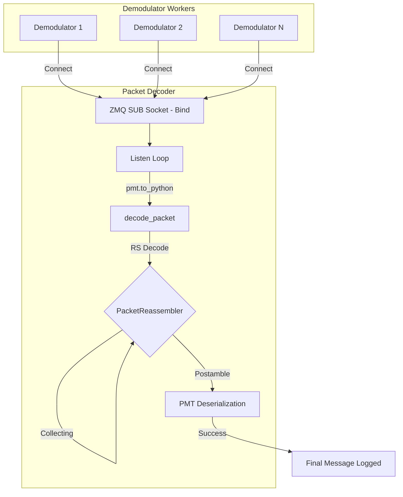
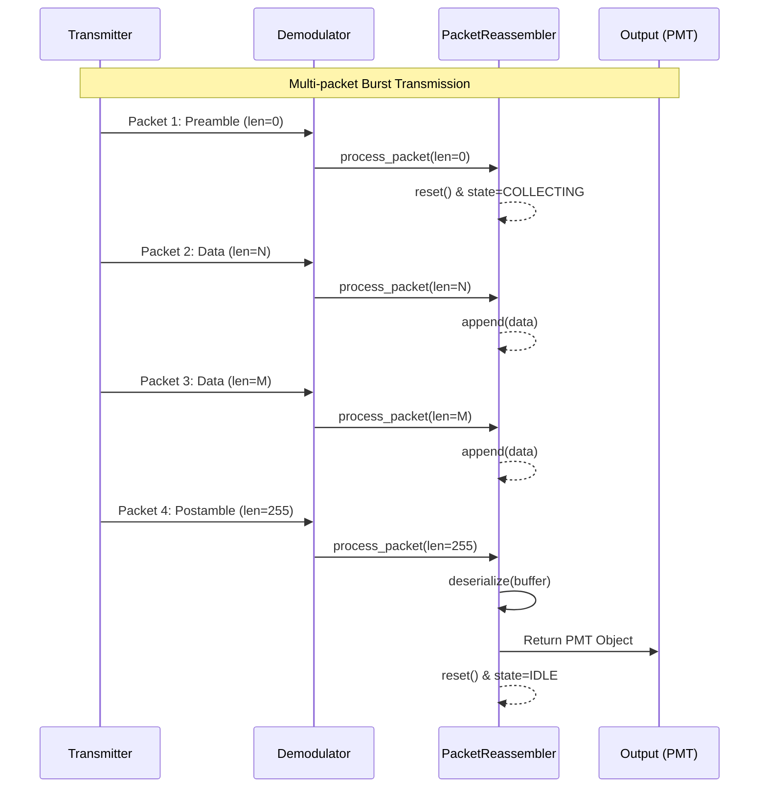

# Packet Decoding Process

This document explains the packet decoding and reassembly process in `src/rx/packet_decoding.py`.

## Data Flow Overview

The packet decoder acts as a central sink for decoded PDUs (Protocol Data Units) coming from one or more `Demodulator` workers.

## PacketReassembler State Machine

The `PacketReassembler` handles messages that span multiple physical packets. It uses the `packet_len` flag (the first byte of the data chunk) to manage state.

- **Preamble (`len=0`)**: Resets the buffer and enters `COLLECTING` state.
- **Data (`0 < len < 255`)**: Appends the specified number of bytes to the buffer.
- **Postamble (`len=255`)**: Triggers deserialization of the accumulated buffer and returns to `IDLE`.

## Implementation Details

- **RS Decoding**: Each raw packet is first passed through a Reed-Solomon decoder ($n=255, k=243, t=6$).
- **Multi-Source Support**: The decoder maintains a dictionary of `PacketReassembler` instances, keyed by `demodulator_id`. This allows interleaved packets from different sources to be reassembled correctly.
- **Deserialization**: Once a postamble is received, the entire buffer is passed to `pmt.deserialize_str` and then converted to a Python dictionary using `pmt.to_python`.
- **ZMQ Architecture**: The `Packet Decoder` binds to the ZMQ port (`SUB`), while the `Demodulator` workers connect to it. This allows a single decoder to aggregate packets from multiple transient workers.
- **Data Type Handling**: Python's `pmt.to_python` returns data buffers as `numpy.ndarray`. The decoder logic converts these back to `bytes` via `.tobytes()` before performing UTF-8 string decoding to ensure compatibility.
