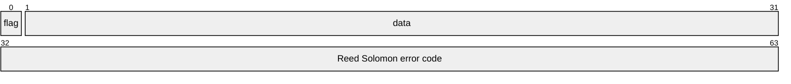
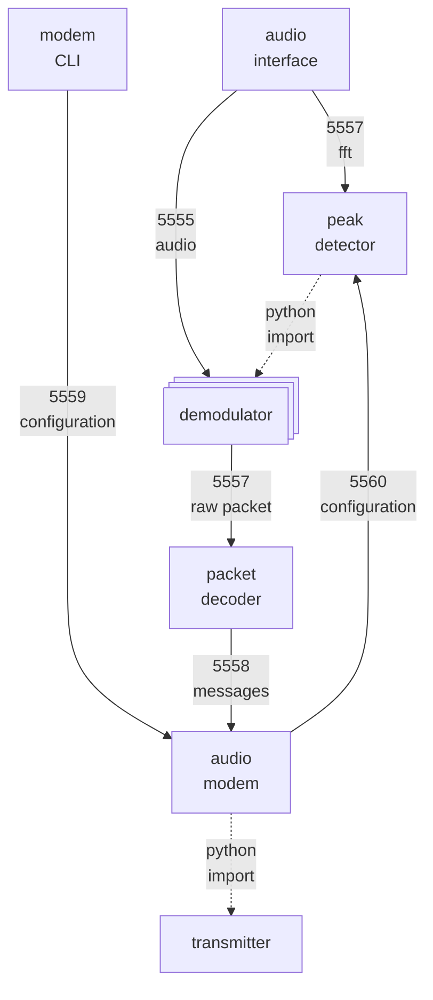

# settings
## packet configuration
### details
| setting                      | value |  unit  |
| :--------------------------- | :---: | :----: |
| total packet lenght          |  64  |  bit   |
| pramble packets              |   1   | packet |
| postamble packets            |   1   | packet |
| error correction code length |  32   |  bit   |

### single packet description

## signal configuration
### details
| setting         | value |   unit   |
| :-------------- | :---: | :------: |
| sampling rate   | 48000 | sample/s |
| beeper duration |   3   | seconds  |
| baud            |  200  |   baud   |
| constellation   | BPSK  |    /     |

## ports configuration
| port description            | port |
| :-------------------------- | :--: |
| audio                       | 5555 |
| fft                         | 5556 |
| raw packet                  | 5557 |
| messages                    | 5558 |
| modem configuration         | 5559 |
| peak detector configuration | 5560 |

## process connection
