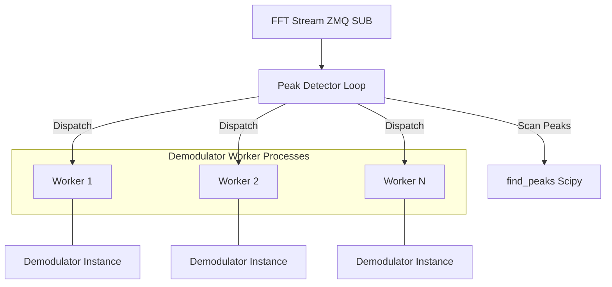
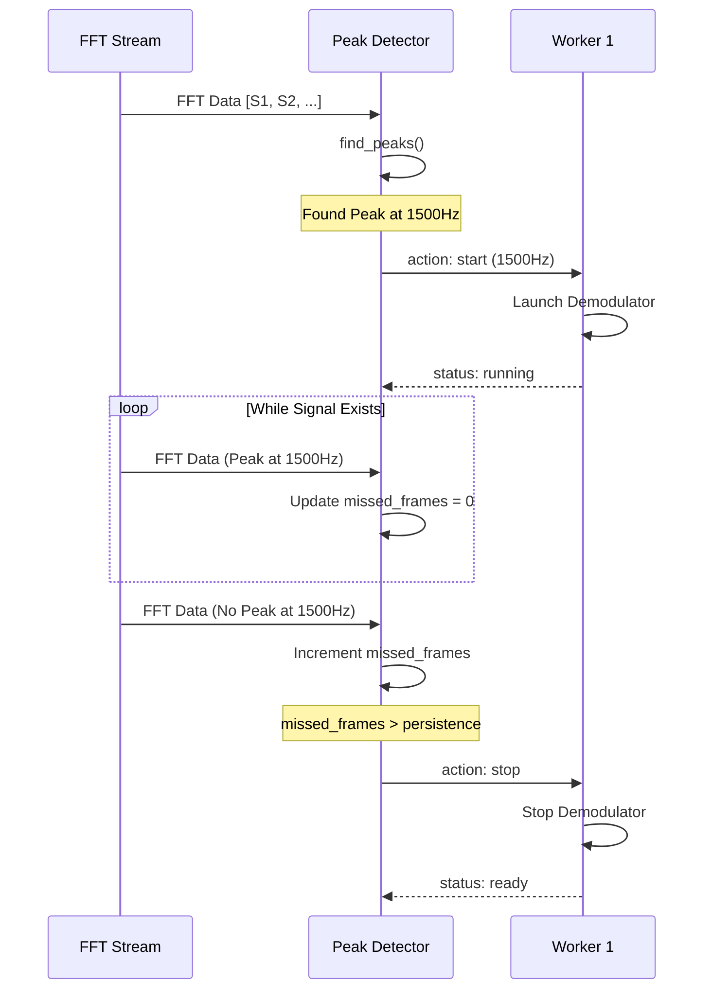

# Peak Detector Documentation

The `Peak Detector` module in `src/rx/peak_detector.py` is responsible for scanning the frequency spectrum for incoming transmissions and dynamically dispatching demodulator workers to decode those signals.

## System Architecture

The peak detector acts as a "traffic controller" for the receiver system. It monitors an FFT stream and manages a pool of `DemodulatorWorker` processes.

## How It Works

### 1. Initialization
- **ZMQ Subscription**: The detector connects to the `fft_port` (typically `tcp://127.0.0.1:5556`) to receive raw FFT power spectral density (PSD) data.
- **Worker Pre-spawning**: A configurable number of `DemodulatorWorker` processes are launched at startup. Each worker maintains its own command and status queues to communicate with the main peak detector loop.

### 2. Detection Loop
The main loop (`search_for_incomming_transmission`) performs the following steps:
1.  **FFT Processing**: Receives raw float32 data, converts it to a NumPy array, and focuses on the positive frequency spectrum.
2.  **Peak Discovery**: Uses `scipy.signal.find_peaks` to identify significant frequency components based on:
    - **Prominence**: Minimum height relative to the noise floor (default: 10).
    - **Distance**: Minimum separation between peaks based on the signal baudrate.
3.  **State Management**:
    - **Active Workers**: Updates the state of workers currently running. If a worker is tuned to a frequency where a peak is no longer detected, it increments a `missed_frames` counter.
    - **Signal Loss**: If `missed_frames` exceeds the `persistence` threshold (default: 20), the worker is commanded to stop and returns to the "ready" state.
4.  **Worker Dispatch**:
    - If a new peak is detected at a frequency not already handled by a running worker (offset > baudrate), the detector searches for an idle ("ready") worker.
    - An idle worker is then commanded to tune to the new frequency and start its demodulation flowgraph.

## Key Components

### DemodulatorWorker Class
A wrapper around a `multiprocessing.Process` that manages a single `Demodulator` instance.
- **`start_tuning(freq)`**: Sends a start command with the target frequency.
- **`stop_tuning()`**: Sends a stop command to the worker.
- **`update_state()`**: Drains the status queue to synchronize the worker's internal state (e.g., "ready", "running") with the main process.

### Parameters

| Parameter | Default Value | Description |
| :--- | :--- | :--- |
| `nb_workers` | 1 | Number of parallel demodulator processes to spawn. |
| `persistence` | 20 | Number of FFT frames without a peak before declaring signal loss. |
| `prominence` | 10 | The required peak height above the local noise floor. |
| `distance` | baudrate/res | Minimum distance between detected peaks. |

## Workflow Diagram

---
*Documentation generated for vibe-audioModem project.*
