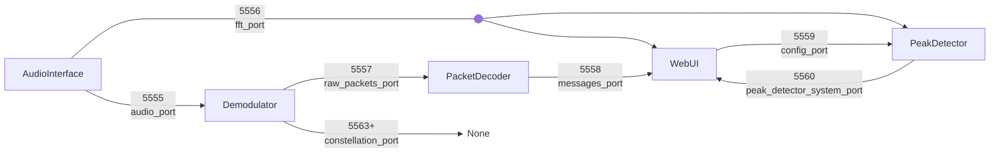

# Port Architecture
## Overview
The application uses **ZeroMQ (ZMQ)** for inter-process communication and **WebSocket** for the web UI.

## ZMQ Ports (Internal Communication)
| Port      | Name                      | Type     | Purpose                                                        | Publisher        | Subscribers      |
| --------- | ------------------------- | -------- | -------------------------------------------------------------- | ---------------- | ---------------- |
| **5555**  | `audio_port`               | PUB      | Raw audio stream from sound card                               | `AudioInterface` | `Demodulator`    |
| **5556**  | `fft_port`                 | PUB      | FFT magnitude spectrum                                         | `AudioInterface` | `WebUI`, `PeakDetector` |
| **5557**  | `raw_packets_port`         | SUB→BIND | Demodulated raw packets from each demodulator worker           | `Demodulator`    | `PacketDecoder`  |
| **5558**  | `messages_port`            | PUB      | Data messages + system status from packet decoder               | `PacketDecoder`  | `WebUI`          |
| **5559**  | `config_port`              | PUB      | Config changes (modulation preset)                             | `WebUI`          | `PeakDetector`   |
| **5560**  | `peak_detector_system_port`| PUB      | System status from peak detector (transmission detected)        | `PeakDetector`   | `WebUI`          |
| **5563+** | `constellation_port`       | PUB      | Constellation diagram points (one port per demodulator worker) | `Demodulator`    | -                |

## WebSocket (External - Web UI)
| Endpoint  | Port | Purpose                                                            |
| --------- | ---- | ------------------------------------------------------------------ |
| **HTTP**  | 8000 | Serves web UI (HTML, CSS, JS)                                      |
| **`/ws`** | 8000 | Real-time streaming of FFT, messages, and system events to browser |

The WebSocket pushes 4 message types with prefix bytes:
- `0x01` - FFT magnitude (dB)
- `0x02` - Waterfall display data (Uint8)
- `0x03` - System messages (JSON: `{"type": "system", "status": "...", ...}`)
- `0x04` - Decoded messages (JSON: `{"type": "data", "sender_name": "...", "data": "...", ...}`)

System message statuses:
- `preamble` - Preamble detected during message reassembly
- `collecting` - Acquiring data bytes during reassembly
- `error` - Reed-Solomon or deserialization error
- `dispatching` - Peak detector dispatched a worker to a frequency

## Component Descriptions
### AudioInterface
Receives audio from the sound card via GNU Radio. Publishes:
- Raw audio samples to port 5555
- FFT magnitude spectrum to port 5556

### PeakDetector
Scans the FFT spectrum for carrier frequency peaks. When a transmission is detected:
1. Dispatches a demodulator worker to tune to that frequency
2. Sends system status to port 5560
3. Monitors for signal loss and stops workers accordingly
4. Subscribes to config changes (port 5559) to update modulation presets

### Demodulator
For each detected carrier frequency:
1. Receives audio from port 5555
2. Demodulates the signal using the configured constellation
3. Publishes raw packets to port 5557
4. Publishes constellation points to port 5563+ (one port per worker)

### PacketDecoder
Collects raw packets and reassembles them into complete messages:
1. Subscribes to port 5557 for raw packets
2. Performs Reed-Solomon error correction
3. Reassembles multi-packet messages
4. Publishes all messages to port 5558 (unified format with `type` field)

### WebUI (FastAPI)
Serves the web interface and bridges ZMQ to WebSocket:
- HTTP endpoints for configuration (`/api/carrier_freq`, `/api/modulation_preset`, `/api/transmit`)
- WebSocket endpoint (`/ws`) for real-time data streaming
- Subscribes to port 5558 (data + packet decoder system messages) and port 5560 (peak detector system messages)