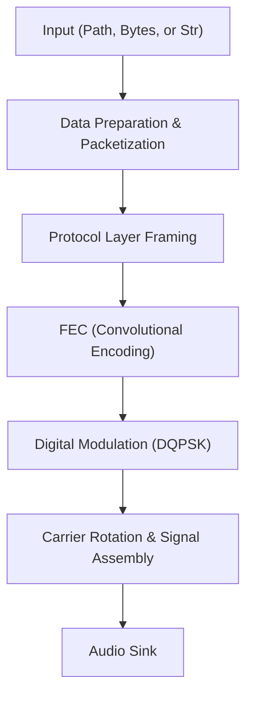
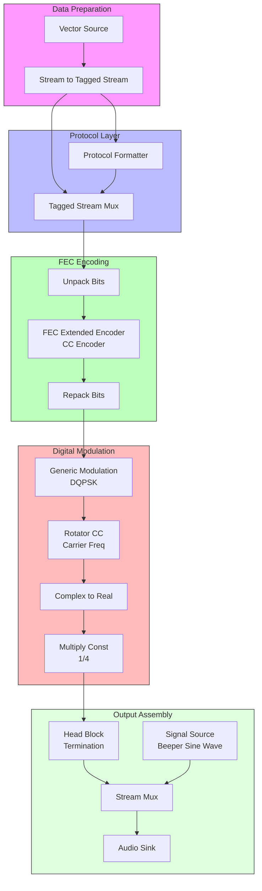

# Transmitter Documentation

The `Transmitter` class in `src/tx/transmitter.py` is a GNU Radio based transmitter designed to send data over audio signals. It handles data packetization, error correction encoding, DQPSK modulation, and audio output.

## High-Level Architecture

The follows diagram illustrates the flow from input data to the final audio signal:

## Detailed Signal Processing Chain

The transmitter flowgraph is composed of multiple GNU Radio blocks connected to perform specific signal processing tasks.

## Key Components

### 1. Data Preparation & Packetization
- **`prepare_data`**: A generic dispatcher in `packetizer.py` that converts various input types (Path, bytes, string) into a serialized PMT (Protocol Buffer Tagged) format, then applies Reed-Solomon encoding and adds pre/postamble packets.
- **Tagged Stream**: The flowgraph uses tagged streams (`packet_len`) to manage packet boundaries throughout the modulation process.

### 2. Protocol Framing
- **Protocol Formatter**: Generates a header for each packet based on a fixed `access_key`.
- **Tagged Stream Mux**: Combines the generated header and the payload data into a single tagged stream.

### 3. Error Correction (FEC)
- **Convolutional Encoder**: Applies a rate 1/2 convolutional code (CC) to the bitstream to provide robust error correction.
- **Unpack/Repack Bits**: Manages the bit-to-byte conversions necessary for the FEC and modulator blocks.

### 4. Modulation & Carrier
- **Generic Modulation**: Performs DQPSK modulation with a Root Raised Cosine filter.
- **Rotator CC**: Shifts the baseband signal to the specified carrier frequency (`sig.carrier_freq`).
- **Complex to Real**: Converts the complex IQ signal to a real-valued audio signal, suitable for playback.

### 5. Signal Assembly & Output
- **Beeper**: A sine wave at the carrier frequency is prepended to the data transmission using a `Stream Mux`. This helps the receiver's AGC and loops lock on before data arrives.
- **Head Block**: Ensures the flowgraph terminates cleanly once the calculated number of samples is transmitted.

## Ports and Interfaces

| Interface | Type | Description |
| :--- | :--- | :--- |
| `input_data` | Any | Path to file, bytes, or string to be transmitted. |
| `Audio Output` | System Audio | Real-time audio signal played through the system speaker. |
| `Signal Config` | Object | Defines sample rate, carrier frequency, and baudrate. |

---
*Documentation generated for vibe-audioModem project.*
