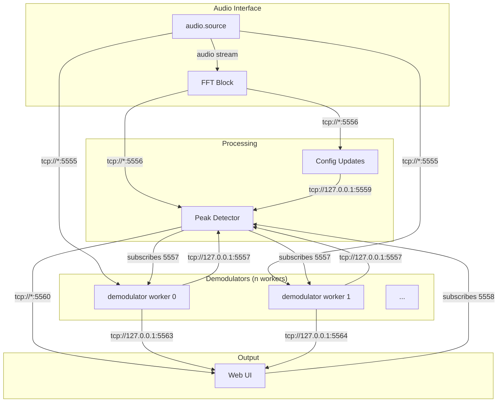

# ZMQ Communication Ports Documentation

## Overview

The audio modem uses ZeroMQ (ZMQ) for inter-process communication between different components of the system. This document catalogs all ZMQ ports and their usage.

---

## Port Configuration

All ports are defined in `src/misc/config.py` via the `PortsConfig` dataclass:

| Port Name                   | Default Value | Purpose                                   |
| --------------------------- | ------------- | ----------------------------------------- |
| `audio_port`                | 5555          | Raw audio stream from sound card          |
| `fft_port`                  | 5556          | FFT spectrum data                         |
| `raw_packets_port`          | 5557          | Demodulated raw packets from demodulators |
| `messages_port`             | 5558          | Decoded messages to web UI                |
| `config_port`               | 5559          | Configuration updates for peak detector   |
| `peak_detector_system_port` | 5560          | System messages from peak detector to UI  |
| `constellation_port`        | 5563          | Constellation diagram data (base port)    |
| `constellation_ports_count` | 10            | Number of constellation ports available   |

---

## Data Flow Diagram



---

## Port Usage by Component

### 1. Audio Interface (`src/rx/audio_interface.py`)

**Role**: Captures audio from sound card and computes FFT.

| Socket Type             | Port | Protocol         | Direction |
| ----------------------- | ---- | ---------------- | --------- |
| `zeromq.pub_sink_audio` | 5555 | `tcp://*:<port>` | Publishes |
| `zeromq.pub_sink_fft`   | 5556 | `tcp://*:<port>` | Publishes |

**Code References**:
- `audio_interface.py:41` - Audio publishing
- `audio_interface.py:53` - FFT publishing

---

### 2. Demodulator (`src/rx/demodulator.py`)

**Role**: Demodulates incoming signals at specified frequencies.

| Socket Type             | Port   | Protocol                 | Direction  |
| ----------------------- | ------ | ------------------------ | ---------- |
| `zeromq.sub_source`     | 5555   | `tcp://127.0.0.1:<port>` | Subscribes |
| `zeromq.pub_msg_sink_0` | 5557   | `tcp://127.0.0.1:<port>` | Publishes  |
| `zeromq.pub_sink_0`     | 5563+n | `tcp://127.0.0.1:<port>` | Publishes  |

**Code References**:
- `demodulator.py:89-98` - Audio subscription
- `demodulator.py:224-226` - Raw packets publishing
- `demodulator.py:229-239` - Constellation publishing

---

### 3. Packet Decoder (`src/rx/packet_decoding.py`)

**Role**: Receives and reassembles packets from demodulators.

| Socket Type | Port | Protocol         | Direction  |
| ----------- | ---- | ---------------- | ---------- |
| `zmq.SUB`   | 5557 | `tcp://*:<port>` | Subscribes |
| `zmq.PUB`   | 5558 | `tcp://*:<port>` | Publishes  |

**Code References**:
- `packet_decoding.py:156-159` - Raw packet subscription (bind)
- `packet_decoding.py:163-164` - Message publishing (bind)

---

### 4. Peak Detector (`src/rx/peak_detector.py`)

**Role**: Detects incoming transmissions and dispatches demodulator workers.

| Socket Type | Port | Protocol                 | Direction  |
| ----------- | ---- | ------------------------ | ---------- |
| `zmq.SUB`   | 5556 | `tcp://127.0.0.1:<port>` | Subscribes |
| `zmq.SUB`   | 5559 | `tcp://127.0.0.1:<port>` | Subscribes |
| `zmq.PUB`   | 5560 | `tcp://*:<port>`         | Publishes  |

**Code References**:
- `peak_detector.py:123-125` - FFT subscription
- `peak_detector.py:127-129` - Config subscription
- `peak_detector.py:139-141` - System message publishing

---

## Message Types

### PMT Message Format

All ZMQ messages use GNU Radio's PMT (Polymorphic Type) for serialization:

```python
# Sending
socket.send(pmt.serialize_str(pmt.to_pmt(message_dict)))

# Receiving
payload = pmt.to_python(pmt.deserialize_str(received))
```

### System Message Types

| Status        | Description                                        |
| ------------- | -------------------------------------------------- |
| `preamble`    | Start of transmission detected                     |
| `collecting`  | Packets being reassembled                          |
| `postamble`   | End of transmission detected                       |
| `dispatching` | Worker dispatched to frequency                     |
| `error`       | Error occurred (e.g., Reed-Solomon decode failure) |

### Data Message Format

Decoded messages include:
```python
{
    "type": "data" | "raw_string" | "raw_bytes" | "file",
    "sender_name": str,
    "data": bytes,
    "carrier_freq": float,
    "path": str (for file transfers)
}
```

---

## Web UI Subscriptions

The web UI (`src/ui/webUI/webUI.py`) subscribes to:

| Port | Data Type        |
| ---- | ---------------- |
| 5558 | Decoded messages |
| 5560 | System messages  |

---

## Default Ports Summary

```
┌────────────────────┬───────┬──────────────────────────────────────────┐
│ Component          │ Port  │ Function                                 │
├────────────────────┼───────┼──────────────────────────────────────────┤
│ Audio Interface    │ 5555  │ Raw audio stream (publish)               │
│ Audio Interface    │ 5556  │ FFT spectrum (publish)                   │
│ Demodulators       │ 5555  │ Audio subscription                       │
│ Demodulators       │ 5557  │ Raw packets output (publish)             │
│ Demodulators       │ 5563+ │ Constellation data (publish)             │
│ Packet Decoder     │ 5557  │ Packet subscription (bind)               │
│ Packet Decoder     │ 5558  │ Decoded messages (publish)               │
│ Peak Detector      │ 5556  │ FFT subscription                         │
│ Peak Detector      │ 5559  │ Config subscription                      │
│ Peak Detector      │ 5560  │ System messages (publish)                │
└────────────────────┴───────┴──────────────────────────────────────────┘
```
