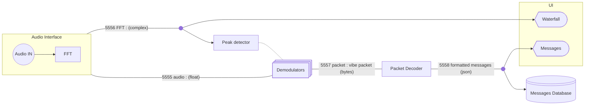
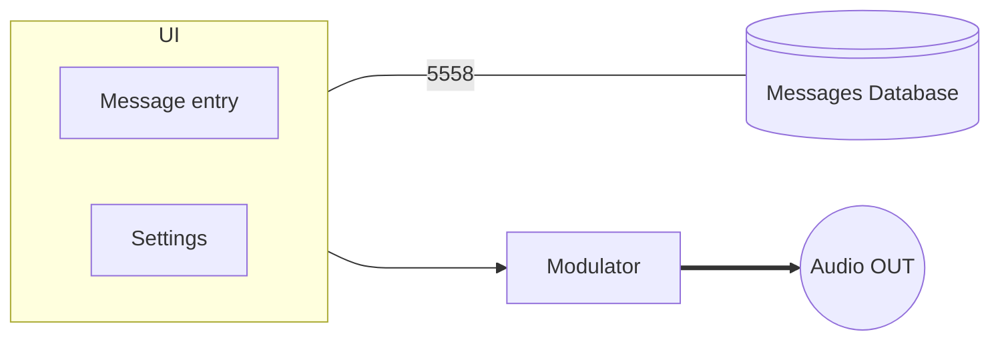

# Vibe architecture
## Receiver
### Diagram

### port description
| port number |  stream description   |   data type    |
| :---------- | :-------------------: | :------------: |
| 5555        |     Audio stream      |     float      |
| 5556        |      FFT stream       | complex vector |
| 5557        |      Raw packets      |     bytes      |
| 5558        | Deserialized messages |      json      |

### Nodes description
| Node              |                                                function                                                 |   input   |      output      |
| :---------------- | :-----------------------------------------------------------------------------------------------------: | :-------: | :--------------: |
| Audio interface   | Gets input audio stream from sound card and computes its FFT. Provides audio and FFT on separated ports |           | ports 5555, 5556 |
| Peak Detector     |    Analyze the spectrum and start a demodulator when and where a incomming transmission is detected     | port 5556 |                  |
| Demodulators      |                 Initialized by the peak detector, demodulate and incomming transmission                 | port 5555 |    port 5557     |
| Packet Decoder    |                              convert raw packet into deserialized messages                              | port 5557 |    port 5558     |
| Messages Database |                                   Store all messages into a database                                    | port 5558 |                  |

## Transmitter
