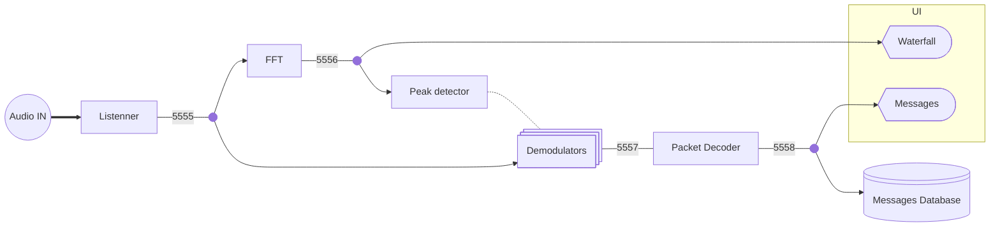
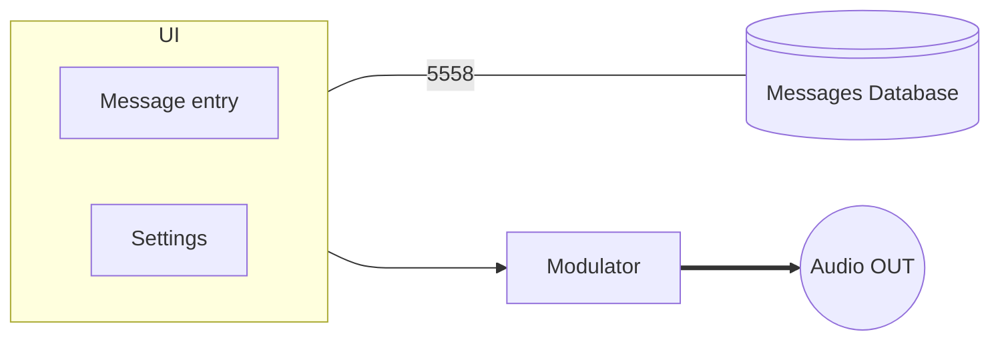

# Vibe architecture
## Receiver
### Diagram

### port description
| port number |  stream description   |     data type      |
| :---------- | :-------------------: | :----------------: |
| 5555        |     Audio stream      |       float        |
| 5556        |      FFT stream       |   complex vector   |
| 5557        |      Raw packets      |       bytes        |
| 5558        | Deserialized messages | json + binary blob |

### Nodes description
| Node                 |                                             function                                             |   input    |  output   |
| :------------------- | :----------------------------------------------------------------------------------------------: | :--------: | :-------: |
| Audio IN + Listenner |                                 Gets Audio stream from soundcard                                 | Sound Card | port 5555 |
| FFF                  |                                 Compute the FFT of audio stream                                  | port 5555  | port 5556 |
| Peak Detector        | Analyze the spectrum and start a demodulator when and where a incomming transmission is detected | port 5556  |           |
| Demodulators         |             Initialized by the peak detector, demodulate and incomming transmission              | port 5555  | port 5557 |
| Packet Decoder       |                          convert raw packet into deserialized messages                           | port 5557  | port 5558 |
| Messages Database    |                                Store all messages into a database                                | port 5558  |           |

## Transmitter
